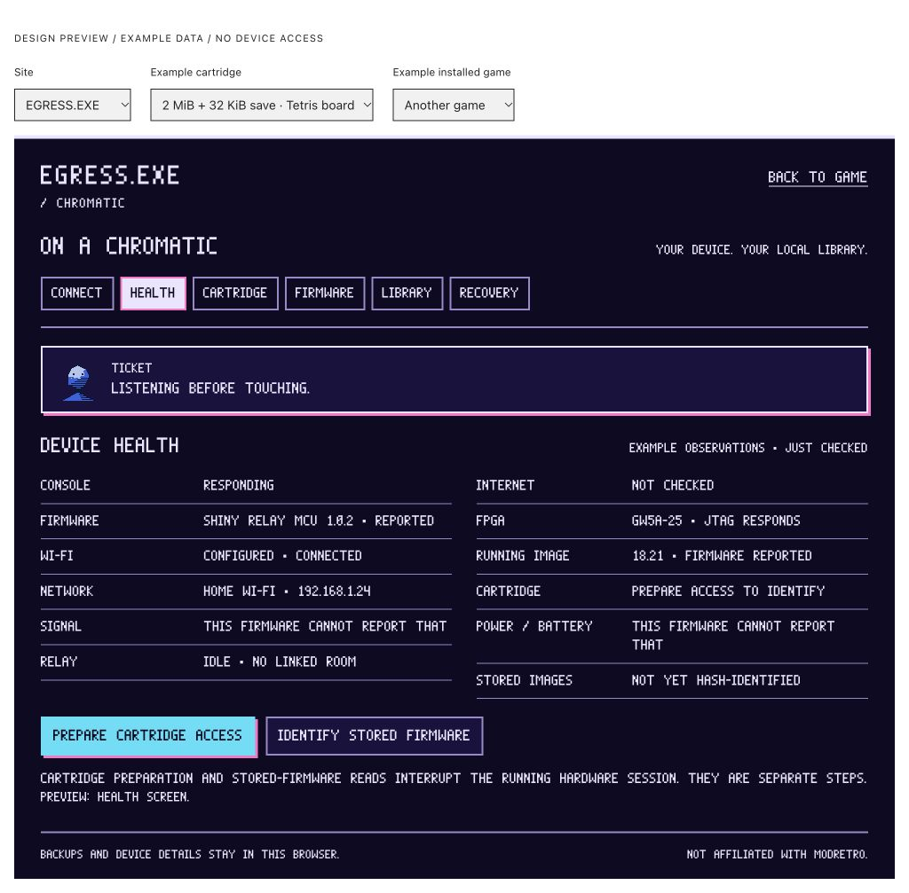
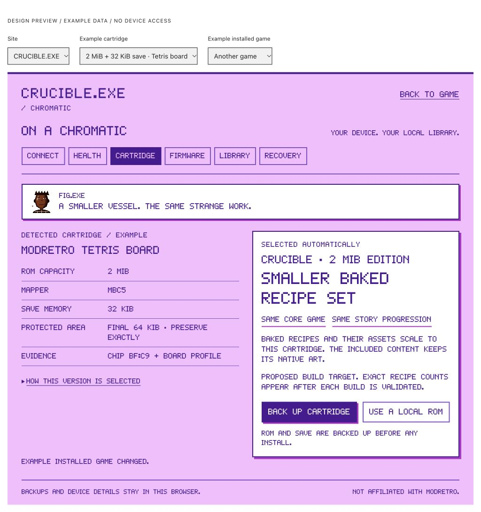

# Chromatic design review

2026-10-15. Research and mocks only. No device connection, persistent write, game build or deployment was performed.

The central behavior is automatic cartridge-dependent releases. Detect the physical cart and the writer's capabilities, then select the highest-content compatible game variant. CRUCIBLE's smaller builds contain fewer baked recipes and corresponding assets, with mandatory mechanics and Story content retained. Actual counts and minimum supported budgets must come from validated builds.

- [Research, source links, protocols, hardware and licensing](RESEARCH.md)
- [Design, automatic build selection, storage, safety, recovery and speed plan](DESIGN.md)
- [Firmware catalogue research](catalogue-research.json) — public metadata and digests, not an install allowlist or firmware binaries
- [Inspected public JavaScript hashes](source-index.json)
- [Exact local site ROM metadata](rom-snapshots.json)

The supplied `shiny-relay-src-cart-engine-c4aebde587b8.tar.gz` matches the public archive: SHA-256 `d2b28c95647c479106ca07691924139624226e8f87b78e823a5e1d4b937841e3`. The separately published firmware archive contains the CBU1 header documentation and reference client; the named standalone protocol document remains unavailable.

## Mocks

The interactive preview in this conversation includes both site themes, 2/4/8 MiB and unknown-cart scenarios, current/earlier installed revisions, connect, health, cartridge, backup, review, firmware history, library, recovery and interrupted-write states. All device observations and operation results are explicitly examples. The 4/8 MiB writer profiles and smaller CRUCIBLE builds are proposed fixtures, not completed support.

EGRESS health screen:

CRUCIBLE automatic cartridge version:

## Validation performed

- Syntax-checked the interactive mock JavaScript and parsed all three research JSON files.
- Inspected native fonts, colours and character portraits in the built-in browser at desktop size.
- Checked the six main screens in both themes at a 320px browser viewport: no horizontal overflow. Inspected desktop at 1024px.
- Exercised automatic 2/4/8 MiB selection and disabled install preparation on an unknown cart.
- Exercised the backup → review → confirmation → example result flow. Changing app-only restore to full restore clears consent. Firmware restore cannot proceed before a fresh example backup.
- Checked earlier revisions offer an update; current revisions report no update needed and finish backup without offering reinstall.
- No browser errors were recorded for the mock. It has no device API or network calls; official installer links are ordinary navigation links.

These are design-preview checks, not transport, hardware, actual ROM build or simulator conformance tests. No heavy suite/build ran on the overloaded local Mac.

## Next gate

The original task requires approval of the design and mocks before implementation. Approval covers the additive page/after-Play offer, native theme treatment, automatic game-version selection, backup/review flow and shared-module architecture. Existing world scenes and controls remain in place.

After approval: implement the shared package and fault-injection simulator, reconcile CRUCIBLE's source with the current release, implement budgeted builds and save migration, then integrate both sites. Real hardware checks require the owner to connect the console and grant browser prompts. Firmware/cart backups and their verification precede writes; rollback/recovery and paired speed measurements remain hardware gates. Third-party image hosting and deployment remain separately unapproved.
