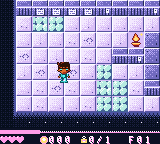
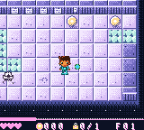
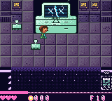

# Egress continuation, 2026-10-15

## Recovered state

Claude's B2 work stopped on the API usage limit, with implementation distributed across five dirty worktrees and
the separate fullscreen prototype. The recovery branch is `codex/resume-stage2`. The original worktrees were read
and preserved; their committed changes, dirty files and untracked source are snapshotted under
`build/recovery-20261015/` with file hashes in `manifest.json`.

| Worktree | Recovered HEAD | Work |
|---|---|---|
| `egress-b2-edges` | `d081658` | Cold-code banking, room edge shading |
| `egress-b2-mobs` | `52bef90` | Generated mobs, elites, particles, shared OAM budget |
| `egress-b2-obstacles` | `17309ee` | Living-obstacle rules, tick solver, structured office walls |
| `egress-b2-stages` | `6c9a342` | Stage deck, generators, cartridge stage controller, rest scenes |
| `egress-b2-boss` | `901a140` + dirty files | THE TENANT, LAST FAX, boss art and emulator harness |
| `egress-fs-proto` | `c29b52b` + dirty files | Separate fullscreen raycaster prototype |

The existing Chromatic/site preparation evidence in the primary checkout was preserved. The recovery does not
change that evidence or claim a new physical-device test.

## Continued implementation

The B2 modules now build together on both mappers. Stage waves use the generated mobs, returned orbs retain their
shooter, four-way crate pushing uses the canonical mover, bosses and ordinary actors share the OAM allocator, and
boss obstacle commands reach the actual obstacle rules. The cartridge obstacle adapter uses the same tick rules
as the host solver, with native generated art, collision, movement, tag responses and plate/shutter updates.

Floor-only room/mover buffers have explicit WRAM addresses above the title's mirrored game-data window. The link
still checks that ordinary game data ends before `0xD800`. Mapper links run serially because GBDK's autobanker
rewrites shared `.rel` inputs.

The 768-room bank was rebaked for the new generator. The bounded candidate search retains the existing acceptance
and fairness rules. Five isolated STEER/MIRROR lessons in `tools/seed_curriculum.txt` use the full solver budget;
each is revalidated when baking. All ten room tricks are present. The compact planner assigns obstacle mechanics
their own bits without colliding with STEPS or changing the full-run mechanic IDs. Obstacle introduction history
is currently per run; the legacy save mask remains unchanged pending B3's save work.

## Missing character bodies: fixed

The new title explicitly selects 8x8 OBJs for its prompt. Its exit restored other LCDC settings but omitted the
OBJ-size bit. Floors use layered 8x16 OBJs, so the art was present in VRAM while the hardware discarded the lower
eight rows of every sprite. This affected bodies and other tall sprites.

`src/title3d/title3d.c` now restores OBJ size, and `floor_show()` explicitly selects 8x16 mode before loading floor
art. `make test-character-art`, also part of `make test`, exercises the real boot/title/play path on both mapper
builds across six skin tones, all 45 animation states and eight directions: 2,160 samples per ROM. The check fails
on the saved pre-fix ROM and passes after the fix. Actual emulator screenshots and the animated state sheet are in
`build/recovery-20261015/proof/`.

Glass shards also now use the shared OAM budget. The allocator's hot loops use byte counts and unsigned clipping;
the latest heir/combat and boss stress captures have no scan line above ten sprites.

## Completed B2 acceptance

The initial recovery evidence remains under `build/recovery-20261015/`. The final tested ROMs, symbols,
maps, full logs, worktree archives and source-coverage inventory are under `build/finish-20261015/`.

| Check | Result |
|---|---|
| Both native mapper builds | Pass; 1,064,960 bytes each, below the 1,900,000-byte gate |
| Header/global checksum and mapper audits | Pass; no forbidden mapper writes |
| Host room bank | 10,724 checks, zero failures; all 768 regenerate, solve and replay |
| Canonical obstacle solver fixture | Pass; 482,274 states, passive-safe winning plan, zero hits |
| 1,000-run curriculum/full-layout/stage simulations | Pass; zero ordering or repetition violations; 18,588 generated stages, zero generation failures |
| Core input/movement/idle | 106 input checks, 52 movement checks, 1,344 idle plans pass |
| Cartridge heirs | Roll parity, sprite mode, six moves, movement, idle scheduler and sprite budget pass |
| Cartridge gravity | 768 native steps per mapper match the portable C reference byte for byte, including stacked and rolling CRTs |
| B2 cartridge stage integration | All 19 checks pass, including own-orb ownership, wave mobs and northward crate pushing |
| Real cartridge input autopilot | Host/cartridge room parity and floor-2 progression pass |
| Both clock versions | Pass, including power-off/carry, missing-chip fallback and cross-mapper saves |
| Baked title | All three loops at 30 fps; exact host/VRAM checks, no missed flips; title-to-play passes |
| Both bosses | All 13 acceptance checks pass: no-hit wins, every phase, intended hit counts, death records, damage profiles and OAM budgets |
| Combat timing | Both bosses deliver 120 game frames in every measured 120-display-frame active-combat window, including phase gates |
| SameBoy | Both exact ROMs boot and enter gameplay with scripted Start/A; both captures show the restored complete body |

`make test`, `make test-b2` and `make test-fs-proto` all pass. The default `make test` now includes the B2
checks. A final rebuild after comment/header cleanup produced ROMs byte-identical to the tested builds.

The no-hit bot now queues inputs and cooldowns on game ticks, takes legal paths around corners and measures
projectile arrival time. THE TENANT takes 24 good hits through all three phases; LAST FAX takes 12 through both
phases. Both runs finish with zero damage. Difficulty and damage were preserved. Combat profiling includes
active attacks and phase gates; full-sequence counters separately retain loading/fade time after combat ends.

The cartridge optimizations reduce OAM write overhead, skip unused enemy passes in boss arenas, avoid redundant
collapse redraws and skip empty CRT rows. `make test-cartridge-gravity` observes completed native steps and
compares all 224 cells against portable C, rather than relying on a second implementation of the fast path.

| Final artifact | SHA-256 |
|---|---|
| `build/egress.gbc` (MBC5) | `8191bc71cd5fb0067dabf58c8886e072658a5053286a0d98c890b299c09e413e` |
| `build/egress-rtc.gbc` (MBC3 RTC) | `df11b82b8e14d164aedb75b9d48a4ec73e2c2ad137e420654c2c6364d3d28bd8` |

## Fullscreen prototype

The renderer remains a separate prototype. Its default fullscreen banded-floor build now enables the per-buffer
floor cache. Exact zero-coefficient multiplication and aligned billboard writes also avoid redundant work.
`make test-fs-proto` builds that default configuration and passes an explicit 20 fps moving-average gate:
20.03 fps for newly redrawn views, 64/64 exact host comparisons, at most ten OBJs per line and VBlank ending no
later than line 153. Reused views inflate aggregate fps; the gate uses `fps_redrawn`.

The worst individual view still takes five display frames (11.95 fps). This is not a sustained minimum-20-fps
claim. The prototype is preserved and checked, but is not wired into the playable cartridge. The title continues
using its frozen bake core. There is no player-facing FAST/SAFE switch or self-test.

## Worktree consolidation

Each dirty source tree was committed before removal. Full local archives also preserve ignored build artifacts;
virtualenv symlinks were excluded, and no save files were found. The archive manifest includes sizes and SHA-256
hashes. Rebuildable binaries and archives stay out of Git.

| Branch | Preserved source commit | Integration |
|---|---|---|
| `b2-boss` | `5c08bde` | Both real boss implementations, art and harness; optimized and accepted above |
| `b2-edges` | `9740ebe` | Cold-code banking, side shading and native look checks |
| `b2-mobs` | `bc56abc` | Generated art, mobs, elites, FX, APIs and shared OAM allocator |
| `b2-obstacles` | `c0c92b8` | Canonical obstacle rules, generator and solver, plus the cartridge adapter |
| `b2-stages` | `e19f98b` | Stage generator, deck, controller, rest scenes and art; temporary boss stub replaced by real bosses |
| `fs-proto` | `dc4b8d4` | Fullscreen renderer and profiling tools, with the checked optimizations above |

The older `b1-puzzle` and `b1-title` branch histories describe features already integrated into the game before
this recovery. Their implementations are retained or superseded by the current room bank, solver, curriculum,
bench, fragile floors, baked title and input-latching code. All changed paths remain present. Their histories are
reconciled with the tested implementation along with the six recovered branches. The stage-only boss stub is the
sole deliberately omitted source file. `source-coverage.json` lists every branch path and final file hash.

The source integration is committed before the history reconciliation. The reconciliation merge keeps that
tested tree, rather than reintroducing mutually incompatible snapshots of shared APIs or obsolete generated
data. The six worktrees can then be removed without discarding unmerged source. Their branch refs remain.

## Later design milestones

The playable cartridge still has the office slice. The roughly 52-floor run is host-planned B4 work; persistent
stats/lineage/continue pages are B3 work. Physical Chromatic validation of this checkpoint is outstanding.
