# EGRESS.EXE redesign

Status: **proposal, waiting for approval.** Nothing in this document is built yet, apart from the proofs marked
**PROOF** (isolated modules and prototypes with their own tests, not wired into the game). The M2 build on `main`
stays as it is until this is signed off.

The owner's verdict on M2 was: "none of it's generative, nothing makes sense, no puzzles... the tile system sucks."
The redesign answers that with one idea. EGRESS is its own game: a sibling of CRUCIBLE set in **the shared world**
(a placeholder; the world isn't named yet, and the game never names it). It shares CRUCIBLE's family look and its
best ideas (combining, the face generator, the matrices), but it has its own tiles, UI, HUD and recipe set.
- you carry elements and objects;
- you combine them on a portable bench with EGRESS's own recipe set (inspired by CRUCIBLE's elements and traits,
  curated for rooms and fights);
- the results act on the room and on enemies through one shared reaction table;
- the world assembles in front of you and falls apart behind you;
- when you die, your heir (your child) carries on.

Every room, mob, weapon, heir and stage is composed from pieces by the seed, and checked by a solver or a simulator
before you ever see it.

**What is reused, and what is EGRESS's own:**

| Reused code (MIT, same owner) | EGRESS's own |
| --- | --- |
| the face generator (`src/avatar/`), the KEEL boot, the music driver approach, the save patterns (two CRC records), glitch/overlay techniques | tiles, UI frames and layouts, HUD, font (M2's), objects, mobs, recipe set, palettes, title |

CRUCIBLE's UI, tiles and colours are a style reference only: pastel, synthwave, nostalgic, backrooms, KEEL dithered
pixel art, glitch.

**Mocks.** All at 4x, 160x144 native. They are drawn with EGRESS's own mock kit (`tools/mock/egkit.py`: its own
dithered tiles, objects, panels, HUD and the M2 font), with faces from the shared face generator.

| File | Shows |
| --- | --- |
| `docs/shots/mock_room.png` | a puzzle room mid-assembly (cards dropping in, landing outlines, glitch tears), with 3 visible treasures and 1 hinted |
| `docs/shots/mock_bench.png` | the portable bench as an overlay on the dimmed room: FIRE + WATER = STEAM, trait chips, the pocket |
| `docs/shots/mock_combat.png` | combat with the far row collapsing, a FIRE-mod hit on a WET target making STEAM (blind) |
| `docs/shots/mock_reaction.gif` | that reaction combo animated: hitstop, steam particles, a parry reflecting an orb, the collapse wave |
| `docs/shots/mock_heir.png` | the heir pick: three human siblings with a family resemblance, with their parent shown |
| `docs/shots/mock_holdout.png` | a holdout stage: the egress assembles while waves come in from the void |
| `docs/shots/mock_cond.png` | a conditional kill: shielded until WET, then SHOCKED (the means are in the room) |
| `docs/shots/mock_mobs.png` | generated mob looks: 8 of one family, tag tells, elites of every size, an animation strip |
| `docs/shots/mobs/family_*.png` | 64 generated variants per family (readability and content review) |
| `docs/shots/mock_obstacles.png` | living obstacles (7.7): six at game scale with their tags, a 4x zoom, an elite beside them, the hit that bounces |
| `docs/shots/mock_obstacle_room.png` | an office room with THE MOVER and glass: start, steer, crack, solved, a mistake and its dead state (solver-checked) |
| `docs/shots/mock_boss.png` | a boss concept in its arena, tearing tiles out of a half-flooded floor |
| `docs/shots/mock_title.png` | the PRESS START title around a real raycaster frame (section 15) |
| `docs/shots/anim.png` | animation states: 8 directions (5 drawn plus 3 mirrored), walk, idle, combo, charge, roll, blink, hurt, death |
| `docs/shots/characters.png` | before/after: M2, CRUCIBLE as style reference, EGRESS now |
| `proto/genetics/out/tree_*.png`, `drift.png` | 30 generations of a family: faces and bred-for abilities |
| `docs/shots/tree_*.png`, `tree_scroll.gif` | the family tree screen (section 9.6): live end, founders, a road not taken, LOOKS / STATS / TRUTH views, node detail |
| `docs/shots/boot_compare.png` | the ported KEEL boot, frame by frame against CRUCIBLE's |
| `docs/shots/mock_stats.png` | the STATS screen (9.8): RUNS and COMBAT at 1x and 3x, a NEW record blinking, the in-game record toast |

These are mock-ups: hand-placed compositions of the kit's pieces. Mobs on the scene mocks are 2:1 reductions of the
48 px faces; the generated mob looks are in `mock_mobs.png`.

---

## 1. Look: EGRESS's own tiles in the family style

The look is the family's (pastel, synthwave, nostalgic, backrooms, KEEL dithered pixel art with glitch). The pieces
are EGRESS's own:

| Layer | EGRESS design |
| --- | --- |
| **Void** (everything that is not floor) | a deep indigo gradient, ordered-dithered, with a faint synthwave grid far below and sparse stars. Whispers drift through it ("NOCLIP", "WAKE UP", "YOU WERE HERE") |
| **Floor slabs** | 16x16 slabs floating over the void: a 1 px highlight/shadow bevel, a Bayer-dithered diagonal light, seeded scuffs (carpet flecks, tile chips), and a dithered underside where a slab meets the void. That is the Bastion read: floating ground |
| **Raised blocks / walls** | a slab top over a front face of vent-grille stripes |
| **Water / hazards** | dithered water with palette-cycled wave highlights; lava, ice and foam the same way |
| **Objects** | EGRESS's own 16x16 pieces: the burner (FIRE), the water-cooler bottle (WATER), the crate, the mug, the CRT, the battery (SPARK), the sprout (SEED)... in the dithered style with a 1 px dark outline |
| **UI** | rounded, dithered panels with a cyan rim over a pink underline (the synthwave edge); dashed item sockets; trait chips; the M2 font with its drop shadow |
| **HUD** | one slim bar at the bottom: hearts, pocket icons, a message slot, tokens |
| **People** | the shared face generator (ported code) for portraits; the player sprite derived from the same genome |
| **Glitch and light** | scanline tears (SCX per row band, the technique CRUCIBLE uses), palette-cycled glows (door hum, CRT flicker, water), sparkles. No fake UI lighting: light only comes from things in the world |

**Biome palettes** (each biome gets one floor family, one void tint, one accent and its own ambient palette
animation):

| Biome | Floor slab | Void | Accent | Ambient animation |
| --- | --- | --- | --- | --- |
| Office | peach | indigo, ceiling-tile grid | fluorescent yellow | light buzz flicker (2-frame palette swap, random) |
| Vents | teal | dark, duct ribs | cyan | fan strobe |
| Flooded atrium | blue | haze | white | water shimmer (3-step cycle) |
| Server farm | teal/navy | glyph rain | green | LED chase |
| Mall food court | pink | sunset gradient | orange | neon sign blink |
| Dream garden | mint | pastel sky | lilac | slow breathing glow |
| Rooftop sky | lilac | stars | cyan | star twinkle |
| Glitch core | inverted lilac | everything torn | magenta | constant tear bands |

CGB budget: 8 BG palettes. 0 floor, 1 floor-lit, 2 walls, 3 void, 4 water/hazard, 5 HUD/text, 6 objects, 7 FX
(flash, glitch tint). Sprites: 0 player, 1–3 mobs, 4 held object/overlay, 5 particles, 6 pieces in flight, 7 elite
glow. Tiles: VRAM bank 1 BG (as now), sprites in bank 0, 8x16 mode.

---

## 2. The world falls into place and falls apart

Rooms are not drawn in one go. They assemble around you and come apart behind you, Bastion-style. This is both feel
and mechanics.

**Assembly.** When a room loads, the void is up and only the cell under the player exists. Cards arrive in a wave
ordered by distance from the player (or from the door you came through). Each card picks one entrance from the data:
- dropping from above (the default);
- rising from below;
- sliding in from the nearest edge;
- glitching in: a 2-frame torn flash, then solid.

It overshoots by 2 px, settles with a 1-frame squash, and commits to the BG. A dotted landing outline in the void
shows where it will land. You can walk onto a card the frame it commits. Rooms can also assemble **conditionally**: a
bridge whose cards only arrive once a recipe is made.

**Collapse.** Cells condemned by the story, cells behind you on a chase stage, cells a boss tears out, and crumble
floor after you leave it:
1. crack (one frame of crack tiles);
2. drop: the card splits into four 8x8 quarters that fall and darken through 2 palette steps;
3. void.

Anything standing on a cell when it drops falls: the player loses a heart and respawns at the last safe cell. Mobs
and pushed blocks are gone.

**Tech.**
- Settled cells are BG tiles. Cards in flight are sprites (2 sprites of 8x16 per card, 4 per falling quarter-set),
  and they commit to the BG on landing.
- The per-tile animation is data:
  `{entrance, delay, speed, overshoot, glitch}` for assembly and `{crack_frames, fall_speed, darken_steps}` for
  collapse. The generator emits the order, so assembly is part of the room's design: the aha cell can arrive last.
- **Sprite limit:** 10 sprites per line. In-flight cards are staggered on a diagonal wave so no more than 4 cards share
  a 16 px band (8 sprites), leaving room for the player.
- **Budget:** at most 8 cards in flight (16 OAM) at once. The wave spawns a new card when one commits.
- **VRAM writes per frame** (double speed, VBlank ≈ 2,280 M-cycles of safe access, plus HBlank-DMA for tile data):
  - committing one 16x16 cell = 4 map bytes plus 4 attribute bytes (VBK switch), about 120 M-cycles with the
    unrolled writer;
  - **budget: 6 cell commits per VBlank** (≈ 720 M-cycles), plus the OAM DMA (160 M-cycles), plus the palette writes
    for ambient animation (≤ 16 bytes, ≈ 100 M-cycles);
  - glitch tears are SCX writes in the STAT/LYC handler (no VRAM);
  - a 10x8 room fully assembles in about 14 frames at the cap. In practice the wave is slower, for feel.
- Tile data (new crack/quarter tiles) is preloaded per biome. No tile uploads during play except the held object's
  overlay (≤ 8 tiles via HBlank DMA, 1 per HBlank).

---

## 3. Puzzles built on combining

**The loop.** Elements and objects lie in the room. You pick things up (pocket of 6). On the portable bench (SELECT)
you combine two with a recipe from EGRESS's set. The result carries traits, and the traits act on the
room. Push, fall and dig remain the physical layer underneath (the existing `eg_room` gravity, rocks, plates and
gates carry over).

**Trait → room verbs** (the trait set follows CRUCIBLE's: HOT COLD WET AIRY STONE SHINY GLOWS ALIVE GREEN MADE BIG
MAGIC, plus EGRESS's GLITCH):

| Trait on the placed or thrown thing | Acts on | Effect |
| --- | --- | --- |
| HOT | wood, foam, drywall, vines | burns away (2 s), spreads to adjacent wood |
| HOT | ice | melts to water |
| COLD | water / flooded floor | freezes into a walkable path (until HOT touches it) |
| WET | fire, lava | puts out / cools to stone |
| WET + HOT (STEAM) | a vent | an updraft lifts you to the ledge above |
| AIRY | dust, smoke, fog | clears it; also pushes light objects one cell |
| ALIVE | earth / planter / gap with soil | grows (vine bridge across a 1–2 cell gap, roots hold a crumble floor) |
| SHINY | a beam | reflects it 90° (mirror placed on a cell, facing set by push) |
| GLOWS | a dark room | lights a radius; reveals invisible things |
| STONE + BIG | a pressure plate | holds it down (a weight you can make) |
| MADE | a lock, ladder slot, gap | tool use: SHOVEL digs, LADDER climbs a ledge, ROPE crosses a pit |
| MAGIC | glitch cells | phases them in or out |

**EGRESS's recipe set.** 38 recipes: 34 follow CRUCIBLE's elements and traits (the pairs and traits match CRUCIBLE's
catalogue, so the shared world stays consistent between the two games), and 4 are EGRESS's own (the backrooms
things at the end):

| Result | Recipe | Traits | Room use |
| --- | --- | --- | --- |
| STEAM | WATER + FIRE | HOT WET AIRY | vents lift; blinds in combat |
| MUD | EARTH + WATER | WET STONE | slows; fills a pit |
| LAVA | EARTH + FIRE | HOT STONE GLOWS | burns; cools to STONE with WATER |
| DUST | EARTH + AIR | AIRY STONE | blinds; reveals invisible things (they get dusty) |
| RAIN | AIR + WATER | WET | wets an area (shields off, plants grow) |
| ENERGY | AIR + FIRE | GLOWS | powers a dead door |
| CLOUD | AIR + STEAM | WET AIRY | floats one cell; rain source |
| SNOW | AIR + RAIN | COLD | freezes slowly; slows mobs |
| ICE | WATER + SNOW | COLD SHINY | freezes water into a path; reflects |
| PLANT | EARTH + RAIN | ALIVE GREEN | grows a 1-cell bridge |
| TREE | PLANT + PLANT | ALIVE GREEN | a 2-cell bridge; blocks a beam |
| MOSS | STONE + PLANT | ALIVE GREEN | holds a crumble cell |
| STONE | WATER + LAVA | STONE | a weight; fills a hole |
| SAND | WATER + STONE | STONE | fills a pit; with FIRE becomes GLASS |
| METAL | FIRE + STONE | SHINY MADE | conducts; a weight |
| GLASS | FIRE + SAND | SHINY MADE | a window: light passes, you don't |
| MIRROR | GLASS + METAL | SHINY MADE | reflects a beam (the dark room) |
| ELECTRIC | ENERGY + METAL | GLOWS | powers doors; shocks WET things |
| LIGHTNING | ENERGY + ENERGY | AIRY GLOWS BIG | a one-shot room-wide shock |
| FAN | AIR + ELECTRIC | AIRY SHINY MADE | pushes a lane of light things |
| BULB | GLASS + ELECTRIC | SHINY GLOWS MADE | a placeable light |
| LASER | CRYSTAL + BULB | SHINY GLOWS MADE | a beam source |
| CRYSTAL | ENERGY + STONE | STONE SHINY GLOWS MAGIC | phases glitch cells |
| SWORD | FIRE + METAL | SHINY MADE | weapon mod (edge) |
| SHOVEL | EARTH + METAL | SHINY MADE | digs 2 deep |
| HAMMER | STONE + WOOD | SHINY MADE | breaks STONE blocks |
| LADDER | WOOD + WOOD | MADE | climbs one ledge |
| ROPE | GRASS + GRASS | MADE | crosses a 1-cell pit |
| GRASS | EARTH + PLANT | ALIVE GREEN | rope source; soft landing |
| LANTERN | FIRE + GLASS | HOT SHINY GLOWS MADE | carried light (dark rooms) |
| FOG | EARTH + CLOUD | WET AIRY GREEN | hides you from turrets |
| FROST | ICE + PLANT | COLD SHINY GREEN | a slow freeze trap |
| GEYSER | EARTH + STEAM | HOT WET AIRY BIG | a permanent lift |
| BRICK | FIRE + MUD | STONE MADE | builds a wall cell; a weight |
| **STATIC** | DUST + ELECTRIC | AIRY GLITCH | EGRESS: phases glitch cells; scrambles mob AI for 2 s |
| **FOAM** | MUD + AIR | AIRY MADE | EGRESS: a soft block you can stand on; burrowers pass under it; burns |
| **COFFEE** | STEAM + SEED | HOT WET ALIVE | EGRESS: wakes a sleeping talker (extra talks); +1 i-frame for a stage |
| **NEON** | GLASS + ENERGY | SHINY GLOWS MAGIC | EGRESS: a light that also reflects; opens neon-locked doors |

Names left out on purpose (they'd duplicate jobs): VINE, WIND, TOOL, BLADE, LIGHT, BATTERY, WIRE. Their jobs go to
PLANT/TREE, FAN, BULB/LANTERN and ELECTRIC. The bench is EGRESS's own overlay (`mock_bench.png`): it rises over the
dimmed room, so making things never leaves the room. It has two sockets, the result socket lit with sparkles, trait
chips, a one-line hint, and the pocket row.

### 3.1 Puzzle grammar: 10 trick types

Each room has exactly one named **trick** (the aha), 0–2 **supporting** tricks and 1–2 **red herrings**.

| # | Trick | The aha | Typical chain |
| --- | --- | --- | --- |
| 1 | **Kettle** | steam rises | WATER + FIRE = STEAM → vent → lift to a ledge |
| 2 | **Cold path** | freeze the flood | AIR + RAIN = SNOW, + WATER = ICE → water cells become path |
| 3 | **Burn through** | fire eats wood, and spreads | FIRE on a wood barricade; spread order matters (don't burn the bridge you need) |
| 4 | **Green bridge** | living things grow across | EARTH + RAIN = PLANT on soil beside a gap → bridge |
| 5 | **Mirror** | shiny turns the beam | GLASS + METAL = MIRROR placed and pushed to face the receiver |
| 6 | **Dead weight** | make your own weight | FIRE + MUD = BRICK onto a plate; or push a block into a pit, then over a plate |
| 7 | **Lights out** | glow shows what's there | LANTERN reveals invisible floor / mobs |
| 8 | **Assembly key** | the bridge comes when the recipe is made | the conditional assembly wave: make X anywhere, cards arrive |
| 9 | **Collapse drop** | gravity is a tool | collapse the cell under a CRT so it falls onto the plate below / onto a mob |
| 10 | **Short circuit** | wet things conduct | RAIN on the floor + ELECTRIC → the whole wet area powers a door (and shocks mobs on it) |

**Obstacle tricks (from B2).** Living obstacles (7.7) can't die. They are room machinery, and they add four trick
types:

| # | Trick | The aha | Typical chain |
| --- | --- | --- | --- |
| 11 | **Rush hour** | it keeps its route, so time it | wait for the gap in a patroller's loop; a block in its path reverses it |
| 12 | **Steer the heavy** | it breaks what you can't | a block or a lure turns the heavy wanderer into the glass you need broken (`mock_obstacle_room.png`) |
| 13 | **Mirror** | it copies you, flipped | use walls to desync the mirror until it pushes the second block onto its plate |
| 14 | **The stare** | it moves only when you look away | keep the sentry in sight; blocks, steam and darkness break the sight line |

**Red herrings** are real ingredients whose recipes lead somewhere plausible but wrong. Examples: SALT in a Kettle
room, or enough FIRE to burn the only wooden bridge. They must never soft-lock the room. The generator checks every
red-herring use against the solver: either it is harmless, or the room re-supplies the consumed ingredient (a spring,
a fire source).

### 3.2 Generator: built backwards from the goal

A room is a dependency graph that is grown backwards from the exit, then laid out and verified:

```
EXIT ← GATE(condition) ← OBJECT(trait) ← RECIPE(a+b) ← INGREDIENTS ← OBSTACLES(trick-specific) ← START
```

1. **Pick the trick** from the floor's deck (weighted by biome, depth, and the "seen" history so it doesn't repeat
   soon).
2. **Pick the gate**: what the exit needs. A ledge needs a lift or a ladder. A flooded floor needs a path. A dark
   corridor needs light. A dead door needs power. A plate needs weight.
3. **Pick the object** whose trait opens it, then **a recipe** for it from the subset. At depth ≥ 3, a two-step
   recipe (ICE needs SNOW first).
4. **Place the ingredients behind obstacles** from the supporting tricks: a wood barricade (burn), a flooded strip
   (freeze), a crumble cell (one-way), a rock (push/dig layer).
5. **Add red herrings**: 1–2 ingredients whose recipes are valid but don't open the gate.
6. **Lay out on the grid** (10x8 cells, walls, void edges), and emit the assembly order (the aha cell last).
7. **Verify with the solver**: the existing BFS/A* solver (`host/eg_solve.c`) extended with pickup, bench and place
   actions and trait effects. It reports:
   - **steps** (the shortest solution length);
   - **branching** (the average number of legal meaningful actions per state on the shortest path: the
     "how many things look possible" feel);
   - **uniqueness** (the number of distinct solution plans up to the move order; 1–2 is ideal, more means the trick
     is skippable);
   - **herring safety** (no sequence of herring uses makes the room unsolvable);
   - **trick necessity** (the room is unsolvable with the trick's key action removed: the aha is real).

   Rooms that fail are rerolled; ones that pass are scored as
   `difficulty = steps + 3·branching + 4·(recipe depth) + 2·(supporting tricks) − 2·(uniqueness − 1)`.
8. **Readability rules** (checked, not hoped):
   - every interactive cell uses a distinct card or icon;
   - nothing that matters is hidden by a wall from the default camera;
   - ingredients sit on lit cards;
   - no more than 6 objects per room.

As now, the game ships with **baked, verified seeds** (the cartridge can't afford to solve). The host tool bakes
thousands of rooms per trick and depth, and the ROM picks from them by seed.

### 3.3 Floor themes change the rules (category-style, as in CRUCIBLE)

| Theme (category) | Rule change |
| --- | --- |
| PLACE | locked: no bench on this floor; only pre-made objects |
| LIFE | ALIVE things grow by themselves every 8 s (vines close paths too) |
| WEATHER | the sky is set per floor (RAIN: everything is WET; SNOW: water freezes over time; STORM: lightning strikes WET cells) |
| ENERGY | doors need power; ELECTRIC lasts longer |
| MATTER | double the ingredients, half the pocket |
| CRAFT | MADE results are stronger (ladder +1 ledge, shovel +1 depth) |
| ELEMENT | only the four starters on the floor; everything must be made |

### 3.4 Fragile and trap tiles (owner request)

A data-driven family of floor tiles that break under weight. The rules are shared by the cartridge and the solver
(`src/core`). The break reuses the assembly/collapse animation the owner signed off ("this is what I wanted"): the
tile wobbles, drops into the void, and leaves a pit.

**Per-kind properties (ROM table):**
- `steps_to_break`: 1–N. Each step shows the next crack stage (hairline → split → shattered, as dithered tiles with a
  readable count), with a sound and a wobble. The last step collapses it into a pit.
- `reset`: none, timed (ticks), or on room reset.
- `breakable_by` mask: player, heavy, mob_walker, mob_heavy, mob_burrower, boss, falling, reaction.
- `flags`: see-through (the void shows through), phased (solid only on the beat), wooden (HOT burns it),
  from-reaction (made by a reaction).
- A break SFX per kind, in the music key.

**Kinds by biome:**

| Biome | Kind | Steps | Notes |
| --- | --- | --- | --- |
| office | worn carpet tile | 3 | tears |
| office | ceiling-tile floor | 2 | crunches |
| any (office in B1) | glass | 1 | shatters into dithered shards and a sparkle; see-through to the void |
| any (office in B1) | glitched glass | – | flickers in and out on a beat; safe only while solid; fails if stood on in the off phase |
| vents | rusted grate | 2 | |
| flooded atrium | thin ice (COLD reaction on water) | 1–2 | |
| flooded atrium | soggy board | 2 | |
| server farm | raised floor panel | 1 | pops up |
| mall | escalator step | 1 | drops |
| dream garden | cloud tile | 1 | fades after you leave it |
| rooftop | skylight | 1 | glass |
| glitch core | corrupted tile | 1–3 (random) | the count is shown by its glitch level |

**Triggers**
- A player step counts 1. The HEAVY trait counts double.
- A dodge roll counts once. A blink skips the count.
- A carried or pushed block counts too: a CRT pushed onto glass breaks it. So do falling objects.
- Reactions: HOT burns a wooden tile, and COLD freezes water into thin ice, which is then fragile.

**Mobs, by tag**
- Heavy mobs break the fragile tiles under them. Burrowers come up through some tiles. Flyers never trigger them.
  Bosses can rip marked tiles out.
- Luring a heavy mob across glass to drop it into the void is a valid kill. It joins the conditional-kill system
  (7.3) as "dies only if dropped".
- **Protected cells:** landing pads, door thresholds, and the cells the solver marks critical. They are never
  fragile and mobs can never break them, so mobs alone never doom a room before you get a chance.
- Mobs breaking tiles can still create a dead state, but only where the player could have prevented it, by luring
  the mob or killing it first. The generator verifies that a player who handles the mobs can still win.
- **Living obstacles** (7.7) follow the same breakage rules (the heavy wanderer counts 2, and it breaks glass
  partitions by walking in) and the same protected cells. They can't be killed, so the generator checks them more
  strictly: the idle rollout and the baked solution must be passive-safe, so their dead states only ever follow a
  player mistake.

**Puzzles (new trick types for 3.1)**
- One-way glass path: each tile is usable once, so plan the route.
- Step-count routing: cross the 2-step tiles in the right order.
- Lure the heavy mob to open a shortcut (B2, when mobs arrive).
- Glitched-glass rhythm crossing.
- Treasure sometimes sits across a fragile path, as a risk tier (4b).

**Breaking is the puzzle (Sokoban-style, owner's correction).** Breaking the wrong tiles, or breaking them in the
wrong order, can make the room unsolvable. Then you reset it.
- **Solver.** It models step counts, the beat phase and pits. A room must be solvable from its start state, and the
  order matters.
- **The solver scores how unforgiving a room is.** It records the share of reachable states that are dead ends, and
  the earliest move at which a fatal mistake is possible. Both feed the difficulty vector (3.5).
- **Dead-state detection at runtime.** After a break or a push, a flood fill on the 16x14 grid checks the common dead
  cases: the exit cut off, or a required item unreachable.
  - On a dead state, a soft glitch hint shows `THE ROOM FORGETS`, with a hold-SELECT prompt.
  - Holding SELECT resets the room, as it already does. The reset costs something small: a token, or the world
    decays a little, plus one matrix trace. Never a death.

**Memory.** One byte per cell of runtime state: a 3-bit step count, a broken flag, a protected flag and 3 spare bits.
For the 16x14 room that is 224 bytes of WRAM, plus a per-kind ROM table of a few bytes per kind. The B1 puzzle branch
reports the measured cost.

**Build.** B1 adds the office kinds (worn carpet, ceiling tile, glass, glitched glass), the protected-cell rule, and
2–3 of the trick types. B2 adds the mob breakage, the lure trick and the first living obstacles (7.7), with the
office glass partition that only a heavy obstacle breaks. B4 adds the other biomes' kinds.

### 3.5 The difficulty ramp: a designed curriculum

Rooms are procedural, but the order you meet them in is designed. Each mechanic goes through four stages:

| Stage | What the room is |
| --- | --- |
| **Introduce** | the new mechanic ALONE in a gentle room: readable, few dead states, one clear aha |
| **Develop** | the same mechanic with a twist: more steps, or an order that matters |
| **Combine** | mixed with mechanics learned earlier (glass + push, glitched glass + reaction, step count + mob lure) |
| **Test** | a harder mixed room, or a stage-type variant |

- **Obstacles have curriculum slots too.** Each living-obstacle behaviour has its own introduce → test track (the
  table in 7.7). It enters alone, one obstacle per room, before it ever combines.
- **Seen mechanics.** The game tracks which mechanics the heir and the line have seen, using the seen history (9.5)
  and the family tree. An unseen mechanic never goes into a hard combination.
- **Difficulty is a vector** from the solver and the sim:
  - solution length;
  - branching;
  - dead-state ratio;
  - the number of distinct insights needed;
  - the mechanic count;
  - enemy pressure;
  - obstacle load: the summed difficulty costs of the room's living obstacles (7.7), plus its rescue windows (states
    one wait away from lost).
- **The target rises with depth and generation, in waves, not monotonically:** tension → a release room → a spike →
  rest/landing. Mixed rooms get more frequent with depth, and late floors mostly combine 2–3 mechanics plus a
  twist.
- **A light adaptive bias.** Two failed rooms running on one mechanic make the next room that uses it one notch
  gentler, never under the depth's floor. Fast clears make it a notch harder (up to +2). The bias is capped (3.6.8),
  so it never trivialises.
- **No repeats.** Never the same trick at the same difficulty back to back, and the deck's seen-history rule stays.
- **On the cartridge:**
  - the baked seed table also stores each seed's difficulty vector and mechanic set;
  - a run planner picks seeds to fit the curriculum and the target wave, deterministic from the run seed plus the seen
    history;
  - picking is a table lookup.
- **Verification:**
  - a host tool generates 1,000 runs headlessly;
  - it plots the difficulty components by room index;
  - it checks that introduce comes before combine in 100% of runs;
  - it shows the wave shape and the mixed-puzzle share by depth.
  B1's plots are `docs/shots/b1_curve_*.png` (the nine-floor slice). The ~52-floor run's curriculum, its checks and
  its plots are in 3.6.

  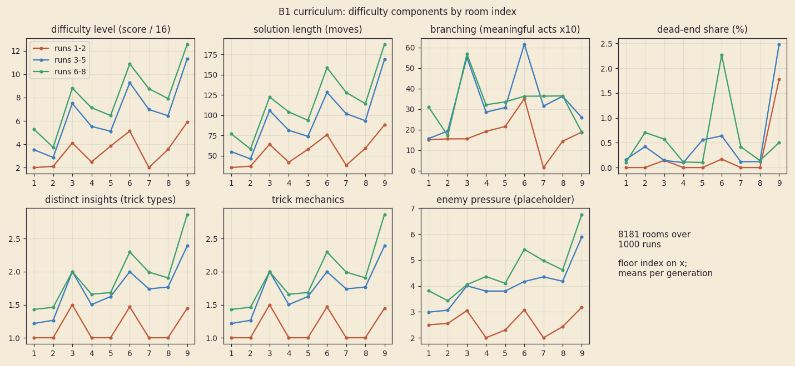
  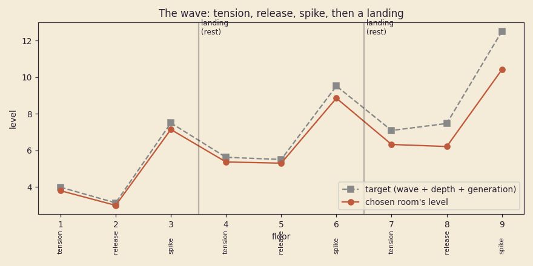
  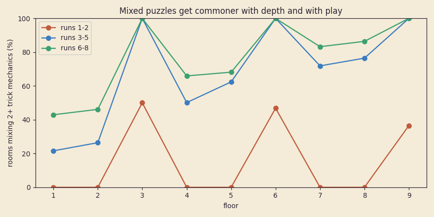
  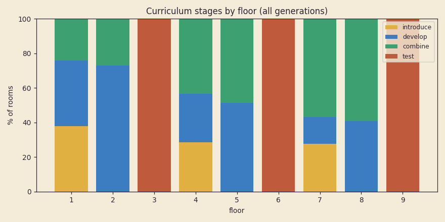

- **The adaptive bias is capped** (3.6.8): it softens only after repeated failure, by at most one level, and never
  under the curriculum floor for the depth.

### 3.6 The full run: ~52 floors, shortcuts, and HARD (run50)

The run is about 50 floors, not 10 (the 10-floor run was a mistake). This section replaces the old run shape (section 4,
"8 floors") and the 10-floor assumptions in 13 and 18. The B1 cartridge only has the office, so it still plays the
**B1 slice** (nine office floors over the baked table, then the Watchman; 3.5). The full run is laid out by the same
planner (`src/core/eg_plan.c`, `eg_run_build`). It is checked on the host (`host/egrun.c`) and compiled into the
cartridge from B4 (`EG_FULL_RUN`; it builds under sdcc at 7.2 KB of bank code).

#### 3.6.1 Shape

```
[biome 1: 4 stages + mid-boss + boss] landing [biome 2] landing ... [biome 8 = glitch core] FINAL EGRESS
```

- **8 biomes in a generated order:** the office or the vents first, the glitch core last, each biome once. The order
  comes from the line's **cycle seed**, so it stays fixed for a family until a new cycle (3.6.5). That keeps the
  shortcut doors meaningful.
- **Per biome: 4–6 stage slots under the curriculum,** a mid-boss after the first half (after stage 2 of 4, or after
  stage 3 of 5 or 6), then the biome boss. Biomes 1, 2 and 8 have 4 stages; the middle five have 4 (60%), 5 (30%) or
  6 (10%). That makes 6–8 floors per biome.
- **A rest landing between biomes** (7 a run): a talker, a trader, the book, the tree, the door toll (3.6.4). A landing
  is not a floor.
- **The final stretch:** after the glitch core's boss, FINAL (the hardest mixed room the run holds, 3 mechanics plus a
  theme), then the EGRESS. The egress asks the ending question that the truth matrix picks (section 10).
- **Length:** 50–55 floors from the front door, **mean 52.3** (`egplan check`).
- **Rare stages replace a combine slot:** a 3D stage (15.2) in 10% of eligible slots, a glitch rift in 6%, and today's
  sky event stage (19) once a run on an event day. Never in biome 1, never two rare stages running, at most one per
  biome. Measured: 3.0% / 1.7% / 1.1% of all stage slots, about 1 3D stage, 0.6 rifts and 0.4 sky stages per full run.

One run, taken from door 4 by a line at generation 13 that has met everything up to biome 7 (`egplan layout 0x5a17
0x42 12 0xffffc 3`; the level is the planned level, with the curriculum floor in brackets; the floor numbers stay the
full run's, so this 32-floor run starts on floor 19):

| Floor | Biome | Slot | Stage | Mechanics | Level |
| --- | --- | --- | --- | --- | --- |
| 19–20 | 4 atrium | combine, combine | escort, puzzle | sentry + weight (+PLACE theme); short + heavy | 8, 9 (8) |
| 21 | | MID-BOSS | | | 11 |
| 22–23 | | combine, test | escort, chase | burn + heavy + short; heavy + sentry | 8, 11 (8) |
| 24 | | BOSS, then a landing | | | 12 |
| 25–30 | 5 mall | combine (rift), combine, MID-BOSS, combine, test, BOSS | rift, hunt, holdout, mixp | pusher + cold + steps; pusher + rhythm; weight + heavy + beam; beam + pusher | 9, 10, 12, 9, 12, 13 |
| 31–36 | 6 vents | combine x2, MID-BOSS, combine, test, BOSS | holdout, dark, puzzle, hunt | steps + mirror; sleeper + glass; mirror + kettle; rhythm + sleeper | 11, 12, 14, 11, 14, 15 |
| 37–42 | 7 server | **introduce**, develop, MID-BOSS, combine, test, BOSS | puzzle, chase, holdout, chase | LIGHT-EATER alone; light-eater; mirror + weight + light-eater; light-eater + short + pusher | 5, 11, 15, 12, 15, 15 |
| 43–48 | 8 core | **introduce**, develop, MID-BOSS, combine (rift), test, BOSS | puzzle, holdout, rift, holdout | DRIFTER alone; drifter; dark + pusher + burn; light-eater + kettle + drifter | 5, 11, 15, 14, 15, 15 |
| 49–50 | | FINAL, EGRESS | | 3 mechanics + a theme | 15 |

#### 3.6.2 The curriculum over ~52 floors

Every mechanic still goes **introduce → develop → combine → test** (3.5). What is new is that the introductions are
spread across the whole run: each mechanic has a **band**, the biome position it arrives at.

| Biome position | Arrives (band) | Count |
| --- | --- | --- |
| 1 | burn, glass | 2 |
| 2 | cold, step-count routing, patroller | 3 |
| 3 | short circuit, kettle, heavy wanderer | 3 |
| 4 | dead weight, sleeper, sentry | 3 |
| 5 | glitched-glass rhythm, mirror beam, pusher | 3 |
| 6 | lights out (dark), eater, mirror (the obstacle) | 3 |
| 7 | follower, light-eater | 2 |
| 8 | glitch drifter (the glitch core's one twist) | 1 |

That is 20 curriculum mechanics (7 from B1, 3 more puzzle tricks, the 10 living obstacles of 7.7) on top of the basic
CRTs and drywall. Each also has a **home biome** (burn and glass in the office, cold in the atrium, sentries in the
server farm ...), which weights it up in that biome's mixes.

**How a biome's stage slots are filled** (deterministic from the run seed and the line's history):
1. The stage after an introduction is always its **develop** (same mechanic, a notch harder: intro level + 2 + depth / 2,
   never the biome's full level).
2. Otherwise, if a mechanic of this band or earlier is unseen by the line, **introduce** it, alone, in a puzzle room at
   the gentle intro level (2 at biome 1, 5 at biome 8), if its develop still fits in the biome. The lowest band goes
   first, then this biome's own. The third mechanic of a 3-band waits for the next biome or the next run.
3. A mechanic the line was introduced to but never developed (the heir died between the two) gets its develop next.
4. The last stage slot before the boss is the **test**: the hardest mix the slot's level allows.
5. Anything else **combines** 2 or 3 developed mechanics open at this depth (3 gets likelier with depth: 10% more per
   biome from biome 4, +15% in a test, +20% in a new cycle), weighted 4x for this biome's band and 3x for its home.
   Some of these slots are a known mechanic alone instead, a notch harder: 40% in biome 1, falling 6 points a biome to
   10%.
6. Biome 4 on adds a **theme** (3.3: PLACE ... ELEMENT) to mixes, 12% more per biome; that is the "fresh twist" in
   biomes that have nothing new left to introduce.

The line's history is two masks in the save (3.6.10): mechanics **introduced** and mechanics **developed**. A mechanic
from a later band never appears early, even if the line has met it, so every run still feels like it deepens: the
office is always about burn and glass, new things always arrive further down. For a line that has met everything, a
biome opens on its own band in mixes rather than re-teaching it.

**The stage types:** an introduction is always a puzzle room. A develop is a puzzle, or for an obstacle a holdout, chase
or escort built around it, or a dark room for lights-out, or mix-under-pressure for a recipe trick. Mixes deal from the
weighted deck (section 4): puzzle 5, holdout 2, chase 2, hunt 2, escort 1, mix-under-pressure 2, dark 2 (once lights-out
is open), heist 1 (biome 4 on). Stage types arrive with depth too (chase and hunt from biome 2, escort and mix-under-
pressure from 3). Measured over played stages: puzzle 52%, holdout 10%, chase 8%, hunt 7%, mix-under-pressure 8%,
dark 5%, escort 4%, heist 2%, rare 6%.

**Bosses close the biome and test its band.** The mid-boss and boss arenas use the band's mechanics as machinery
(7.5, 7.7: THE TENANT drags MOVERs across the office glass).

**Generations raise the pressure.** The planned level is `base(biome) + wave + min(g, 24) / 6 + 2·(cycle − 1)`,
clamped to 15. The base is 2 3 5 6 8 9 11 12 by biome position. The wave inside a biome is −1, 0, +1 up to the
mid-boss, then −1 (release), 0/+1, and +2 for the test; the mid-boss is base + 2 and the boss base + 3. At the cap,
the pressure moves into themes and 3-mechanic mixes.

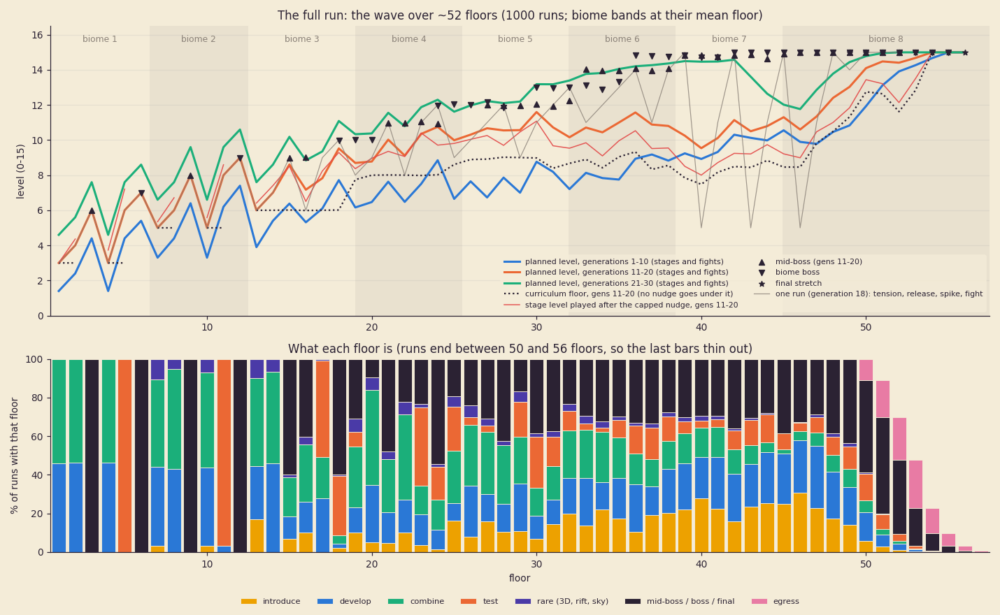

`run50_wave.png` (`egplan runsim 1000`, 1,000 runs at generations 1–30, laid out from the front door): the planned
level per floor for three generation groups, the curriculum floor, the level played after the capped nudge, the
fights, one run's own wave, and what each floor is.

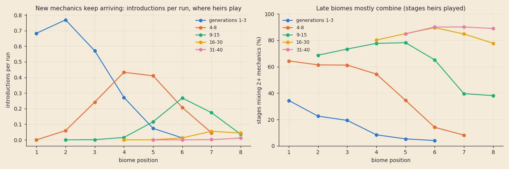

`run50_mix.png` (from the survival model, 3.6.7: only the stages heirs actually reached): the introductions move down
the run as the line gets deeper. Generations 1–3 meet theirs in biomes 1–3, generations 9–15 in biomes 5–7, and late
lines meet the drifter and the last obstacles in biomes 7–8. A line of generation 16 or later mixes in **78–90%** of
its stages in every biome it plays.

#### 3.6.3 Pacing

A stage takes 2–4 minutes (a puzzle about 3, a rare stage about 4), a mid-boss 3, a boss 5, a landing 2. A
front-door full run is about 34 stages, 16 fights, 7 landings, FINAL and the egress: **about 3 h 10 min.** A run from
door 7 (the last two biomes) is about 45 minutes. Most runs end earlier: the median run is 8–15 floors.

So the mid-run continue is essential (B3). It saves at every floor start and every landing (3.6.10).

#### 3.6.4 Lineage shortcuts (Rogue Legacy-style)

- **Unlock.** Beating the boss of the biome at position k (2–7) finds **door k**: the entrance of that biome. Door 1
  is the front door. The glitch core has no door: the last biome is always walked into from the one before it, so a
  shortcut run is at least two biomes plus the final stretch.
- **Open (the cost).** A found door is opened at a landing by **LOCK's toll keeper** for 40 x (k − 1) tokens (40 for
  door 2, 240 for door 7). Partial payments are kept, so a poor heir can pay toward it and a later one finishes it.
- **Use (the trade-off).** An heir who takes door k:
  - skips biomes 1..k−1 and everything they hold: the heart shards, pieces and finds a front-door heir would have
    gathered. **The toll buys a stake:** the keeper hands the heir a starter pack worth about 20 floors of finds (about
    three quarters of a full run's kit; the model's run-kit term starts at 0.76, not 1). Without the stake a deep door
    is a trap: in the model, lines that never took a door cleared more often than lines that did (5.5% against 1.3% a
    run at generation 20);
  - finds **half the treasure budget** in the first biome after the door ("the stairs are picked clean");
  - takes a **matrix trace**: REVERSIBLE leans one step toward "it can't be undone" (taking the stairs is fleeing,
    section 10), and the run is marked SHORTCUT in the stats.
  - The door is a choice on the heir pick screen (a door row under the three siblings). The deepest open door is the
    default.
- **Bytes:** the line progress record (3.6.10), doors found 1, doors open 1, the remaining toll per door 6.

#### 3.6.5 After the first egress

- **Descent (endless).** Unlocked by the line's first egress, from the title (DESCENT, under CONTINUE). Strata of 5
  mixed stages in a biome drawn fresh (never the last stratum's), a remixed boss, a landing every second stratum.
  - Nothing is introduced; every slot mixes from everything the line has developed.
  - The level starts at 12 and rises half a level a stratum to 15. Past that, the pressure stacks themes: 1 theme,
    then 2 from stratum 4, 3 from stratum 8; 3-mechanic mixes go from 40% to all.
  - The **leaderboard is on the STATS page** (9.8): the line's five deepest descents (floor, generation, heir). The
    bytes are in the line progress record, so the STATS record stays as B3 laid it out.
- **The matrix keeps moving.** Play after the egress still leans the four axes (section 10). The egress marks the
  question it asked. A different ending question needs a different lean, and **new truths can surface**: four deep
  truths open only to a line that has already asked a question (a second egress, a descent past stratum 6, a new
  cycle, all four axes past ±96). They are delivered the same way (whispers, boss lines, the book's margins), never as a
  reveal. Bytes: endings asked 2, truths surfaced 1.
- **New cycle (optional).** Offered at the egress ("THE BUILDING SETTLES. AGAIN?"). The world reassembles:
  - a new cycle seed: a new biome order and new stage counts;
  - **the calamity shifts:** the truth matrix's starting lean rotates, and the bosses lie about a different axis;
  - the doors close (it is a different building), but the line keeps its genes, its inheritance and its history;
  - **harder:** +2 levels per cycle, 3-mechanic mixes +20%, themes +20%;
  - **new mechanic combos:** one mechanic moves across each band boundary (2→3 ... 6→7), so mechanics arrive next to
    neighbours they never met before.

#### 3.6.6 Difficulty: HARD, and fair

Two things stay separate:
- **Build fairness stays.** No build or breeding strategy beats random picks by more than a few points (9.4, 13).
- **Absolute difficulty goes way up.** For a skilled player: a first heir rarely gets past biome 2–3, a full clear
  takes many generations and shortcuts, and the clear rate per run stays in the low single digits until the line is
  strong.

What makes it hard in the game (the model's knobs in 3.6.7 stand for these):
- **Hearts:** start at 4. A heart shard drops from each mid-boss and boss (4 shards make a heart), not every 2 floors.
  No healing between floors. A landing restores 2 hearts. The trader sells healing at a price.
- **Bosses are punishing but fair:**
  - every attack has a tell of at least 24 frames, and a fixed tell per attack family, so a fight is learnable across
    heirs (the model gives a boss +0.3 ability per earlier attempt, up to +1.5);
  - nothing hits off screen, nothing hits without a tell, there is no damage roll;
  - **the no-hit bot:** the stage sim plays every boss template with perfect inputs and must take 0 damage, so a hit
    is always avoidable (the player's fault);
  - phase 3 slams take 2 hearts, there are no heals in the arena, and an enrage timer stops a turtle;
  - 20–25 good hits over 3 phases (13).
- **Late-run puzzles are genuinely hard mixed rooms:** tier 4–5 (level 12–15), 3 mechanics plus a theme, and the bake
  asks more of them: a dead-end share of at least 25%, a first fatal move within 8 acts, 3 or more insights.

#### 3.6.7 The survival model (`egplan survive`, `tools/plot_survival.py`)

A line of heirs played by a skilled player, one heir (one run) per generation, 4,000 lines x 40 generations, through
the real layout (`eg_run_build`) and the real capped nudge.
- **Death on a floor:** `P = 0.006 + 0.85·logistic((challenge − ability) / 1.345)`.
- **Challenge:** 0.607 x the level after the nudge, plus the stage type's pressure (holdout and chase +0.8, escort and
  mix-under-pressure +0.9, a 3D stage +1.0, a rift +1.6), +0.4 per theme, and +0.7 per mechanic the line hasn't met.
  A mid-boss adds 1.22, a boss 2.99 (less what the line has learned of that fight), the final room 4.2 (it passes 40%
  of the heirs who reach it at generation 20 and 50% at 40).
- **Ability:** the player's skill (6.2, growing by up to 2.45 over 200 floors played), biome familiarity (up to +1),
  the line's strength (inherited mods, recipes and bounded genes: up to +3.0, time constant 6 generations), the run's
  kit (up to +1 over 14 floors; a door start begins at the toll's stake, 20 floors' worth), and the heir's build
  (σ 0.35; the best bred strategy adds +0.21 on a young line, falling to 0 as the line reaches full strength: 9.4's
  shared ceiling).
- **Doors:** found on a boss kill, paid at landings (7 tokens a floor), and the deepest open one is taken.
- **The front-door arm:** 4,000 more lines (random picks) that never take a door, for the front-door clear rate.

The knobs were tuned to the targets by a random search, then by hand. They are constants at the top of the model in
`host/egrun.c`, and `EGSURV="NAME=value,..."` overrides them for tuning.

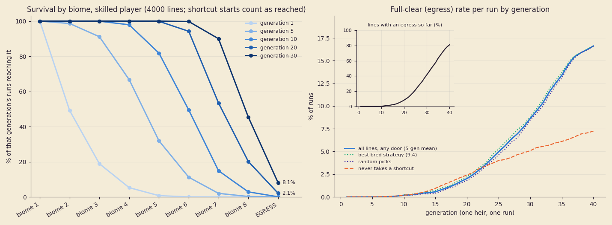

**% of runs reaching each biome** (a run that starts at a door has reached it):

| Generation | biome 2 | 3 | 4 | 5 | 6 | 7 | 8 | **egress** |
| --- | --- | --- | --- | --- | --- | --- | --- | --- |
| 1 | 49.2 | 18.9 | 5.3 | 0.7 | 0.0 | 0.0 | 0.0 | **0.00** |
| 5 | 98.7 | 91.1 | 66.7 | 31.9 | 11.2 | 2.0 | 0.2 | **0.00** |
| 10 | 100 | 100 | 97.9 | 81.8 | 49.5 | 14.9 | 2.9 | **0.07** |
| 20 | 100 | 100 | 100 | 99.9 | 94.2 | 53.5 | 20.2 | **2.1** |
| 30 | 100 | 100 | 100 | 100 | 99.8 | 90.0 | 45.5 | **8.1** |
| 40 | 100 | 100 | 100 | 100 | 100 | 99.2 | 58.9 | **16.2** |

- **A first heir** dies in biome 1 half the time. 18.9% reach biome 3 and 5.3% reach biome 4.
- **The full-clear rate per run** is 0.02% over generations 1–10, 0.9% over 11–20, 5.3% over 21–30 and 13.7% over
  31–40.
- **The first egress** comes at generation 26 / 32 / 38 (quartiles); 19% of lines have none by generation 40.
- **Doors carry the line** (`run50_doors.png`): the most-taken door is door 3 at generation 5 (51%), door 4 at 10
  (53%), door 6 at 20 (68%) and door 7 at 30 (76%) and 40 (98%).
- **A front-door full clear** (all ~52 floors in one run, about 3 hours) is counted on its own by the front-door arm:

  | Generation | 10 | 15 | 20 | 25 | 30 | 35 | 40 |
  | --- | --- | --- | --- | --- | --- | --- | --- |
  | never takes a door | 0.10 | 0.83 | 2.3 | 3.6 | 5.2 | 5.9 | **7.5** |
  | takes the deepest open door | 0.07 | 0.65 | 2.1 | 5.1 | 8.1 | 14.1 | **16.2** |

  Up to about generation 22 the two are level (a line that never pays a toll has the same floors of experience in
  one long run). After that the doors pull ahead, and by generation 40 they double the rate. So most lines clear
  through the doors, and a front-door clear stays the feat the STATS page counts separately.
- **The nudge** softens 0.5% of the stage slots in the waves sim, and never under the floor.

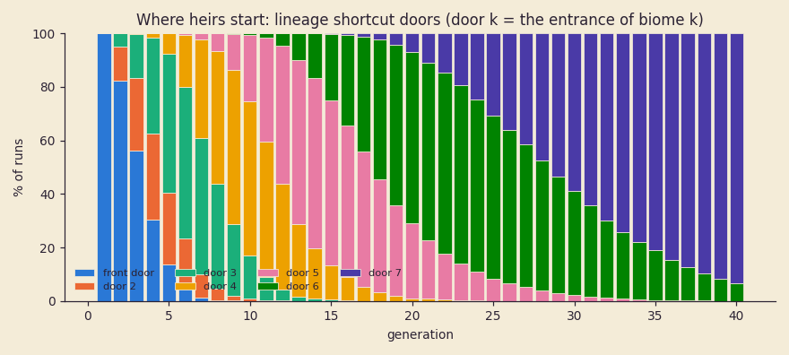

**Build fairness over a long run.** On one stage the best bred strategy is +3.7 points over random picks (the 9.3
bred-lines table). Over a 52-floor run a constant edge compounds, and it grows with the clear rate, so the late
generations show it most. Best bred minus random on the egress rate per run, 8,000 lines x 40 generations (the first
four rows before the door stake, with the final room at 2.6):

| Bred edge in the model | Worst single generation, 10–40 | Worst 5-generation window |
| --- | --- | --- |
| constant +0.21 (+3.7 a stage, as measured) | +9.0 points (generation 37) | +7.7 |
| constant +0.105 (halved) | +4.2 | +3.4 |
| constant +0.05 (a quarter) | +3.3 | +1.9 |
| +0.21 on a young line, falling to 0 at full strength | +1.4 | +1.0 |
| **the same, with the adopted knobs (4,000 lines)** | **+2.0** (generation 26) | **+0.9** |

Halving the edge is not enough on its own. **The lever is 9.4's shared ceiling:** breeding decides how an heir
reaches the line's ceiling, not how high it is. A young line's picks matter in full; by the time lines clear, a
random line has caught up. The adopted model meets the target (13): within +3 points of random at every generation
from 10 to 40. Over generations 26–35 the two egress at 9.6% and 8.9% a run.

#### 3.6.8 The capped nudge

The adaptive bias may never make it easy:
- **Hardening is free:** a fast clean clear moves the next room on that mechanic up a notch, to at most +2.
- **Softening needs repeated failure:** two failed rooms running on one mechanic (2+ resets, or the room was lost).
  Then it softens by **at most 1 level**, and only once, until a clean clear puts it back on plan.
- **Never under the curriculum floor:** a stage's level after the nudge is at least `base(biome) + pressure − 1`, and
  never more than 1 under its plan. Introductions, fights and the final room are never softened.
- `eg_nudge_level` and `eg_nudge_result` are shared by the slice and the full run. `egplan check` drives 20,000
  random result streams and every laid-out slot through them: 0 under the floor, 0 past the cap, 0 softening without a
  streak.

#### 3.6.9 The seed bank and the ROM

**Demand.** The survival model records every room a line draws in its first 30 generations, by cell: the lead mechanic
x mix size (2 or 3) x curriculum class x stage type x tier. A cell holding n rooms that a line plays v times repeats
about v²/2n of them (the birthday bound, an upper bound). The cheapest pool that meets a repeat target sizes each cell
by √E[v²], with at least 4 rooms a cell so no run repeats inside itself (`tools/seed_bank.py`,
`docs/shots/run50_seed_bank.json`).

**The rule that keeps it small:** a baked room serves a slot when it holds the slot's lead mechanic and nothing outside
the slot's open set. The planner then takes the room's own mechanics as the slot's. Keying the bank by exact mechanic
sets instead needs 7,135 room cells and about 490 KB, which doesn't fit.

| Repeat target (a line's first 30 generations) | Puzzle-family rooms (puzzle, mix under pressure, dark) | Stage seeds (holdout, chase, hunt, escort, heist) | Total |
| --- | --- | --- | --- |
| ≤ 10% repeats | 564 cells, effective pool 3,306 → **2,449 records x 6 B = 14.7 KB** | 845 cells, pool 4,739 → **6,319 x 5 B = 31.6 KB** | **46.3 KB** |
| ≤ 5% repeats (**recommended**) | pool 5,796 → **4,294 x 6 B = 25.8 KB** | pool 8,397 → **11,196 x 5 B = 56.0 KB** | **81.7 KB** (+ a 2 KB directory) |

- A line draws about 132 puzzle-family rooms and 74 other stages in 30 generations.
- **Rooms by tier** (10% target): 109 / 416 / 410 / 734 / 820 / 817. **By class:** introduce 227, develop 827, mix
  2,252. The deep tiers need the most, because that is where long lines spend their runs.
- **A room record, 6 B:** seed 2; mechanic-set index 1 (into a table of the sets that occur, at most 256); level and
  insights 1; trick (5 bits) and variant mask (3 bits) 1; biome mask 1. The bake verifies each record's transforms (an X mirror, a
  herring swap) and its biome reskins (which biomes' fragile kinds map onto its own). The estimate assumes 1.8
  verified variants per seed and 75% of biomes; the first B4 bake measures both. The table is sorted by (set, tier),
  so a 2 KB directory gives each set's range and the pick stays a table scan of one range.
- **A stage record, 5 B:** seed 2, the stage sim's budget and condition count 1, type and tier 1, a biome mask 1.
- **Generated on the cart, no bank:** 3D mazes (the world generator's mazes are solvable by construction; a flood fill
  checks the exit), glitch rifts (a stage seed plus rift modifiers), sky stages (built on the event). That is 17.3
  plays per line in 30 generations.
- **Descent** reuses the deep tiers in every biome with stacked themes. Repeats there are expected and fine.
- **The B1 table** (768 x 12 B = 9.2 KB) is replaced by the B4 bank.

**ROM ledger** (gate 1,900,000 bytes; settled with the B3 STATS session on 2026-10-15):

| Item | Bytes |
| --- | --- |
| current ROM (code, heir data and art, office look, B1 seeds), measured | 475,136 |
| title (3 pre-baked walks), 479 KB | 490,496 |
| 3D stage tables (cap) | ≤ 393,216 |
| seed bank (5% target) plus its directory | 81,744 + 2,048 = 83,792 |
| less the B1 seed table it replaces | −9,216 |
| **total** | **1,433,424** (~1.42 MB) |
| **left for B2–B7 code, art and music** | **466,576** (about 456 KB; the STATS session's round figure is ~480 KB) |

- **Estimates for B2–B7** (not measured): 7 biome looks at ~6 KB each (the office's is 4.6 KB), 42 KB; the mob look
  generator and families ~24 KB; 16 boss and mid-boss templates and arenas ~40 KB; music ~16 KB; sky scenes 14 KB
  (19.5); talk and lore text ~12 KB; the full-run planner 7.2 KB (measured under sdcc); the stage generator ~8 KB.
  That is about **163 KB**, which leaves about 300 KB of margin. The 3D stages' own tables (38 KB measured in 15.1,
  plus billboard frames at 9–10.5 KB a mob variant) sit inside their 384 KB cap.
- **If the bank ever has to go:** generate puzzles on the cart with a lightweight verify. The backwards generator
  already runs on the cart. The cart replays the generator's own plan forward under the cart's rules, running the 3.4
  flood fill after each step (≤ 80 steps x ~9,000 M-cycles ≈ 0.72 M M-cycles ≈ 21 frames at double speed, inside the
  room's ~60-frame assembly). That proves the room solvable and protected-cell safe. It cannot prove trick necessity
  or herring safety (they need the host solver), so on-cart rooms would be a fallback for deep descent strata only,
  never the curriculum.

#### 3.6.10 Saves: the mid-biome resume and the line progress (9.5)

**The mid-run continue record** (A at `0xA040`, B at `0xA140`, 256 B each; the higher valid sequence wins). It is
written at every floor start (after the room is picked, before it assembles) and at every landing. HP is rewritten (with
the CRC) on every hit, so pulling the power never heals. A death or the egress clears both. On resume, the layout is
rebuilt from the run inputs (`eg_run_build` is deterministic), and the heir re-enters that floor's assembly or that
landing.

| Offset | Size | Field |
| --- | --- | --- |
| `0x00` | 4 | version, sequence, state (0 none, 1 floor start, 2 landing), mode (story / descent) |
| `0x04` | 2 | run seed |
| `0x06` | 2 | cycle seed |
| `0x08` | 2 | cycle, door taken |
| `0x0A` | 2 | generation (u16) |
| `0x0C` | 4 | heir ring slot, descent stratum, today's sky event, spare |
| `0x10` | 6 | mechanics introduced and developed **at run start** (3 + 3; the layout's inputs) |
| `0x16` | 6 | resume point: slot index, floor, the room's seed (2), tier, variant bits |
| `0x1C` | 20 | the nudge: per curriculum mechanic, bias (3 bits, signed) and failure streak (3 bits) |
| `0x30` | 16 | rooms played this run (a 128-bit Bloom of bank indices: no repeats inside a run) |
| `0x40` | 69 | the heir: HP now 1, max hearts 1, shards 1, tokens 2, keycards 1, pocket 6 x 5, weapon base + 4 mods 5 x 5, recipes known this run 5, run buffs 3 |
| `0x85` | 12 | matrix this run: truth deltas 4, faction deltas 6, room-forgot traces 2 |
| `0x91` | 4 | treasure: found, offered, relics carried 2 |
| `0x95` | 16 | the run's counters for STATS (9.8's stage accumulator, folded in at the run's end) |
| `0xA5` | 3 | RNG state 2, sky stage used 1 |
| `0xA8` | 86 | spare |
| `0xFE` | 2 | CRC-16 |

**170 bytes are used (with the CRC) and 86 are spare.** The old row's "room state delta" is gone: a resume always re-enters at a
floor start, so no mid-room state is kept.

**The line progress record** (new, A at `0xA2C0`, B at `0xA300`, 64 B each, taken from the 240-byte free run):

| Offset | Size | Field |
| --- | --- | --- |
| `0x00` | 2 | version, sequence |
| `0x02` | 2 | doors found, doors open (bit k − 1 = door k, the entrance of biome k; bit 0, the front door, always set) |
| `0x04` | 6 | toll left per door 2–7, in units of 4 tokens (≤ 60) |
| `0x0A` | 2 | cycle seed (the world order of this cycle) |
| `0x0C` | 4 | cycle, egresses (u8, saturating; 0 keeps descent locked), calamity shift, flags (front-door clear done, new cycle offered) |
| `0x10` | 6 | mechanics introduced, mechanics developed (20 bits each, as 3 bytes) |
| `0x16` | 4 | endings asked (16 bits), truths surfaced (4 bits), spare |
| `0x1A` | 30 | descent leaderboard: 5 x (deepest descent floor u16, generation u16, heir hash u16) |
| `0x38` | 6 | spare |
| `0x3E` | 2 | CRC-16 |

The B1 cart keeps its 7 seen bits in the meta record's seen word (`MK_FROM_SEEN`). B4 moves them here.

**Claimed in 9.5 by run50:** `0xA040`–`0xA23F` (the continue records, contents redefined) and `0xA2C0`–`0xA33F` (the
line progress pair, 128 B). `0xA340`–`0xA3AF` (112 B) stays free. `tools/mock/stats_save.py` checks the whole map
with these rows: **5,241 used, 2,951 free.**

#### 3.6.11 Verification (`make test` runs `egplan check 1000`)

The check plays the B1 slice as before, then lays out 1,000 full runs over lines of 25 heirs (with deaths, doors and
cycles 1–3; a quarter of them from arbitrary saves at arbitrary doors), plus 160 descent strata:

```
floors per front-door run: 50..55, mean 52.3
structure breaks 0; band breaks 0; introduce -> develop -> combine ordering breaks 0
introductions 4495, not alone/gentle 0; develop not right after its introduction 0
back to back: same mechanics at the same level 0, same stage type 0, two rare stages 0
nudge under its floor or past its cap 0; descent slots that don't mix 0
fresh line, whole layout: every position introduces (of 40): 80 80 82 83 83 83 85 80
progressive lines: introduced in its own biome 66.5%, one later 29.0%, two later 4.5%, later 0.0%
mixed share by biome position:    54%   55%   52%   48%   43%   40%   78%   86%  (late biomes 78%)
```

It fails on any break: structure (biome order, 4–6 stages, mid-boss and boss placement, landings, 50–57 floors),
bands, ordering, introductions alone and gentle, develop-after-introduce, back-to-back repeats, the nudge cap, the
spread (every biome but the last introduces something on a fresh line), and late biomes under 60% mixed.

---

## 4. Stages: not always "find the key, open the door"

The world generator picks each stage from a **weighted deck** per biome and depth. It never deals the same type back
to back and keeps a "seen" history (the last 6 types and the last 10 tricks) so nothing repeats too soon.

| Stage type | Win condition | Notes |
| --- | --- | --- |
| Puzzle room | reach the exit | the 10 tricks above |
| Holdout | survive N waves (2–4) while the egress assembles or charges | the charge pauses when you leave its ring; waves arrive from the void as glitch-in cards |
| Escort / protect | a talker or a fragile object reaches the exit / survives | it walks a generated path; you clear and shield it |
| Chase / collapse | reach the exit before the collapse wave | the floor drops behind you at a set speed; shortcuts need recipes |
| Hunt | kill the marked target | the target has a kill condition (section 7.3); the means are in the room. Never a living obstacle (7.7). |
| Mid-boss / boss arena | win the fight | 2–3 phases, environment use (section 7.5) |
| Heist / trade | take or buy the thing, get out | a talker's shop: barter recipes, tokens or a heart; stealing triggers a holdout |
| Dark room | reach the exit lit | GLOWS lights a radius; SHINY reflects light / a beam onto a receiver |
| Mix under pressure | make the target recipe while mobs come | the bench is open in a ring, so you have to clear space to use it |
| Rest / landing | none (leave when ready) | a talker and a trader, the book, the lineage tree; history-gated talks |
| Glitch rift (optional) | survive a short random stage | glitch modifiers, high reward (rare pieces), risk (a curse affix) |

**Falling as a tool, not decoration.**
- **Puzzles:** collapse a cell so a CRT or rubble drops onto a switch below (Collapse drop trick).
- **Kills:** armoured things that only die when crushed. Lure them under a collapsing cell, or drop a block on them.

**Escalation.**
- Every stage is scored by its generator: solver steps for puzzles, the enemy budget (sum of mob cost), the
  condition count (how many kill/gate conditions must be met) and modifiers.
- The **target level** per slot comes from the run planner (3.6.2): the biome's base, the wave, the generation and
  the cycle. The generator rerolls (or the planner picks from the bank) until the stage lands in the band.
  (The prototype sim below used `D(d,g) = base + 6·d + 2·min(g, 8)` over 8 floors.)
- **Run shape:** about 52 floors over 8 biomes, each 4–6 stages plus a mid-boss and a boss, landings between, then
  the final stretch and the egress (3.6.1). Rare stages (3D, rifts, sky events) take combine slots.
- **Biome order** is generated per **cycle** (fixed for a family until a new cycle, so the shortcut doors of 3.6.4 mean
  something):
  - the glitch core is always last;
  - the office or the vents comes first;
  - every biome appears once.
- The biome sets which recipes and elements are common (the flooded atrium is WET-heavy and COLD-useful, the server
  farm is ELECTRIC, the dream garden is ALIVE).

**Verified headlessly** (10,000 runs, `proto/matrix/RESULTS.md`):
- **Repeats:** 0 back-to-back stage types. The same type two stages apart 2.5% of the time. A trick repeats within 6
  trick rooms in 0.6% of rooms.
- **Difficulty:** it climbs every floor (mean 27 → 52) and with heir generation (40 → 52).
- **Fairness:** 86% of stages need a specific means. Before the guarantee step, 65.1% would be unwinnable from the
  room alone; **after it, 0**.
- **Coupling** (measurable but weak): a hated CHARGE raises SHOCK/HOT enemies from 17% to 27%; a DREAM leaning
  raises dream-garden visits from 47% to 61%.
- **Proxy:** completability for puzzle rooms is a means proxy here; the real solver verifies the actual grids.

---

## 4b. Treasure: greed at risk

Treasure is layered through every stage to pull you off the safe path. The main path never depends on it.

**Where it is.**
- **Visible but hard to reach:**
  - on top of raised blocks;
  - on ledges over the void;
  - across crumble floor;
  - behind hazards;
  - on a flyer's route;
  - on a card that is still assembling or about to collapse.
- **Hidden:**
  - under foam or rubble;
  - under a CRT (push it to reveal);
  - inside breakable drywall;
  - in a crumbling patch;
  - under water you must freeze or drain.
- **Hinted:**
  - a card with a slightly different tint and a slow shimmer (palette-cycled, 1 colour);
  - a sound tell (a soft in-key chime when you're within 2 cells);
  - a talker line;
  - heir traits: INSOMNIAC sees the shimmer at night, REMEMBERS marks patches an ancestor found, COLOUR-BLIND sees
    the SHINY ones.

**Reach cost and risk tiers.** After the room is generated and verified, the generator places treasure from a
per-stage **budget** (it rises with depth). For each candidate spot, the solver/sim measures the **reach cost**:
- extra solver steps off the main path;
- hazards crossed;
- enemies within 3 cells;
- whether it needs a recipe, a reaction, a collapse or a specific heir trait;
- whether it is timed (a floor that drops, a holdout wave, a beam cycle).

Reward tier = f(reach cost). The richest patches need daring play:
- a timed run before a floor drops;
- grabbing it mid-holdout;
- dashing through a beam;
- riding a card as it falls.

Some patches are reachable **only** with a specific reaction or heir trait (SMALL through a vent, HEAVY pushing two
blocks, a BLINK through a gap), a reason to come back with another heir.

**What you find** (the weights shift with tier and biome):

| Find | Notes |
| --- | --- |
| tokens | the common tier |
| rare recipe ingredients | CRYSTAL, RUBY, SEED, OIL... ingredients that unlock deeper recipes |
| weapon/mod pieces | super-matrix pieces, some found-only |
| lore fragments | chosen by the truth matrix (they show the current lean, vaguely) |
| lineage relics | dropped by an ancestor on the floor where they died: their face, their last piece |
| cosmetic avatar parts | hair, hat, colour variants fed to the generator (seeded, diverse) |
| cursed items | an upside piece with a cost piece attached, clearly marked by a glitch outline |

**Rules.**
- Placement comes after the main path is built and verified.
- Every patch is verified reachable by the solver (or the stage sim for combat stages), and its reach cost is stored
  with the baked room.
- Treasure never blocks or softlocks the main path. Taking a patch may cost you the safe route (the floor drops), but
  never the exit.
- Deterministic from the seed.

**Tally.** At the end of each stage: "FOUND 2 OF 5". Hidden patches you didn't find show as "?". The book tracks the
best tally per stage type.

**Feel.**
- **Visible treasure** sparkles: 2 particle glints from the pool, on a timer, never more than 2 per patch.
- **The reveal** is its own animation state: a hidden → hinted → uncovered → lifted → collected sequence, with a
  rising arpeggio in the music's key (the tier sets the length: 2, 3 or 5 notes).
- **Cursed items** hiss instead (noise burst, then a minor second).

**Verified** (10,000 runs):
- 1.5 patches per stage, 76 per run;
- 44% hidden (a third of those hinted);
- 15.3% trait-gated;
- reach cost against tier correlates at r = 0.94;
- unreachable: 16% before the placement guarantee, **0 after**;
- 0 main paths depend on treasure.

`mock_room.png` shows:
- 3 visible patches: on a wall block, on a block still dropping in, and on a card mid-assembly;
- 1 hinted patch: the warmer card with a shimmer, bottom left, with a lineage relic under it;
- the HUD tally.

---

## 5. The super matrix: one composition system for everything

Traits, weapons, mods, elements, dodge styles, mob parts, elite affixes and boss parts are all **pieces**. Like
recipes, they combine through rules, not hand-written combos.

### 5.1 Piece schema (5 bytes)

```
byte 0  trigger (5 bits) | stack group (3 bits)
byte 1  effect  (5 bits) | shape (3 bits: self, melee arc, projectile, area, trail, aura, summon, terrain)
byte 2  tags    (8 bits: HOT COLD WET SHINY ALIVE MAGIC GLITCH STONE)
byte 3  magnitude (4 bits) | cooldown/period (4 bits, in 1/4 s)
byte 4  flags: found-only, bench-craftable, cost side (for paired traits), rarity (2 bits)
```

**Triggers:**
- on hit, on kill
- on dodge (start / end), on parry, on perfect parry
- on charge release
- on hurt, on low HP (≤ 1 heart)
- on push, on dig
- on recipe made
- on enter tile (water/ice/void edge)
- every N seconds
- on combo hit 3

**Effects:**
- projectile, area burst, status (wet, burn, frozen, shocked, blind, slowed, marked)
- terrain change (freeze/melt/burn/grow/collapse/assemble a cell)
- stat change (speed, damage, i-frames, push strength)
- summon (afterimage, sprout, mini-turret)
- heal / shield
- token gain

**Stacking:**
- Pieces in the same stack group add with **diminishing returns**: the 1st counts 100%, the 2nd 60%, the 3rd 30%,
  the 4th and later 0.
- Hard caps: speed +50%, damage x2.5, i-frames +6, projectiles per trigger 3, summons alive 2.
- Every trigger has an internal cooldown floor (6 frames), so "on hit" chains can't loop.

### 5.2 One reaction table for rooms and fights

Tags meet when an effect with tags touches a target with a status or tags: a mob, a cell, an object or the player.
The same table runs the puzzle tiles and the combat. Fire burns the wooden wall and the enemy; cold freezes the water
tiles and the enemy.

| × | HOT | COLD | WET | SHINY | ALIVE | MAGIC | GLITCH | STONE |
| --- | --- | --- | --- | --- | --- | --- | --- | --- |
| **HOT** | flare (+dmg) | thaw/shatter (frozen target takes x2, breaks ice) | STEAM cloud (blind, lifts at vents) | glare (blind short) | BURN (DoT, spreads to ALIVE/wood) | ember sigil (delayed burst) | flicker fire (random cell ignites) | glow-heat (STONE becomes LAVA cell 3 s) |
| **COLD** | | deep freeze (frozen 2 s) | FREEZE (frozen; water cells become ice path) | prism (beam splits in 2) | frost-bite (slow, stops growth) | crystal (target becomes a SHINY block you can push) | stutter (target skips frames) | brittle (next hit shatters) |
| **WET** | | | soak (+WET duration) | slick (target slides 1 cell) | OVERGROW (vines root target / bridge cell) | bloom (heal 1 for the player) | SHORT CIRCUIT if shocked (chain stun across connected WET) | MUD (slow area) |
| **SHINY** | | | | REFLECT (projectile reverses; parry reflection splits in 2) | sun-feed (ALIVE grows x2) | lens (charged shots pierce) | mirror ghost (a decoy) | polish (block slides farther when pushed) |
| **ALIVE** | | | | | swarm (+1 summon) | wild growth (cell becomes bridge/wall) | rot (armour −1) | moss (crumble cell holds) |
| **MAGIC** | | | | | | resonance (+cooldown speed) | GLITCH BURST (area tear, scrambles mob AI 2 s) | rune (block becomes a switch) |
| **GLITCH** | | | | | | | duplicate (the effect repeats once, 30 frames later) | noclip (cell phases out 2 s) |
| **STONE** | | | | | | | | crush (heavy hit, ignores armoured front) |

ELECTRIC/SHOCK is a status that ELECTRIC things carry, and it reacts with WET (short circuit). ICE is COLD+SHINY,
STEAM is HOT+WET+AIRY, and so on: an item's traits *are* its tags, so a crafted thing reacts exactly as its
traits say.

**Fixed resolution order per frame:**
1. input;
2. player state;
3. mob AI;
4. movement and collision;
5. hits (sorted by actor slot);
6. triggers (in piece order, by slot);
7. reactions (cell-major, then actor slot);
8. statuses tick;
9. terrain commits (queued, ≤ 6 per frame, VBlank budget);
10. particles and SFX requests;
11. HUD.

Everything is fixed-point (8.8 positions, 4.4 speeds) and deterministic from seed and input.

### 5.3 Generative weapons, mods and heirs

- A **weapon** = a base (blade, hammer, whip, gauntlet, launcher) + 1–3 pieces.
- A **mod** = 1 piece; crafted on the bench (SWORD → "EDGE" mod, LANTERN → "EMBER" mod, ICE → "RIME" mod) or found.
- **Heirs** = a dodge style + 1–2 paired trait pieces (an upside piece plus a cost piece).
- **Names** come in the family's wacky voice: a tag adjective plus an object noun from the piece pool, for example
  KETTLE EDGE, SORRY LAMP, DAMP INTERN, RIME TOASTER.
- Some pieces are found-only or bench-only, so crafting matters.

### 5.4 Ten example builds

| # | Build | What happens |
| --- | --- | --- |
| 1 | RIME blade + GLITCHED heir + blink dodge | each blink leaves a frozen afterimage (summon, COLD); a GLITCH × COLD stutter freezes mobs that touch it; hit it and it shatters (HOT × COLD) |
| 2 | EMBER mod + DAMP heir (always WET) | your hits are HOT on a WET source: every hit makes a STEAM cloud that blinds; steam also lifts you at vents |
| 3 | MIRROR gauntlet + parry | perfect parries REFLECT orbs; SHINY × SHINY splits each reflected orb in two |
| 4 | Hammer + HEAVY heir | push strength 2 (two blocks), the charged slam is STONE: crushes armoured fronts, collapses cracked cells under mobs |
| 5 | SPROUT whip + RAIN on the floor | combo hit 3 plants a seed; WET floor → OVERGROW roots mobs; on puzzle floors you grow bridges mid-fight |
| 6 | VOLT launcher + flooded atrium | shots carry SHOCK; WET floor → SHORT CIRCUIT chains across every mob standing in water |
| 7 | LANTERN mod + dark room + INSOMNIAC heir | the night palette; the lantern lights a radius and burns ALIVE; insomniac hears more talks, sees invisible mobs at the edge |
| 8 | Slide dodge + FROST trail mod | the slide leaves an ice trail: mobs slip (WET × SHINY slick), ice over water becomes a path |
| 9 | CRYSTAL blade + GLITCH rift curse | MAGIC × GLITCH bursts on kill; the curse (cost) means random cells phase out under you |
| 10 | Blade, no mods, ECHO heir | the baseline: the last heir's ghost path shows the route; clean combos and parries; the control build the sim compares against |

**Sim results** (`proto/matrix/`, a host C prototype; 10,000 seeded runs, all 250,614 player builds; an abstract
combat model, so it finds runaway stacks and dead pieces but doesn't predict feel):
- **Clear rate:** the calibrated field clear rate is 40.9%. Every archetype sits between 34.8% and 47.8%, every mod
  and trait between 32% and 52%, every weapon between 36% and 45%.
- **Extremes:** 37 of 250,614 builds clear 90% or more (a lucky stack, not an archetype); none clears 3% or less.
- **Fixes found by the sim:**
  - lifesteal bypassed stacking: it is now capped heal-only;
  - avoid was the strongest axis: TINY was trimmed;
  - weak pieces were raised as data.
- **Soft caps as shipped:** DAMAGE 90, STATUS 70, AREA 80, PROJ 80, DEFENSE 45, SPEED 40, SUMMON 60, REACT 60
  (hard stop x1.5). The auto-tuner needed no change.

### 5.5 Particles, FX and SFX per tag and reaction

**Particle pool:** 8 sprites, hard cap, shared, oldest-first recycling. Each tag has a particle (an ember, a frost
mote, a drop, a glint, a leaf, a rune, a tear pixel, a pebble), and each reaction has a burst pattern (steam: rising
puffs; shatter: 6 shards; short circuit: arcs along WET cells drawn as BG flashes, not sprites).

**Feedback scaled by magnitude:**
- palette flash on the target (1–3 frames);
- screen shake via SCX/SCY offsets (0–2 px);
- hitstop (0–4 frames).

The shake and flash stay off for anything under magnitude 4, so ordinary hits feel crisp, not noisy.

**SFX:** one short sound per reaction. The tonal ones are in the music's key (section 14). Steam is filtered noise
plus a falling pulse; shatter is a short high noise; overgrow is a soft rising wave; the short circuit is a buzz
under 120 ms. None is harsh: no full-volume square leads, envelopes on everything.

**OAM budget, worst case (40 entries):**

| Use | Count |
| --- | --- |
| player | 4 |
| weapon arc / held object | 2 |
| mobs (up to 4 on screen at 24 px, 4 sprites each) | 16 |
| pieces in flight (assembly/collapse) | 8 (4 cards) |
| particles | 8 |
| elite glow / boss parts | 2 |
| **total** | **40** |

The 10-per-line rule is enforced by a per-band counter. When a band is full, particles drop first, then flicker
cycling applies to mobs.

**CPU budget at 60 fps** (double speed, ≈ 35,000 M-cycles per frame):

| Work | Typical | Worst case |
| --- | --- | --- |
| input + player | 600 | 600 |
| mobs (≤ 8 AI, 6 active) | 4,000 | 8,000 |
| collision | 2,000 | 4,000 |
| hits + triggers + reactions (cap 16 reactions per frame, the rest queued) | | 6,000 |
| particles | | 1,500 |
| assembly/collapse | | 2,000 |
| music + SFX | | 2,500 |
| OAM build | | 2,000 |
| HUD diff | | 500 |
| **total** | | **≈ 27,000 (≈ 78%)** |

Anything over the reaction cap waits for the next frame, in order, so the result is the same.

---

## 6. Combat: one weapon, six moves, two buttons

Bastion-style: one weapon at a time, crafted mods, and the owner's exact mapping. **B is the dodge button.**

| Input | Move |
| --- | --- |
| **A tap** | main attack: a 3-hit combo |
| **A hold** | charge; release for the charged attack (levels by hold length) |
| **B tap** | dodge: the heir's own style (roll, blink or slide); starts **instantly** on press |
| **B hold** | a held B move that continues out of the dodge (see below) |
| **B then A** | dodge-cancel strike: A inside the cancel window cancels the dodge into a lunge that keeps its momentum |
| **A then B** | weapon secondary / parry (a perfect parry reflects orbs and staggers) |

SELECT opens the bench, START the menu.

**Input rules.**
- **Tap or hold.** A tap is a release within `T_HOLD` frames, a hold is still held at `T_HOLD`. The exact counts are
  in the frame table below.
- **No input lag.** A tap's anticipation (startup) starts on the press frame. If the button is still held at the
  threshold, the hold branches off the tap's startup, so a hold never makes a tap feel late.
- **No chord delay on B.** The dodge starts on the press frame. B→A is a cancel window inside the dodge, not a chord.
- **A→B uses order.** Whichever button went down first decides it, within a small window.
- **Same-frame presses** (A and B together) are a parry: the 0-frame end of the A→B window. B→A can't mean the lunge
  on that frame anyway, because every cancel window opens at dodge frame 3 or later.
- **Buffer.** A 6-frame buffer queues presses during recovery.
- **Determinism.** The whole thing is a pure function of the input stream, evaluated once per frame from the held
  byte (edges are computed inside).
- **Dodge style.** Each heir's style changes the dodge's frame data and look (roll, blink, slide); the six inputs
  stay the same.

**B hold: two options.**
- **(a) Sprint-slide:** B held past the threshold carries the dodge into a low slide and then a sprint (+40% speed,
  no attack until released), keeping the dodge's direction.
- **(b) Held guard:** B held after the dodge raises a guard that blocks frontal hits (chip damage) and turns into a
  parry on release-and-press.

**Pick: (a) sprint-slide.** A→B already owns parrying, so a second guard would blur the two. The sprint is the
missing movement verb for chase/collapse stages and holdouts. It also composes with pieces: a slide leaves trails
(build 8), and blink-style heirs blink-chain instead.

**PROOF.** The resolver is written as a pure portable C module, `src/core/eg_input.{h,c}`, with a host test,
`host/test_input.c`, that feeds exact frame timings. The frame-data table and the test results are in
`proto/input/FRAMES.md`; the table is reproduced here once it is final.

**Frame data** (60 fps frames, counted from 0 on the move's first frame; windows inclusive). **PROOF, done:**
`host/test_input.c` passes 106 checks and `host/test_move.c` passes 50.

| Move | Input | Startup | Active | Recovery | Total | Window |
|---|---|---|---|---|---|---|
| Dodge, roll | B press | 0-1 | 2-11 (i-frames) | 12-17 | 18 | B->A cancel 4-14 |
| Dodge, blink | B press | 0-2 | 3-6 (i-frames) | 7-13 | 14 | B->A cancel 6-11 |
| Dodge, slide | B press | 0 | 1-12 (i-frames) | 13-19 | 20 | B->A cancel 3-16 |
| Sprint | B held >= 11 frames | loop while B held | | | | starts at the dodge's first recovery frame, or at the threshold if that is later: roll 12, blink 10, slide 13 |
| Skid | B released in sprint | | | 0-3 | 4 | A or B cancels it at once |
| Lunge | A in the dodge cancel window, or A in sprint | 0-1 | 2-5 | 6-17 | 18 | combo link to Hit 2 from 10; keeps dodge momentum |
| Hit 1 | A press | 0-3 | 4-5 | 6-15 | 16 | combo link to Hit 2 from 8 |
| Hit 2 | A, buffered or in the link | 0-3 | 4-5 | 6-17 | 18 | combo link to Hit 3 from 9 |
| Hit 3 | A, buffered or in the link | 0-5 | 6-8 | 9-26 | 27 | finisher, no link |
| Charge | A held >= 11 frames | loop while A held | | | | branches off the hit at frame 10 (outside its active frames) |
| Charged | A released in charge | 0-2 | 3-6 | 7-20 | 21 | level 1: held 11-29, level 2: 30-49, level 3: 50+ |
| Parry | B within 0-4 frames of A's press, or while A is held | 0-1 | 2-9 (guard) | 10-21 | 22 | perfect 2-4 |

Rules:
- **Tap or hold:** the press frame counts as frame 1 of the hold. Released after 10 or fewer frames is a tap.
  Held for 11 or more is a hold (`EG_HOLD_T = 11`). Taps never wait: B starts the dodge and A starts Hit 1 on the
  press frame. The hold branches off that move afterwards.
- **Buffer:** one slot, `EG_BUF_FRAMES = 6`. A press can fire on its own frame or on any of the 5 frames after it.
  The newest press replaces the old one. A press the state can't take yet waits in the slot, for example A during
  attack startup or active frames, or B during an attack's active frames, a dodge, or a parry.
- **A before the cancel window:** buffered into the window. It fires on the window's first frame, which is always
  within 6 frames of a press made after the dodge started. A after the window but before the dodge ends is a normal
  A: Hit 1 starts on the first idle frame if the buffer hasn't expired. A after the dodge ends is a normal A.
- **A then B:** B counts as the secondary (parry) when A is held, or when A went down 0 to 4 frames earlier
  (`EG_AB_WIN`). Otherwise B is a dodge. The parry can cancel any phase of Hits 1-3 and the charge, but only the
  recovery of the lunge and the charged attack.
- **Same-frame A+B:** parry. This is the 0-frame end of the A->B window. B->A can't mean the lunge on that frame,
  since every cancel window opens at dodge frame 3 or later. Plain B already gives the dodge, so the chord gets a
  meaning of its own.
- **B during attacks:** a dodge cancels a hit's startup and recovery at once. During active frames it is buffered.
  For the lunge and the charged attack, a dodge only cancels recovery.
- **No infinite cancels:** a dodge started out of a lunge is marked as chained and can't lunge again. A in its
  window is held as a normal A. Hit 3, the charged attack, the parry and dodges can't be cancelled by A.
  Counters saturate at 255.

The tests feed exact frame-by-frame timings and cover:
- B tap and B hold;
- B→A on the first and last frame of each style's cancel window and one frame outside each edge;
- A pressed before the dodge ends;
- both pressed on the same frame;
- tap/hold at 10/11/12 frames;
- charge levels at their boundaries;
- A→B inside and outside the window;
- perfect-parry timing;
- the buffered 3-hit combo;
- 10,000 frames of seeded mashing, which checks invariants (no illegal state, never two moves at once, bounded
  counters) and determinism (the same stream twice gives identical traces).


**Enemies are designed so all six moves matter:**
- armoured fronts (dash-cancel behind them, B→A);
- projectiles (parry/reflect, A→B);
- lunges with a tell (dodge, B);
- swarms (charge spin, A hold);
- chasers on collapse floors (sprint, B hold);
- staggers that open combo windows (A tap).

---

## 7. Mobs, elites and bosses from the same matrix

### 7.1 Mob axes

A mob = **body** + **attack** + **defence/kill condition** + **tag** + **behaviour**, each a piece:

- **Body / mobility:**
  - walker
  - flyer (over pits and water)
  - phaser (through walls)
  - burrower (under foam)
  - wall-crawler
  - gravity-bound (falls, can be dropped, pulls things toward it)
  - heavy (slow, unstoppable, breaks blocks)
  - teleporter/blinker
  - swarm
  - turret
  - mimic (hides as one of the room's objects)
- **Attack:** melee lunge, projectile, AoE slam/ring, beam, trail hazard, summon, grab/pull, terrain change (freezes
  water, sets fire, collapses tiles).
- **Defence / kill condition:**
  - none
  - armoured front
  - shielded until WET, then SHOCKED
  - only dies when crushed
  - splits on death
  - reforms unless frozen
  - only hurt by its reflected shots
  - invisible in the dark
- **Tag:** one of HOT COLD WET SHINY ALIVE MAGIC GLITCH STONE, which drives the reactions.
- **Behaviour:**
  - aggressive
  - coward/kiter
  - flanker
  - guard (protects another mob)
  - pack leader (buffs others)
  - thief (steals tokens and runs)

**Compatibility rules** prune nonsense:
- a turret can't be a thief;
- a phaser can't be "crush only";
- a flyer can't burrow;
- a beam needs a 20-frame tell;
- a mimic must be a real icon from the biome's recipe pool.

**Every attack has a tell:** a palette flash plus a pose frame, at least 12 frames (24 for beams and slams).

**Families per biome** give a visual language, drawn by the mob look generator (section 7.6):
- office: human and robot clerks, lamps, fax things;
- vents: flyers and crawlers, sheet ghosts;
- flooded atrium: wet blobs, cloud styles;
- server farm: AI-eye turrets, pixel invaders;
- mall food court: mimics, flame styles, thieves;
- dream garden: ALIVE styles, radiant and poly faces;
- rooftop sky: flyers, cloud and observatory motifs;
- glitch core: everything torn.

**Names** are generated in the family's wacky voice: DAMP INTERN, SORRY LAMP, FAX MOTH, HOLD MUSIC, MALL SAINT, ROOT CLERK,
SPARE FAN, TINY CHORUS, PILOT LIGHT, LAST BUS, COLD CALL, GRAVE AUNT. See `mock_mobs.png`.

### 7.2 Elites

An elite is a mob plus 1–2 affixes (a cap of 2, and never two from the same stack group):
- shielded
- vampiric
- splitting
- hasted
- element aura
- teleport-on-hit
- collapse trail

Elites are marked by an outline in OBJ palette 7 (one colour per affix), affix particles from the pool, and a name
prefix. They give 2x tokens and a chance at a found-only piece.

### 7.3 Conditional enemies ("doesn't die unless X")

Hard enemies carry 1–2 conditions drawn from the reaction table:
- frozen then shattered;
- wet then shocked;
- lured under a collapse;
- hit from behind after a dash;
- its reflected orb returned to it;
- a recipe made nearby (it fears the thing).

**Fair by construction:**
- When the generator adds a conditional mob, it must also add the means: a WET source and a SHOCK source reachable
  in the room, or in the player's guaranteed kit (the weapon base always has a parry; the bench recipes reachable
  from pocket and room).
- The stage sim checks the conditions are satisfiable. Stages that fail are rerolled, and the reroll rate is reported.
- The player is told:
  - a visual tell on the mob (a shield ring, an armour glint, a frost reform shimmer);
  - its name, which hints at it;
  - a talker line or the whisper in the void ("IT HATES RAIN").

See `mock_cond.png`.

### 7.4 Variety numbers

From the prototype composer and the 10,000-run world sim (`proto/matrix/RESULTS.md`):

| Measure | Result |
| --- | --- |
| mob builds (behaviour axes) | 46,464 raw combos, **15,981 valid** after the compatibility rules |
| elite builds | 883,325 |
| valid boss templates | 2,415,192 |
| distinct mob builds met per run | ~77 (min 65, max 93) |
| repeat rate within a run | **0.2%** (24-pick history window) |
| coverage over 10,000 runs | 100% of valid mob builds; 132,591 distinct elites; 47,722 distinct bosses |
| **looks** (section 7.6) | **678,012,660** distinct looks; 22.3 billion with tag and defence cues |

A mob on screen is one behaviour build × one look, so no two runs look alike. Players learn **tags and defences**,
whose tells never change, not individual looks.

### 7.5 Bosses

Every boss = a **boss template** (body plan, arena rule, 3 phases) + generated pieces + phase scripts. The bosses
**use the environment**:
- tear tiles out of the floor and throw them;
- collapse the arena ring by ring;
- flood or freeze it;
- drop CRTs from the void;
- switch the lights off;
- rearrange the room as it falls apart;
- use the biome hazard.

The player can turn the same tools against them: freeze the flood to stand on, drop the torn tile back on the boss,
reflect its orbs. Bosses can also summon or command living obstacles (7.7).

**Phases** demand different moves:
1. dodge-heavy (lunges and slams);
2. parry-heavy (orbs and beams);
3. the arena is half gone: sprint and dash-cancel (punish windows behind armour).

Each phase is gated by its own environmental beat (the floor drops, the lights go). Target length: 20–25 good hits
across 3 phases (folds in the M2 balance note), with clear telegraphs (24+ frames).

**Tied to the matrix.** The boss's identity, lines and twist come from the truth matrix and faction standing. Bosses
are the calamity's unreliable witnesses. They each tell you who did it, and they disagree. Example templates:
- OLD MONITOR (server farm: pulls tiles toward itself, CRT drops);
- THE TENANT (office: lights out, drywall rearranging);
- LIFEGUARD (atrium: floods and freezes);
- THE GARDENER (dream garden: overgrowth closes the arena).

See `mock_boss.png`.

### 7.6 Mob looks: a generator, like the face generator

A mob's look is composed from parts by the seed (`tools/mock/mobgen.py`, spec `proto/mobs/MOBGEN.md`, sheets
`docs/shots/mobs/family_*.png`, overview `docs/shots/mock_mobs.png`). It is drawn from xorshift32 in a fixed field
order, each field picked from what the rules allow given the fields already drawn:

- **family base silhouette:** 8 biome families with 4 bodies each. Office: clerk blob, filing cabinet, desk lamp, fax
  thing. Server farm: rack, eye orb, block bug, cable snake. And so on;
- **size class:** S 12 px (swarms), M 16, L 24, XL 32;
- **topper:** antennae, horns, tuft, cap, bun, halo, sprout, cable, fin;
- **limbs:** 2/4/6 legs, arms, tentacles, wings, wheels, hover shadow, turret mount (the mobility axis forces some);
- **eyes:** 1–4, dot/ring/slit/screen/sleepy;
- **mouth:** line, teeth, O, smile, grille;
- **pattern:** stripes, spots, circuit, cracks, dither band;
- **biome accessories:** lanyard, tie, sticky note, coffee stain; cables and LEDs; vines and flower; scarf...;
- **palette:** a family body ramp (the office has 8: cream, mint filing cabinet, sticky-note pink and yellow, carpet
  teal, lavender CRT, coral, toner magenta) × an element ramp × 5 hue shifts, then nudged to meet contrast floors
  (outline ≥ 4.5 against the floor, body ≥ 4.0 against the void);
- **idle quirk:** twitch, bob, flicker, breathe, eye roll.

**Readability rules:**
- **Family cues survive any variation:** every office mob carries a lanyard, tie or sticky note; server mobs always
  have LED/screen eyes.
- **Tag and defence tells are fixed and drawn the same on every look:** COLD frost rim, WET drips, HOT ember, ALIVE
  leaf, MAGIC rune, GLITCH shifted bands, armoured front plate, shield ring.
- Conflicting decorations were removed so a tell is never ambiguous: atrium mobs use a water line, not drips;
  garden vines never use leaf green.

**Animation** is composed from the parts (pose offsets, part swaps, palette swaps), so every variant animates:
- idle (2 frames);
- move (2);
- tell (a crouch, a yellow/white flash and a `!`);
- attack (a 4 px lunge);
- hurt (a white flash);
- death (fade plus a Bayer dissolve).

**Sprite budget:**
- S and M are 2x2 tiles, L is 3x3, XL is 4x4. At most one XL per screen.
- Body palette A, overlay palette B, elite palette 7.

**Counts:** 678,012,660 distinct looks (the office has 422 million). 22.3 billion with tag and defence cues. The
idle quirks (x5) are not counted.

**Content review** (owner's rules, every sheet checked by eye):
- Shapes that could read as a hood, a cross, phallic or fingers were redesigned.
- The circuit pattern is one-orientation only.
- There are no human likenesses.
- Hue spread passes on every sheet: 6–10 hue bins with 3% or more of body pixels, the largest bin 21–33%. None is
  monotone.

**Elites are impossible to miss** (and ANY mob can be one: any family, mobility type, size or biome; elite chance
and
affix count scale with depth and generation):
- **Palette-cycle pulse:** a 1 px outline outside the silhouette, alternating the two affix colours each phase.
  Palette 7 is reserved for elites.
- **Crown piece** above the head, one icon per affix: SHIELDED badge, VAMPIRIC fangs, SPLITTING twin cells, HASTED
  `>>`, AURA drop in the element colour, TELEPORT brackets, COLLAPSE falling blocks. It bobs 1 px.
- **Orbiting particles** in the affix colours (4 on S/M, 6 on L/XL, from the shared pool).
- **Size bump:** S→M, M→L, L→XL. An XL elite gets a second dithered glow ring instead.
- **Entrance:** an "ELITE" name tag with the affix words ("ELITE · VAMPIRIC HASTED · PALE HEDGE"), its own spawn
  sting in the music key, a 12-frame pause, and the camera nudging toward it.
- **Tiny swarm elites:** glow, particles and the size bump only.
- **Elite mimics:** stay disguised as the object; the only giveaway is a 3-pixel shimmer travelling round the rim.

### 7.7 Living obstacles (B2, owner request)

Mobs that can't die. They are part of the puzzle machinery, not combat targets. Every rule is deterministic, so the
solver simulates them exactly. They are a seeded variant of the mob schema: a mobgen look plus a matrix record.

Mocks: `mock_obstacles.png` (six looks, a 4x zoom, an elite beside them) and `mock_obstacle_room.png` (an office room
with THE MOVER and glass). The room is modelled and checked in `tools/mock/obstacle_room.py`. The drawing script is
`tools/mock/obstacle_mock.py`.

**The clock.**
- Obstacles act on the **room tick**: one tick every 24 frames (0.4 s), fixed. Their step sounds land on it.
- The player still moves freely (section 8). At each tick the game latches the player's cell (the hitbox centre) and
  their 8-way facing.
- A move tweens over the tick's 24 frames. The cell changes at the tick, and all collisions use cells, not pixels.
- The solver models the player as moving at most one cardinal cell per tick. A real player walks about 1.5 cells per
  tick. Being faster only adds options, so any plan the solver finds can be played.

**Tick order.** This runs on tick frames, inside step 3 (mob AI) of 5.2's frame order:

| # | Step | Detail |
| --- | --- | --- |
| 1 | latch | the player's cell P, facing F and previous cell P'. Tiles the player left since the last tick have already cracked, and pushes and pickups have already happened (3.4). |
| 2 | statuses | stun, freeze, root and wake counters drop by 1. A counter that reaches 0 frees the obstacle from step 4 on. |
| 3 | sense | all obstacles at once, against the latched state: the sentry's sight test, the lure scan, noise flags raised since the last tick, the mirror's delta P − P'. |
| 4 | act | slot order 0 → 2, each on its phase (period 1 or 2 ticks). Pick the target cell, resolve it (table below), then move, push, eat or toggle. Later slots see where earlier slots moved. |
| 5 | tile effects | step-off cracks (heavy counts 2), partition breaks, phase toggles, darkness. They go into the terrain commit queue (≤ 6 per frame). |
| 6 | dead check | the 3.4 flood fill, only if a tile, block or item changed this tick. |

**Collision and crush resolution** (shared by every behaviour):

| Target cell holds | Result | Exceptions |
| --- | --- | --- |
| a wall, the exit door, a pit | blocked | the drifter passes phasable walls; the patroller rides its rail over pits |
| a block | blocked | the pusher pushes it one cell if the cell beyond is free (onto floor glass it falls through, 3.4) |
| another mob or obstacle | blocked | none. A cell is never shared and two mobs never swap. The lower slot wins a contested cell. |
| a glass partition | blocked | the heavy wanderer breaks it and walks in |
| an item (token, key, ingredient) | walks over it | the eater eats it |
| the player | **shove**: the player moves one cell along the obstacle's path, the obstacle moves in, no damage | **Pinned** (the shove cell is solid): **trample**. That's 1 hit, and the player and the obstacle swap cells. The sentry **catches** instead (below). |

- "Blocked" runs the behaviour's own blocked rule: turn right, reverse or hold.
- A body never counts as a block. You can't steer an obstacle by standing in its way; you get shoved. Only solid things
  steer it.
- It never traps you. Trampling always frees you.
- An obstacle never falls. Floor glass breaks *behind* it, when it steps off (as for the player), and it never steps
  into a pit.

**The ten behaviours.** The tiles column gives each one's weight on fragile tiles (3.4).

| Behaviour | Step rule | When blocked | Tiles | Items | Blocks | Period |
| --- | --- | --- | --- | --- | --- | --- |
| **Patroller** | the next cell of its route: a closed loop of ≤ 8 runs, each (direction, length) | reverses and walks the loop backwards | rides a rail: never cracks, ignores pits | passes over | blocked: reverses | 1 |
| **Heavy wanderer** | straight ahead | turns right, without moving that tick | weight 2; breaks glass partitions by walking in | passes over | doesn't push | 2 |
| **Pusher** | straight ahead; a block ahead is pushed and it follows | turns right (also when the block can't move) | weight 1 | passes over | pushes one block | 2 |
| **Eater/collector** | straight ahead | turns right | weight 1 | eats any item in a cell it enters (holds up to 4) | doesn't push | 1 |
| **Mirror** | the player's delta flipped on its axis (variant X, Y or both), applied x then y | that axis holds; the other still moves (the desync is the puzzle) | weight 1 | picks up nothing | pushes like the player | each tick the player moved |
| **Sentry** | only while unseen: one cell toward the player, on the axis with the bigger gap (x on a tie) | tries the other axis, else holds | weight 1 | passes over | doesn't push | 1 |
| **Light-eater** | as the wanderer, or along a route (variant) | turns right / reverses | darkens radius 2 (Chebyshev): the dark palette row, and GLOWS rules apply | passes over | doesn't push | 2 |
| **Glitch drifter** | straight ahead, through phasable walls | reverses at the room's outer edge | toggles each phasable cell it leaves (open ↔ solid) | passes over | doesn't push | 2 |
| **Follower** | dormant until the player passes next to it; then it moves into P' every tick, always one step behind | holds | weight 1 | passes over | doesn't push | 1 |
| **Sleeper** | asleep: solid, holds. Woken: a 2-tick yawn tell, then its awake rule (variant: patroller or wanderer) | as its awake rule | as its awake rule | as its awake rule | as its awake rule | 1 or 2 |

Rule details:
- **Lures.** At the sense step, the wanderer turns toward the nearest lure in its row or column with a clear line,
  within 5 cells (ties go N, E, S, W). The eater does the same for any item within 4: food is its lure.
- **Lure sources.** A token you drop on the cell you face is a lure; you can pick it up again unless something eats it.
  Noise is also a lure, and it wakes sleepers within 4: breaking glass, a dropped CRT, a STEAM burst at a vent,
  LIGHTNING, and a LOUD heir moving within 2.
- **The eater coughs up.** A stunned eater drops everything it holds onto its cell and the nearest free cells. A key it
  eats is never lost, because a parry is always in the kit (6).
- **The drifter's limits.** It toggles only cells the generator marked phasable: glitch cells and flagged interior
  walls. It never toggles outer walls, door thresholds or protected cells. It skips a toggle when the cell holds the
  player, a block or an item, so nothing ever ends up inside a wall.
- **The sentry's catch.** If the sentry enters the player's cell, that is 1 hit. It then snaps back to its plinth
  (its start cell) in a static burst.
- **Light.** A placed GLOWS object makes the cells within 1 of it count as walls for the light-eater. A carried light
  makes dark cells count as lit for the sight test.

**The sentry's facing test.**
- **2D.** Let v = sentry cell − P (in cells), and f = the 8-way facing as a grid vector, with diagonals (±1, ±1).
  - The player faces the sentry when v·f > 0 and |v × f| ≤ v·f. That is a 90° cone, in integers, with two
    multiplies and no division.
  - To be seen, the sentry must also be in line of sight. The Bresenham line between the cell centres must not cross a
    wall, a closed partition or a block (a crate hides it), and no STEAM or FOG cell can sit on that line.
  - Its cell must also not be DARK, unless the player carries a light.
  - If any of these fails, it is unseen, and it moves.
- **3D (15.2).** The sentry is seen when its billboard drew at least one unoccluded 4 px column in the last view. The
  renderer already computes that per column against the wall depths, so the view's FOV is the cone. The LOS, smoke and
  dark rules are the same. It moves only on ticks when the last view didn't show it.
- **Weeping-angel read.** The sentry has 3 poses and changes pose with every unseen move. When you look back, it is
  closer and in a new pose. It makes no step sound. Within 2 cells, it makes a one-frame static skitter.

**Interactions through the reaction table (5.2).** Obstacles take statuses but never damage.

| Effect on an obstacle | Result |
| --- | --- |
| any hit, from any weapon or reaction | 0 damage; a spark and a clink (below) |
| parry (A then B) timed on its shove or trample | **stunned** 4 ticks (a perfect parry: 6) |
| COLD (FREEZE, COLD × WET) | **frozen** 6 ticks (deep freeze, COLD × COLD: 10); a frost rim; solid like a block, but it can't be pushed |
| HOT on a frozen obstacle | thaws at once. Thaw/shatter's ×2 and the shatter never apply. |
| WET then SHOCK (short circuit) | stunned 4 ticks; it chains across WET cells as usual |
| ALIVE (OVERGROW) | **rooted** 6 ticks: it can turn but not move |
| GLITCH (STATIC, GLITCH BURST: "scrambles mob AI") | **reversed** once: facing +2, route direction flipped, mirror axis swapped. Deterministic, never random. |
| STEAM or FOG on a sight line | blocks the sentry's sight test: it moves while you can't see it |
| GLOWS | repels the light-eater; lights dark cells, so the sentry can be seen |
| a lure or noise | turns the wanderer or the eater, and wakes the sleeper (above) |
| freeze during a sleeper's yawn | it goes back to sleep |

- **Stops are brief by rule.** After any stop (stun, freeze or root) ends, that obstacle ignores stops for 4 ticks.
  You can't lock one down forever.
- **A stopped obstacle is readable.** Its glyph stops flickering and dims, then blinks fast over its last 2 ticks: a
  countdown with no number.
- **Using them** is the other half of the puzzle:
  - a wanderer breaks the glass you need broken;
  - a pusher moves a block you can't reach onto a plate;
  - a follower you lead onto a plate, then stun, is a weight;
  - a mirror pushes the second block;
  - an eater carries a key over a pit (stun it on the far side);
  - a drifter opens a wall;
  - a light-eater's dark hides you from a turret.

**Clearly invincible** (`mock_obstacles.png`). The same language in every biome:
- **Body:** CHROME (banded metal tinted for the biome, with a white specular line) or DARK (near-ink, with a chrome
  rim at the top-left key light, like the heirs).
- **Outline:** a solid 1 px INK cut-out outside the silhouette.
- **Halo:** one still Bayer checker ring outside that, in one colour. It never pulses.
- **Glyph:** ∞ (mobile obstacles) or a lock (anchored ones: the sentry, a sleeping sleeper), 2 px above the head. It
  flickers like a failing neon (on 6 frames, off 2) and never bobs.

| | Elite (7.6) | Obstacle |
| --- | --- | --- |
| outline | a colour line in palette 7 that pulses | an ink cut-out plus a still halo |
| above the head | a crown that bobs 1 px | ∞ or a lock that flickers |
| particles | orbiting, in the affix colours | none |
| size | bumped one class | its true size |
| a hit | a white flash and HP lost | a spark and a clink, never a flash |
| palettes | body A, overlay B, elite 7 | body A (chrome or dark), overlay B (halo, specular, cue); never palette 7 |
| tag | the pink `ELITE` chip plus affix words | a steel-rimmed panel with the glyph, a name and a rule line |
| rewards | 2x tokens | none. It is never a hunt target and never counts as a kill. |

- **Never an elite.** The record reuses the affix slots (below), so an obstacle can't carry an affix.
- **Every hit bounces off.** A 2-frame spark from the particle pool, your 2-frame hitstop and a 3 px weapon recoil. No
  shake, no flash, no number.
- **First sight**, once per run for each behaviour:
  - the name tag for 2 s, with a 12-frame pause;
  - a low static swell instead of the elite sting;
  - the camera nudges toward it, as for elites.
  The rule line never changes between biomes, so players learn the verb, not the name. Each behaviour also has a fixed
  cue colour in overlay B (eyes, accents): patroller amber, wanderer coral, pusher green, eater sky, mirror violet,
  sentry red.

**Name tags per biome.** Each name is `THE` plus a noun (≤ 14 characters). The rule line is ≤ 20 characters, so the
tag fits two text rows of the 160 px screen.

| Behaviour (rule line) | Office | Vents | Atrium | Server farm | Mall | Garden | Rooftop | Glitch core |
| --- | --- | --- | --- | --- | --- | --- | --- | --- |
| Patroller (WALKS ITS ROUTE) | COMMUTER | SWEEPER | TIDE | CRON JOB | SHOPPER | SPRINKLER | NIGHT BUS | LOOP |
| Heavy wanderer (CRACKS ITS PATH) | MOVER | BOILER | SANDBAG | MAINFRAME | FORKLIFT | BOULDER | WATER TANK | DEAD WEIGHT |
| Pusher (SHOVES WHAT IT FACES) | FILE CART | BLOWER | CURRENT | PACKET | TRAY CART | BARROW | GUST | OVERFLOW |
| Eater (EATS WHAT IT REACHES) | SHREDDER | LINT TRAP | DRAIN | COLLECTOR | VACUUM | COMPOST | GULL | NULL |
| Mirror (COPIES YOU, FLIPPED) | OTHER TEMP | ECHO | SURFACE | BACKUP | DISPLAY | TWIN BUD | SHADOW | DUPLICATE |
| Sentry (MOVES WHEN UNSEEN) | COAT RACK | WATCHER | STATUE | CAMERA | MANNEQUIN | TOPIARY | GARGOYLE | STARE |
| Light-eater (EATS THE LIGHT) | POWER CUT | SOOT | DEEP END | BLACKOUT | LAST CALL | NIGHTSHADE | ECLIPSE | VOID |
| Drifter (PHASES THE WALLS) | REORG | DRIFT | UNDERTOW | PATCH | REFIT | MIST | STATIC | NOCLIP |
| Follower (BLOCKS YOUR WAY BACK) | REPLY ALL | DRAG | WAKE | LOG | QUEUE | BURR | TAILWIND | AFTERIMAGE |
| Sleeper (WAKES ON NOISE) | STANDBY | DORMANT | DEEP | IDLE | ALARM | BULB | SIREN | DAEMON |

The looks come from the family's bodies (7.6), so a TOPIARY is a garden body and a MOVER is an office filing cabinet.
Names are titles, not likenesses: no obstacle is drawn as a person.

**Mobgen and the record.** An obstacle is a seeded variant inside the existing schemas.
- **Matrix record** (`mx_mob`, 7 bytes, unchanged size):
  - `beh = BH_OBSTACLE` (new value 6) and `def = DF_INVULN` (new value 8);
  - `atk` holds the **rule** (0–9; an obstacle has no attack, its contact rule is its "attack");
  - `el` keeps the tag, so a COLD sentry still shows its frost rim and reacts as COLD;
  - `af[0]` and `af[1]` hold parameter bytes A and B, so it can't take an elite affix.
  - `mx_mob_valid` gains a rule ↔ body table: wanderer → heavy, drifter → phaser, patroller → walker or flyer,
    sentry → walker or mimic, and so on.
- **Baked room record**, 4 bytes per obstacle:

| Byte | Bits |
| --- | --- |
| 0 | rule (4) · period − 1 (1) · hand, right or left (1) · DARK body (1) · lock glyph (1) |
| 1 | start cell (8: 16x14 = 224 cells) |
| 2 | start direction (2) · variant (3: mirror axis, sleeper's awake rule, light-eater route) · flags (3: lure, noise, starts asleep) |
| 3 | parameter: route index, wake radius, or darkness radius |

- **Routes.** A per-room table of up to 8 runs per route, one byte each (direction 2 bits, length 6 bits).
- **The look** is drawn by mobgen from (room seed, slot), so it costs no bytes. The look struct gains an `obst` bit and
  a chrome ramp pick. The HALO topper is banned (it would read as the halo). Tag cues show only when tagged.
- **Cost:**
  - ROM: 4 B × ≤ 3 per baked room, plus ≤ 8 B per route;
  - WRAM: 8 B per obstacle at runtime (cell, a 2-byte tween, direction or route index, counters, belly, flags), so
    24 B per room.
- **Difficulty cost** (the `mx_mob_cost` analogue, read by 3.5): patroller 2, wanderer 3, pusher 3, eater 2,
  mirror 4, sentry 3, light-eater 2, drifter 4, follower 2, sleeper 2.

**Solver state** (`host/eg_solve.c`, the same model as `obstacle_room.py`):
- **Per obstacle, ≤ 3 bytes:**
  - position (8 bits) and direction (2);
  - phase (1);
  - route index (3) and route direction (1);
  - the stop counter (3) and the immunity counter (3);
  - awake (1), and the belly as a bitmask of the room's ≤ 6 objects (6).
  Drifter rooms add a bitmask of phasable cells (≤ 8).
- **Search size.** Measured in the mock room: the reachable states hold 9,996 distinct player, block and tile
  configurations. Adding THE MOVER's cell, direction and phase makes **482,274 (×48)**. The mover reaches all 200
  combinations open to it (25 cells × 4 directions × 2 phases).
  - *Clocked* obstacles multiply the space by at most their route length (×2 if they can reverse). That covers a
    patroller with no blocks near it and a sleeper that never wakes.
  - *Free* obstacles multiply it by up to cells × 4 × period: the wanderer, pusher, eater, mirror, sentry, follower and
    drifter.
- **Cap per room:** at most 3 obstacle slots. An L obstacle takes 2 slots, and there is at most one L. At most 2 are
  free movers. The bake rejects any room over 4M solver states.

**Fairness** (in `obstacle_room.py` and run by the generator on every candidate room):
1. **The start is winnable.**
2. **Idle rollout.** The player only waits for two full obstacle cycles (or 2·4·period·(W+H) ticks), and every state
   stays winnable. Obstacles never make a room unwinnable on their own before the player acts.
3. **Only player mistakes.** Every state on the baked solution is **passive-safe**: waiting there, for any number of
   ticks, never makes the room unwinnable. The player never has to race an obstacle to keep a room alive, so a
   room-losing deadline only exists after a mistake.
   - Those deadline states are counted as **rescue windows**: winnable now, but one more wait loses the room. The
     count goes into the difficulty vector.
   - This matches the fragile-tile rule: breaking is the puzzle, and the order is the player's.
4. **Protected cells (3.4).** An obstacle never cracks or toggles a protected cell.
5. **The runtime hint never lies.** The flood fill closes only cells that can't reopen (walls and pits). Blocks,
   obstacles and unbroken partitions count as open, so `THE ROOM FORGETS` never fires on a room that can still be won.
   It can miss a Sokoban dead end, which the solver scores offline instead.

**The mock room** (`mock_obstacle_room.png`, office, 10x7):
- **The setup.** THE MOVER loops the walls of the left hall. The exit sits in an alcove behind a glass partition and a
  1-step glass landing. There is a crate and a CRT (the herring).
- **The solution (24 ticks).** Push the crate into the top-left corner (tick 7). The mover, walking north, hits it and
  turns east down row 2. It walks through the partition (tick 15) and shuttles in the corridor. Slip in behind it and
  leave over the landing.
- **The mistake.** Push the CRT into the corridor behind the mover "to trap it" (tick 28). It comes back west, the CRT
  turns it north onto the landing, and the landing breaks behind it (tick 37). The solver knows the room is lost at
  tick 36; the hint shows at tick 37.
- **Solver numbers:**
  - 482,274 states, 31.7% of them dead;
  - the first fatal move is possible at tick 7;
  - the idle rollout and the solution are both passive-safe;
  - 140 rescue-window states.

**Curriculum (3.5).** Each behaviour goes introduce → develop → combine → test, like every other mechanic:

| Behaviour | Arrives | Introduce (alone) | Develop | Combine with |
| --- | --- | --- | --- | --- |
| Patroller | B2, office | time one crossing | two loops out of phase | push blocks (a block reverses it), fragile tiles |
| Heavy wanderer | B2, office | steer it with one block into one partition (the mock room) | a lure plus a turn | glass routes, the CRT herring |
| Sleeper | B2, vents | wake it, on purpose | wake it at the right moment | glass (breaking is noise) |
| Pusher | B3 | it pushes the block you can't reach | two blocks, in the right order | plates, pits |
| Eater | B3 | grab the key first | bait it, stun it, take the cough-up | thieves, treasure (4b) |
| Sentry | B3, then 3D stages | one stare across a room | two sentries, one sight line | darkness, steam, 3D corridors |
| Mirror | B4 | one block, one plate | wall desyncs | pushers |
| Follower | B4 | lead it onto a plate | no going back | one-way glass |
| Light-eater | B4, dark rooms | it hides the floor | repel it with a light | sentries (unseen in its dark) |
| Drifter | B4, glitch core | it opens a wall | it closes the one behind you | MAGIC/CRYSTAL phasing |

- Obstacle load is part of the difficulty vector: the sum of the difficulty costs, plus the rescue-window count.
- The seen-history rule holds: an unseen behaviour never goes into a combine room.

**GBC costs** (budgets; the CPU figures are estimates, not yet measured):

| Item | Cost |
| --- | --- |
| OBJ, M (16 px) | 2 body + 2 overlay + 1 glyph = 5 entries, 4 per line (8x16 mode) |
| OBJ, L (24 px) | 6 body + 3 overlay + 1 glyph = 10 entries, 6 per line |
| OAM per room | ≤ 15. Obstacles draw from the mob pool of 16 (5.5). 3 M, or 1 L + 1 M. |
| 10-per-line | the per-band counter drops overlays first, so the body, ink outline and silhouette stay. The glyph sits on its own line. |
| sprite tiles | M: 8 per frame (body and overlay); L: 18. Two shared glyph tiles (∞ and lock). Frames stream as mob frames do. |
| palettes | body A (chrome ramp or dark) and overlay B (halo, specular, cue). Palette 7 is never used. |
| CPU per tick | sense and act ≤ 1,500 M-cycles per obstacle (the sentry's Bresenham line is ≤ 16 cells) |
| CPU per frame | tween and OAM build ≈ 300 M-cycles per obstacle |
| dead check | a 224-cell flood fill, ≈ 9,000 M-cycles, only on ticks that changed something. It runs on the frame after the tick, split over 2 frames if needed, so the 27,000 M-cycle worst case (5.5) holds. |

**SFX and FX** (in the music key, section 14):
- **A hit.** A clink: pulse 1 at 12.5% duty, a falling fifth over 6 frames. DARK bodies give a 4-frame static hiss
  instead. Plus the spark from the particle pool. Never a hurt sound.
- **Steps.** The wanderer thuds low on each move, and the 3.4 break sounds play as it cracks things. The patroller ticks
  softly in time. The sentry is silent, except for the static skitter within 2 cells.
- **A sleeper waking.** A rising yawn tone and a `!` flash on its 2-tick tell.
- **Stopped.** The shared status FX (frost rim, roots, stun stars). The glyph dims and stops flickering, then blinks
  out its last 2 ticks.
- **First sight.** The static swell and the steel-rimmed tag.

**Bosses (7.5).** Bosses can summon or command obstacles. Obstacles are never bosses, and summoned ones glitch out
when the boss falls.
- **Summon.** A phase drops 1–2 obstacles from the void as glitch-in cards, onto unprotected cells, within the cap.
  Boss rooms allow 2 obstacles.
- **Command.** One telegraphed command per boss tell (24 frames or more), all deterministic:
  - REVERSE: every patroller reverses;
  - WAKE: every sleeper wakes;
  - FETCH: the boss's target cell becomes a lure for wanderers and eaters;
  - LIGHTS: light-eaters double their radius for 6 ticks.
- **Examples:**
  - THE TENANT drags MOVERs across the office arena's glass, cracking it ring by ring. You steer them into the cells
    under its own feet.
  - OLD MONITOR kills the lights and sets CAMERAs (sentries) in the dark.
  - LIFEGUARD runs TIDEs (patrollers) in lanes across the flood.
  - THE GARDENER closes the arena with TOPIARY sentries.

**Other stages.**
- **Holdout.** Obstacles are moving cover and lanes. In combat stages a patroller or wanderer shoves regular mobs just
  as it shoves the player. A mob shoved into a pit falls, and that counts as the player's kill.
- **Chase/collapse.** A follower is the collapse at your heels. A wanderer crosses your escape line. The collapse
  front is modelled as a clocked obstacle, so the same solver checks the stage.
- **3D stages (15.2).** The sentry in a corridor is the signature use:
  - it starts 4 or more cells behind you;
  - it moves only on views where none of its columns drew, so a sidestep or backstep (B) to look back holds it;
  - a catch is 1 hit and it snaps back to its plinth.
  Patrollers cross junctions, so you time the crossing. The mover cracks floor cells, which swaps the floor set.
  Obstacles count toward the 3-mobs-in-view rule. At the 3 nearest billboard sizes, the glyph is a 2-column topper.

**Build.** B2 brings the clock, the resolution table, the patroller, the heavy wanderer and the sleeper, the record and
the solver extension, plus the fairness checks in the bake. B3 adds the pusher, eater and sentry, and the sentry's 3D
test with the 3D stages. B4 adds the rest.

---

## 8. Movement: 8-way, with a 4-way option

Every GBC D-pad (the ModRetro Chromatic's too) reports diagonals as two directions held.

- **Default: 8-way free movement** on sub-pixel fixed-point positions. The diagonal speed is normalised to ≈ 0.7
  with an integer ratio (181/256), deterministic.
- **SETUP option: 4-way.** The most recently pressed direction wins (press order is tracked).
- **Facing:** 8 directions, kept when you stop. Attacks and all six moves use the 8-way facing. Sprites: 5 drawn
  directions (S, SE, E, NE, N) plus 3 mirrored, for every animation state (see `anim.png`).
- **Collision** is axis-separated, so you slide along walls. A **corner nudge** helps when you clip a corner by a
  few pixels: you're slid round it, deterministically.
- **Grid interaction stays cardinal:**
  - pushing, digging and placing work on the 16x16 grid;
  - on a diagonal into a block, the push resolves to the axis you're moving into (the blocked one), while the other
    axis keeps sliding;
  - a push needs 10 consecutive frames of contact with the block in the same direction, so it is never accidental;
  - placing goes to the faced cardinal cell (a diagonal facing places on the axis with the larger input history).
- **Fixed point:** positions are 12.4. The diagonal step is speed x 181/256, with the remainder carried so the
  distance is exact. The hitbox is 12x12 px. The corner nudge applies when the box overlaps a solid lane by 4 px or
  less. In 4-way mode, same-frame presses rank DOWN, UP, LEFT, RIGHT.

**PROOF:** `src/core/eg_move.{h,c}` and `host/test_move.c` cover:
- diagonal speed;
- 4-way most-recent-wins;
- 8-way facing;
- the wall slide;
- the corner nudge;
- the diagonal push resolving to the right axis only after the hold;
- no push on a brief bump;
- determinism.

---

## 9. Heirs, lineage and genes (Rogue Legacy, but a real family)

When you die, you pick **1 of 3 heirs: your children**, siblings with a family resemblance (`mock_heir.png` shows
them under their parent). Everything an heir is comes from **one genome**: how they look, how they dodge, which
weapon they reach for, their traits, their elemental affinities and their base stats. The heir you pick becomes the
parent of the next three, so **your picks breed the family**: a blink line, a fire-affine line, a heavy line.

### 9.1 One kind per line

**Pick: the kind is fixed per line, and changes only through a rare, explicit "glitch birth".**
- A new lineage's founder is human, with seeded diverse skin tones across the full range (the existing rule).
- Other kinds (constructs, sheet ghosts) can only come from a glitch birth: a matrix event that needs the SELF
  axis to lean hard toward "the same person every time", inside the glitch core or a rift. It's announced ("SOMETHING
  CAME THROUGH"), and that card wears a glitch outline. From then on, that kind is the line's kind.
- No ghost is ever mixed in at random among human siblings.

**Why:**
- Family resemblance only reads if the siblings share a body plan.
- A kind change is a story beat, and it feeds the open question of whether you're the same person each time.
- Making it rare and visible keeps it meaningful and never confusing.

### 9.2 The genome (14 bytes)

**Looks: 6 bytes.** These are the face generator's own genome, read as genes, so a face *is* its genes and the
ported code renders it unchanged.

| Bits | Gene | Values |
| --- | --- | --- |
| g0 hi nibble | skin tone | 0..5, a light-to-deep ramp (mapped onto the generator's skin table) |
| g0 lo nibble | kind | fixed per line (human = 1) |
| g1 0–2 | face shape | 0..7 |
| g2 0 | mouth part | 0..1 |
| g2 3–5 | hair style | bald, short, long, bun, spikes |
| g2 6–7 | neck | 0..3 |
| g3 0–2 / 3–5 | face pattern / shading dither | 0..7 / 0..5 |
| g3 6–7 | size | 0..2 (*linked*: HEAVY makes it 2, SMALL makes it 0) |
| g4 0–2 | clothes accent | 0..7, eight saturated cloth colours (*linked*: a full affinity, expressed 2, dyes the clothes one of that tag's two shades and the gene's parity picks which, so a fire line wears crimson or gold; below 2 the gene's own colour shows) |
| g4 3–5 | worn mark | none, glasses, headphones, scarf, beanie, two small face glyphs (5, 6), visor. The 16x16 bust and the 48x48 portrait both draw it (9.6) |
| g5 3–4 | look | DREAM / BOY / GIRL |

**Abilities: 8 bytes.** These are diploid where it matters, so recessives can skip generations:

| Bits | Locus | Rule |
| --- | --- | --- |
| 2 + 2 | dodge (two alleles) | ROLL is dominant over SLIDE, which is dominant over BLINK (recessive): blink lines must be bred |
| 3 + 3 | weapon tendency (two alleles) | the allele from the played parent leads |
| 10 x 2 | traits (allele from the parent, allele from the mate) | HEAVY, SMALL, DAMP, LOUD, INSOMNIAC, ALLERGIC are dominant; ECHO, REMEMBERS, COLOURBLIND, GLITCHED are recessive |
| 7 x 2 | affinities: HOT COLD WET SHINY ALIVE MAGIC GLITCH | quantitative 0..3, **expressed capped at 2** |
| 4 x 3 | stats: speed, power, guard, focus | quantitative 0..7, expressed through diminishing returns (+0 10 18 24 28 31 33 34%), then scaled into **one shared 40-point budget** across all four |
| 4 | flags | mutated, glitch-born, founder, spare |

The same traits as before (each is an upside paired with a cost):

| Trait | Upside | Cost |
| --- | --- | --- |
| COLOUR-BLIND | sees hidden SHINY paths (one palette channel swapped) | the palette shifts: reds and greens merge |
| INSOMNIAC | more talks (night palette, extra whispers) | sleepy: −1 i-frame on dodges |
| GLITCHED | free blinks at random (dodge on a timer) | random blinks, sometimes the wrong way |
| ALLERGIC (to an element) | immune to its opposite | that element hurts you |
| REMEMBERS | keeps one recipe across death | forgets a different one |
| HEAVY | pushes two blocks; crushes; the dodge-cancel lunge staggers | slow (−10% speed); crumble floors break at once |
| SMALL | fits through vents (shortcut cells) | −1 heart |
| ECHO | sees the last heir's ghost path | the ghost's death spot spawns its killer |
| DAMP | always WET (steam builds, short-circuits hurt you) | fire does nothing to you; shocks do double |
| LOUD | mobs come to you (escort/holdout easier) | stealth and dark rooms are harder |

At most **2 traits express**; the rest stay latent and can resurface.

### 9.3 Inheritance and mutation

Each child = the played parent + an unseen mate. The mate is drawn 2 times in 3 from the family's gene pool (the
newest 16 heirs of the 24-heir lineage ring, so recessives come back), otherwise a new partner from near the family's
look. The pool stays at 16 so the bred-line balance below still holds; the ring's 8 older heirs are kept for the
tree, ghosts and talkers.

**Looks:**
- **Skin:** the parent's tone 62.5% of the time, one step lighter or deeper 34.4%, two steps 3.1% (bounded to the
  ramp). Siblings vary naturally, and a line drifts slowly but visibly.
- **Other look loci:** the parent's 72%, the mate's 28%.
- **Mutation:** 2.3% per locus (a new hair style, a new mark).
- **Sibling spread.** The three kids are rolled as a set. A later kid that shares 4 or more of the five spread loci
  (hair, worn mark, clothes as worn, face shape, neck) with an earlier kid takes one of the shared loci from its own
  mate, or a hashed new value if the mate agrees. A kid that would wear the same clothes as an earlier kid re-draws
  its accent the same way (a dyed line keeps its two shades, so the third kid matches one of them). This is
  recombination, not mutation: it never sets the mutated flag, never touches the size locus (HEAVY/SMALL own it) and
  uses its own hash stream, so every ability roll is unchanged.
- Measured over 400 lines x 30 generations (`genes.py`, random and heavy picks), before → after: visible loci that
  differ per sibling pair 1.76 → 3.25; pairs that differ in fewer than 2 loci 44% → 1.2%; kids' cloth colours per
  generation 1.70 → 2.84 of 3; skin changes between generations 25.9% → 30.7%. The selection numbers in 9.4 and the
  bred-line balance table are byte-identical (`drift.json` unchanged), because ability rolls don't move.

**Abilities:**
- one allele from each parent per diploid locus;
- affinities as (3·parent + mate + 1) / 4, ±1 drift at 8%;
- stats as (3·parent + mate + noise) / 4, ±1 mutation at 9%;
- **trait mutation:** 0.4% per allele, about 1 child in 16 carries a brand-new trait (6% measured). It's flagged "NEW" on the card.

**Caps keep bred lines honest:**
- at most 2 expressed traits;
- affinities expressed at most 2;
- stat bonuses through diminishing returns, inside one shared 40-point budget for all four stats;
- every trait is an upside paired with a cost.

The balance sim runs bred lines against the same ~60% bar (`proto/matrix/RESULTS.md`, "Bred lines"):

Final (adopted): every genetic trait as this section defines it, HEAVY at -10% speed, and the dodge-cancel lunge staggers (stagger 5). 200 generation-30 heirs per strategy, 32 runs each. Enemies stay on base builds (K=42, tuned caps).

| strategy | clear | vs random | heirs > 60% | p10 / p50 / p90 |
|---|---|---|---|---|
| random | 56.1% | +0.0 | 61 (30.5%) | 40 / 56 / 75 |
| heavy | 56.8% | +0.7 | 60 (30.0%) | 43 / 56 / 71 |
| blink | 58.7% | +2.6 | 80 (40.0%) | 43 / 56 / 75 |
| fire | 59.8% | +3.7 | 81 (40.5%) | 46 / 56 / 78 |
| power | 58.5% | +2.4 | 89 (44.5%) | 43 / 59 / 75 |
| all heirs | 58.0% | | | |

Every strategy clears at or under 60% and lands within +4 of random. Breeding is a playstyle choice, not a power climb.

How it got here (clear rate, with the gap to random):

| model | random | heavy | worst gap |
|---|---|---|---|
| before: no stat budget, REMEMBERS/COLOURBLIND/ALLERGIC free | 84.0% | 90.1% | heavy +6.1 |
| 40-point stat budget plus real costs for the three traits | 64.8% | 72.9% | heavy +8.1 |
| traits as defined in this doc, HEAVY at -20% speed | 52.0% | 42.6% | heavy -9.4 |
| **final: HEAVY at -10% speed, lunge stagger 5** | **56.1%** | **56.8%** | **fire +3.7** |

The three trait costs: REMEMBERS forgets a different recipe, adding one step in every mix room. COLOURBLIND merges reds and greens, so HOT and ALIVE foes' tells read worse and they deal +25%. ALLERGIC makes one seeded element hurt +50% and its opposite -50%. Alone, each cost moves the field by 0.1 point or less, because few heirs carry them (37, 20 and 108 of 1000).

The stagger sweep: 0 gives heavy -3.8, 3 gives -1.3, 5 gives +0.7, 8 gives +3.2, 12 gives +6.7. 5 is the non-zero value with the smallest gap.

### 9.4 Selection over 30 generations (simulated)

`proto/genetics/genes.py` (integer-only, seeded, the cartridge's rules). 200 lines per strategy, 30 generations;
the values are averages over the three offered siblings:

| Picking strategy | HEAVY share | BLINK share | HOT affinity | POWER gene | new-trait children per generation |
| --- | --- | --- | --- | --- | --- |
| random | 0.32 → 0.33 | 0.11 → 0.15 | 0.35 → 0.62 | 2.96 → 3.06 | 0.19 of 3 |
| heavy | 0.32 → 0.96 | 0.11 → 0.18 | 0.35 → 0.69 | 2.96 → 3.06 | 0.18 of 3 |
| blink | 0.32 → 0.29 | 0.11 → 0.73 | 0.35 → 0.72 | 2.96 → 2.91 | 0.19 of 3 |
| fire | 0.32 → 0.29 | 0.11 → 0.17 | 0.35 → 2.25 | 2.96 → 2.97 | 0.19 of 3 |
| power | 0.32 → 0.31 | 0.11 → 0.16 | 0.35 → 0.70 | 2.96 → 5.51 | 0.20 of 3 |

Reading it:
- **Selection works and is slow enough to feel earned.** Picking heavy heirs takes HEAVY from a third of children to
  nearly all of them in about 15 generations. Recessive BLINK goes from 11% to 73%. A fire line reaches HOT 2+ (the
  expression cap).
- **Random picking stays near the start values**, apart from a slow random drift.
- **Recessives reappear through the pool**: blink still shows up at 13–18% in lines that never picked for it.
- **About 6% of children carry a new trait.**

**One shared ceiling (the run50 fairness rule, 3.6.7).** What a bred line gains (its traits, affinities and stat
genes) and what every line gains (inherited mods, recipes) fill one ceiling per heir. Breeding decides how an heir
reaches it, not how high it is: the bred bonus an heir can express is clamped to the ceiling less the line's strength.
On a young line the picks matter in full (+3.7 points a stage for the best strategy, the 9.3 table). By the time lines
reach the egress, a random line has nearly caught up. Over the ~52-floor run the best bred strategy then stays within
+2 points of random picks on the egress rate at every generation from 10 to 40 (survival model, 4,000 lines). A
constant edge would compound to +9.

The face trees (`proto/genetics/out/tree_heavy.png`, `tree_random.png`) show 3 siblings per generation over 30
generations, with the played heir outlined. Siblings resemble each other and their parent, and skin and hair drift
slowly across the line. `drift.png` charts the four measures per strategy.

### 9.5 Lineage in the save

- The family tree is kept: names, faces, how each heir died, their floor and biome, and their generation. It shows
  on the TREE screen (from the heir pick and from the landing) as faces across generations, so the resemblance and
  drift are visible.
- **The next generation also inherits a bounded slice of the world:**
  - weapon mods unlocked;
  - known recipes, partly (each generation forgets 1 in 4, seeded; REMEMBERS protects one);
  - a trace of faction standing (halved each generation);
  - the truth matrix leaning (decayed by 1/4).
- **Ancestors return.** On the floor where an ancestor died, their ghost (ECHO) or their body (a lineage relic with
  their face) can appear. Some talks mention your parent, always vaguely.
- **The same person?** That's a matrix axis (section 10), never answered.

**SRAM map** (8 KiB, one bank, `0xA000`–`0xBFFF`; A/B records with a sequence byte and CRC-16 like the meta
record). `tools/mock/tree_mock.py` checks it on every run: the regions are contiguous, end exactly at `0xC000`, and
both tree copies fit (`tree_report.json`, entry "save").

| Address | Size | Content |
| --- | --- | --- |
| `0xA000`–`0xA01F` | 32 | meta record A (save version, settings incl. 4/8-way, volumes, sequence, CRC-16) |
| `0xA020`–`0xA03F` | 32 | meta record B (mirror) |
| `0xA040`–`0xA13F` | 256 | mid-run continue record A (run50, 3.6.10: run inputs, resume point, nudge, heir, matrix and counters for the run; 170 used, 86 spare) |
| `0xA140`–`0xA23F` | 256 | mid-run continue record B |
| `0xA240`–`0xA2BF` | 128 | sky event scenes (section 19: 17 seen bytes, 4-byte gallery mask, 24 first-seen minutes; 117 used, 11 spare) |
| `0xA2C0`–`0xA2FF` | 64 | **line progress record A** (run50, 3.6.10): shortcut doors and tolls, cycle, egresses, mechanics introduced and developed, endings and truths, the descent leaderboard |
| `0xA300`–`0xA33F` | 64 | **line progress record B** (the same layout; the higher valid sequence wins) |
| `0xA340`–`0xA3AF` | 112 | **free** (the old 16 x 20 lineage rows lived here) |
| `0xA3B0`–`0xA3EF` | 64 | inheritance: mods unlocked 8, known recipes 6, forgotten 6, faction trace 6, truth leaning 8, reserved 28, CRC 2 |
| `0xA3F0`–`0xA46F` | 128 | seen history: tricks, stage types and biomes recently dealt; book bits for the recipes; talks heard; treasure tallies |
| `0xA470`–`0xA56F` | 256 | book: best tallies per stage type (4b), recipe margins. The lifetime stats moved to their own record (9.8) |
| `0xA570`–`0xAA6B` | 1,276 | **tree copy A** (9.6): header 6, ring 24 x 49, founders 50, waiting kids 42, CRC 2 |
| `0xAA6C`–`0xAF67` | 1,276 | **tree copy B** (same layout; the higher valid sequence wins) |
| `0xAF68`–`0xAF87` | 32 | tutorial/settings A/B, 16-byte CRC records |
| `0xAF88`–`0xB4BF` | 1,336 | **free** |
| `0xB4C0`–`0xB4DF` | 32 | kept clock, two 16-byte records (9.7.1) |
| `0xB4E0`–`0xB4EF` | 16 | HOST CLOCK block (9.7.1) |
| `0xB4F0`–`0xB4FF` | 16 | RTC block (16b): chip anchor base, fold count and flags. The RTC build only; the MBC5 build leaves it untouched |
| `0xB500`–`0xB73F` | 576 | face generator base layer (`base_` in `crucible_avatar_int.h`, one 48x48 2bpp face) |
| `0xB740`–`0xBBFF` | 1,216 | **free** (the old table reserved 2.75 KB for the face generator; the port only uses 576 B) |
| `0xBC00`–`0xBD7F` | 384 | **STATS record A** (B3, 9.8): header 4, lifetime fields 246, lineage slots 4 x 32, spare 4, CRC-16 |
| `0xBD80`–`0xBEFF` | 384 | **STATS record B** (the same layout; the higher valid sequence wins) |
| `0xBF00`–`0xBFFE` | 255 | **free** |
| `0xBFFF` | 1 | reserved: the byte the RTC build's register access goes through (16b), never used for save data |

- **Used: 5,273 bytes. Free: 2,919 bytes**, in four runs: 112 at `0xA340`, 1,336 at `0xAF88`, 1,216 at `0xB740`
  and 255 at `0xBF00`. Before B3 it was 4,345 used and 3,847 free; B3 made it 5,113 / 3,079.
- **run50's claim is `0xA2C0`–`0xA33F` (128 bytes, the line progress A/B pair, new)** plus the contents of the
  existing continue records at `0xA040`–`0xA23F` (3.6.10). Nothing else moved.
- **B3's claim is `0xBC00`–`0xBEFF` (768 bytes, the STATS A/B pair) and nothing else.** `tools/mock/stats_save.py`
  checks this map: contiguous, ending at `0xC000`, and both claims clear of every other row.
- **The lineage** (both tree copies plus inheritance) is 2,616 bytes, up from 432 for the first 16 x 20 ring.
- **24 heirs fit with room to spare.** Between the book (it ends at `0xA56F`) and the kept clock (`0xB4C0`) there are 3,920
  bytes; two copies of the tree block take 2 x (100 + 49 x N), so the largest ring that fits there is **37 heirs**
  (and more if the tree moved into the `0xB740` run).
- The ring keeps the last 24 heirs. The newest 16 are the gene pool (9.3). An heir leaving the ring is folded into the
  FOUNDERS aggregates (9.6), and their deaths still count in the matrix through the leaning bytes.

### 9.6 Family tree screen

The TREE is a full screen, not a list. It opens from the **title menu** (TREE, under CONTINUE), from the **heir pick**
(SELECT, as `mock_heir.png` already shows) and from the landing/pause menu. Mocks: `docs/shots/tree_*.png` (4x) and
`tree_*_1x.png` (native 160x144); `tree_scroll.gif` scrolls the whole line; `tree_strip.png` is the whole tree
unrolled; `tree_contact.png` puts them side by side. Script: `tools/mock/tree_mock.py`. It draws the screens tile by
tile and checks them against the CGB limits; results are in `docs/shots/tree_report.json`, with 0 violations on every
screen. The line in the mocks is a real `genes.py` line bred for HEAVY over 30 generations (founders G1–G6 plus a
full 24-heir ring, G7–G30), with 3 kids waiting (G31).

| File | Shows |
| --- | --- |
| `tree_faces.png` | the live end, opened from the heir pick: G28–G30 played, the 3 kids (G31) waiting, the cursor on a kid |
| `tree_founders.png` | the root: the FOUNDERS node (G1's face, with the folded elders as faded silhouettes either side), then G7 onward |
| `tree_sibling.png` | the cursor on a road not taken ("HUGO NOT TAKEN"), with glitch lines and sparkles on mutated siblings |
| `tree_looks.png`, `tree_stats.png`, `tree_truth.png` | the three SELECT views |
| `tree_detail.png` | node detail (A) |

**Layout** (20x18 tiles):
- **Top bar** (2 tile rows, fixed): the view name and its legend.
- **Window** (13 tile rows, scrolls): the tree, one generation per 3 tile rows (24 px). Two rows hold the 16x16
  nodes. The third row is the connector: the drop from the parent, the bar, and the drops to the three children.
- **Bottom bar** (3 tile rows, fixed): the selected node's caption and the buttons.

The window shows about 4.3 generations.
- **The live branch is a straight spine** down the middle (tile columns 9–10). Each played heir is a full-colour
  bust on a dithered pink glow, joined by a 2 px cyan line. The glow strengthens toward the present.
- **Unpicked siblings** hang off the same bar, left and right (columns 5–6 and 13–14). They are faded busts in one
  shared lilac palette, on dotted lilac lines: the roads not taken.
- **Mutations and glitch births** break their connector into a **glitch line**: magenta runs, displaced sideways. A
  sparkle sits on the node. A glitch-born node also switches to its new kind's bust template.
- **Labels:** the generation is on the left. On the right are the floor reached and the biome, plus a sun-sign glyph
  (an OBJ in the last column).
- **The FOUNDERS node** sits at the top. It shows G1's own bust with the folded elders as faded silhouettes either
  side, labelled `G1-G6 / FIRST / 6 GEN`, so the root is never forgotten.
- **The live end:**
  - opened from the heir pick, the bottom row is the three waiting kids in full colour on a dotted cyan bar (`G31
    NEXT`, A picks);
  - opened from the title, the bottom is the living heir on a dotted spine.
- **Look:** a synthwave genealogy chart.
  - Pastel lines on the void (cyan spine, lilac roads, magenta glitches), sparse dither drift lines and stars.
  - The glow's bright entry is palette-cycled pink > lilac > cyan > lilac, one palette write every 8 frames.
  - Scrolling is gentle: an eased SCY over 12 frames per generation.

**Controls:**

| Input | Does |
| --- | --- |
| Up / Down | one generation (hold: one every 6 frames); the cursor stays on the spine |
| Left / Right | the siblings of that generation (wraps) |
| A | node detail (on a waiting kid: pick it and return to the heir pick) |
| SELECT | cycle the view: FACES > LOOKS > STATS > TRUTH |
| START | jump between the root and the live end |
| B | back to wherever the tree was opened from |

**Views (SELECT).** Every view keeps the tree and redraws only the right-hand 4 tile columns, plus one palette swap
(BG7). Each lane is exactly one tile column, so a tile only ever holds one lane colour.
- **FACES** (default): floor reached, biome, sun sign.
- **LOOKS:** gene drift as four colour bands down the tree, for HEAVY (amber), BLINK (ice), HOT (ember) and
  GLITCHED (magenta). A solid band means expressed, a dithered band means carried (latent or one recessive allele), a
  dotted guide means absent. In the mock, HEAVY switches on at G9 and stays on; BLINK shows as carried, skips
  generations, then expresses at G21–G23.
- **STATS:** the line's records in the top bar (`DEEP F8 G10`, `LONG ISA 4D`). Per generation: a floor-reached bar (8
  steps, pink at F8) and the kill count. The caption adds kills and lifespan.
- **TRUTH:** four unlabelled threads (CAUSE, CULPRIT, REVERSIBLE, SELF) that lean left or right per generation, with
  "IT LEANED / NOT A FACT" in the header. The caption gives one vague question per node, from its strongest axis
  ("WAS IT MADE?", "WAS IT YOU?", "CAN IT CLOSE?", "SAME HANDS?"). No axis names and no values, as section 10 wants.

**Node detail (A),** `tree_detail.png`:
- **Who:** the full 48x48 portrait (the shared face generator), name, generation.
- **Birth:** date and time, and the sun sign with its glyph in a box. The glyph box is the chart's door: SELECT opens
  the chart (birth data and the chart are designed separately; this screen only reserves the slot). Lifespan in real
  time ("LIVED 1D 4H").
- **World ties:** "SEEN AS GHOST 2X" / "NEVER CAME BACK".
- **Genes:** a dodge chip plus expressed-trait chips. Carried recessives show as faint icons after "CARRIES" (ECHO,
  REMEMBERS, COLOURBLIND, GLITCHED, BLINK).
- **Factions:** the one liked (heart, green) and the one hated (cracked heart, red).
- **Death:** floor and biome reached, then exactly what the epitaph card printed (12b.4): the cause on 2 lines,
  rebuilt from the node's 3 cause bytes by the card's grammar ("UNRENDERED BY / A NOCLIP MOTH"), and the one-line
  epitaph in quotes from the node's epitaph id ("'SHE KNEW THE WAY'"). Both are recomputed from stored ids, never
  stored as text, so the card, the tree, a ghost's tag and a talker can't disagree.
- **Best feat:** an icon plus a line, such as first boss killed or rarest recipe.

Up and Down step through generations without leaving the detail. On a sibling the same page shows the bust's genes
and "NOT TAKEN", with no death block.

**World ties:**
- A ghost (ECHO) or a body (lineage relic) placed in a run carries its ring slot (5 bits, for 24 slots). "Read the tag" shows the
  name, the generation and the epitaph.
- From a landing or the pause menu, SELECT on that memory opens the tree at that node.
- Each meeting bumps the node's ghost or body counter (world-ties byte).
- Talks have an `{ANCESTOR}` slot, filled by rule:
  - the most recent ancestor who died on this floor;
  - else one who liked or hated the talker's faction;
  - else the founder.
  Naming sets the node's "named" bit. Faction talkers lean on liked/hated ("WE REMEMBER ODA").

**Music sting:**
- On open: a 4-note rising arpeggio (pulse 2) over a wave-channel pad swell, about 1.2 s. The running loop then
  continues ducked, with its high pulse muted.
- Each generation step: one soft pluck, a step lower per generation (older = lower).
- Landing on a glitch-line node: a 2-frame noise-channel crush.

**CGB budget (tree screen; checked by the script):**

| Slot | BG palette | Colours | Used for |
| --- | --- | --- | --- |
| 0 | VOID | V0 indigo, V1, V2, star | the void |
| 1 | LINES | V0, lilac, cyan, magenta | connectors, glitch lines, the 4th lane colour |
| 2 | GLOW | V0, plum, pink (cycled), cyan | the live branch's glow and spine |
| 3 | GHOST | V0, three lilacs | every unpicked sibling |
| 4 | TEXT | V0, V1 (shadow), pink, white | labels on the void |
| 5 | UI-A | ink, panel, cyan, white | bars |
| 6 | UI-B | ink, panel, cyan, pink | bars |
| 7 | VIEW | swapped by SELECT: BANDS / BARS / LEANS | the right-hand lanes |

- **OBJ palettes:** OBJ0–6 are dynamic node palettes. Each played heir or waiting kid gets three colours: ink/hair
  and skin from the face generator's palette tables, plus cloth from the accent gene (so a fire line wears warm).
  OBJ7 holds the cursor, the sun-sign glyphs and the glitch sparkles.
  - Worst case on screen: 3 played rows + 3 kids + 1 partial row = 7 node palettes + OBJ7.
  - The mocks use at most 5 (siblings now wear different clothes, 9.3).
- **Sprites:** a node is two 8x16 OBJ.
  - Worst line: the kids row, 6 + cursor 2 + a sparkle = 9 of 10.
  - Played rows: 2 + cursor 2 + glyph 1 + up to 3 sparkles = 8.
  - Measured max: 8.
- **Tiles:**
  - The tree is a tall BG (632 px for the 24-heir ring + founders + kids). It is streamed into the 32x32 map one
    generation at a time during VBlank: 60 map + 60 attribute bytes and at most about 14 new tiles (224 B by HDMA)
    per 24 px scrolled.
  - Measured per screen (the window and both bars): 118–126 unique BG tiles in FACES, LOOKS and STATS, 162 in TRUTH
    (the threads are unique). The earlier ±1-generation estimate was 129 (FACES) and 185 (TRUTH) plus about 40 for
    the bars. Either way it fits the 256 BG tiles of VRAM bank 1; the ring size doesn't change it, since only the
    window is resident.
  - OBJ: 4 tiles per visible node (at most 7 nodes = 28), cursor 2, glyphs and sparkle about 6: under 40 tiles of
    bank 0.
- **Detail screen:**
  - 8 BG palettes: UI-A, UI-B, PORTRAIT (card + the face's 3 colours), CHIPS, FAINT, FACTION, SIGN and WORDS.
  - 167 unique BG tiles, including the portrait's 36.
  - No sprites.
- **Mini portraits** are not a reduction of the 48x48 face. A 3:1 or 2:1 reduction was tried and turns the
  generator's dithered shading into mush. Instead, a small **bust generator** builds the 16x16 bust from the same
  look genes:
  - skin and face shape (a superellipse: width from the shape gene and size, round or square jaw);
  - hair (5 masks), neck (4), size (HEAVY widens the head and shoulders, SMALL narrows them);
  - accent (the cloth colour) and the worn mark (glasses, headphones, scarf, beanie, visor);
  - fixed eyes and mouth, then a 1 px ink outline pass.
  - **The 48x48 portrait wears the same things.** The face generator (`src/avatar`, the human style of
    `avatar_make_genome`) reads the same mark gene: 1 glasses (rims lit on top so they read on every skin tone, drawn
    over the eyes and over a blink), 2 headphones (a band over the crown, cups over the ears), 3 scarf (a striped wrap
    with a hanging end), 4 beanie (knit ribs, a turned-up cuff and a bobble, over the hair), 7 visor (the generator's
    own visor band and glint). Marks 5 and 6 stay small forehead glyphs, which the bust doesn't draw. So a node's mini
    bust, its detail portrait and the memorial photo show the same accessory. The portrait has only its 3 face
    colours, so it draws accessories in ink with light highlights where the bust uses the cloth colour. Talker faces
    (`avatar_make`) never wear one. Cost: about 200 bytes of code in the face generator's banks, no new tiles.
- **Tree colour.** The bust's cloth is the only per-node colour beyond skin and hair, so the tree leans on it: the
  8 cloth colours are saturated and spread round the wheel, none near a skin tone (the old orange read as skin on
  warm lines); a full affinity dyes one of two shades (9.2); and the three kids never share clothes (9.3). The mock's
  waiting kids went from one shared crimson to yellow, green and violet, and the ring shows sky, violet, pink,
  crimson, teal, green and gold. Skin drifts across the line (light at the root, deeper through G17–G27, lighter
  again by G30).
  - Cost: about 0.5 KB of masks and code. A bust renders far faster than the face generator, so a whole row streams
    in one frame.
  - Played busts go to OBJ tiles. Siblings go to BG tiles through the GHOST mapping (ink to dark lilac, cloth to mid,
    skin to light).

**Save: the tree record.** This replaced the old 16 x 20 lineage rows (9.5's map has the final addresses). The ring
holds **24 heirs** with full genomes; the newest 16 are the gene pool (9.3).

Per-heir node, **49 bytes** (24 in the ring). It has 3 cause bytes (12b) and the sky's 3 bytes (9.7.3). The birth
stamp stays at offset 22 and the sky bytes at 44, where 9.7.3 put them: the cause grew in place by moving the best
feat to the end.

| Offset | Size | Field |
| --- | --- | --- |
| 0 | 14 | genome (9.2; flags carry mutated, glitch-born, founder) |
| 14 | 1 | name id (256-name ROM table) |
| 15 | 1 | death floor (bits 0–3, 0 = alive) and stage on the floor (bits 4–7) |
| 16 | 1 | biome (bits 0–2) and stage type (bits 3–6); bit 7 = died in a rift |
| 17 | 1 | cause, VERB: how (bits 0–3: the plain hit that takes the biome's verb, the 12 reactions, the void), owner (bits 4–5: SELF, MOB, BOSS, ROOM), killer class (bits 6–7: mob, object, reaction/projectile, boss) |
| 18 | 1 | cause, KILLER: a mob's generated name (bits 0–3 its noun, bits 4–7 its adjective: "RIME TOASTER"), else the object, reaction or boss id in that class's table |
| 19 | 1 | cause, TWIST: the context clause (bits 0–2: none, ONE HIT SHORT, MID-dodge, item IN HAND, Ns IN, PHASE n, LAST HEART) and its value (bits 3–7: item id, seconds, phase). A SELF death's relative clause ("SHE PUSHED HERSELF") is implied by owner SELF + an object and needs no bits: the verb is the object's own |
| 20 | 1 | epitaph id: pool (bits 0–2: the truth axis that leaned hardest x 2 + sign), line (bits 3–4), keepsake source (bits 5–6: the line's own noun, the best feat, expressed trait 1 or 2), bit 7 spare (12b.4) |
| 21 | 1 | factions: liked (bits 0–2), hated (bits 3–5), strength (bits 6–7) |
| 22 | 5 | birth stamp (owned by the birth-data design): 4 bytes of minutes since 2000-01-01 UTC, and 1 byte UTC offset in 15-minute steps. Death = the child's birth, so lifespan costs nothing |
| 27 | 2 | truth lean at death: 4 axes, signed nibbles (the TRUTH threads) |
| 29 | 1 | kills (saturating) |
| 30 | 1 | rooms cleared (saturating) |
| 31 | 1 | world ties: ghost met 0–3 (bits 0–1), body found 0–3 (bits 2–3), named by a talker (bit 4), chart opened (bit 5), where the pick sat among the three (bits 6–7) |
| 32 | 12 | two sibling records, 6 bytes each |
| 44 | 3 | sky: alignment tiers, the parent's echo, the strengthened aspect (9.7.3) |
| 47 | 2 | best feat: type (bits 12–15: first boss, elite, rarest recipe, treasure, escort, none...) and id (bits 0–11). Its type also picks the epitaph's keepsake noun |

Sibling record, **6 bytes**. Siblings never breed, so their full genome is dropped; the kind is the line's.

| Offset | Size | Field |
| --- | --- | --- |
| 0 | 4 | looks packed into 28 bits (skin 3, shape 3, mouth 1, hair 3, neck 2, pattern 3, dither 3, size 2, accent 3, mark 3, look 2), plus expressed dodge (2), mutated (1) and glitch-born (1) |
| 4 | 1 | name id |
| 5 | 1 | expressed traits: 2 x 4 bits (0 = none, 1–10) |

FOUNDERS node, **50 bytes:**

| Offset | Size | Field |
| --- | --- | --- |
| 0 | 32 | G1's own node bytes 0–31, without siblings (written once, never evicted; its 3 cause bytes and epitaph id included) |
| 32 | 2 | G1's best feat (node bytes 47–48). G1's sky bytes are not kept (9.7.3) |
| 34 | 2 | elders folded in (16-bit count) |
| 36 | 1 | elders' deepest floor (bits 0–3) and its biome (bits 4–6) |
| 37 | 2 | the generation of that deepest run |
| 39 | 1 | bosses killed by elders (saturating) |
| 40 | 2 | elders' total kills (16-bit, saturating) |
| 42 | 1 | glitch births (high nibble) and mutations (low nibble) among elders |
| 43 | 2 | traits ever expressed by an elder (10-bit mask) and dodge styles seen (3 bits) |
| 45 | 2 | elders' average truth lean (4 signed nibbles: the top of the TRUTH threads) |
| 47 | 2 | the longest elder life, in hours |
| 49 | 1 | one remembered elder name id (the longest-lived; talkers can quote it) |

When a 25th heir enters the ring, the oldest ring node is folded into these aggregates and its slot is reused.

The tree block, one copy:

| Size | Content |
| --- | --- |
| 6 | header: ring head, count, generation (16-bit), write sequence, record version |
| 1,176 | ring: 24 x 49 |
| 50 | founders |
| 42 | the waiting kids' genomes (3 x 14, so a pick survives power-off) |
| 2 | CRC-16 over the 1,274 bytes before it |
| **1,276** | **one copy** |

It is kept as two copies, A/B with the sequence byte (the meta record's rule), so a power cut mid-write can't lose
the family: copy A at `0xA570`–`0xAA6B`, copy B at `0xAA6C`–`0xAF67`, **2,552 bytes**. The inheritance block
(`0xA3B0`, 64 bytes) is unchanged. **Lineage total: 2,616 bytes** (was 432 for the first ring, 1,764 for a 16-heir
ring of 47-byte nodes). The rest of the bank is in 9.5's map: 3,847 bytes stay free, and the largest ring that fits
the same span is 37. These totals supersede the 16-heir figures quoted in 9.7.3 (752 / 850 / 1,700 bytes).

**Open questions:**
1. **A real-time birth stamp needs a clock.** The cart is MBC5, which has no RTC. Options:
   - MBC3 + RTC (MBC30 for 8 KiB SRAM banks);
   - a date set once at first boot, plus play time;
   - the host or link.
   This needs a decision with the birth-data design.
2. **Sun signs repeat.** With real-time births, a session's heirs mostly share a sun sign (the mock line spans about
   9 weeks: Virgo to Scorpio). Is that fine, given the chart varies faster?
3. *(Decided: the portrait draws the busts' accessories; see "Mini portraits".)*
4. *(Decided: 24 heirs; see "Save: the tree record" and 9.5's map.)*
5. **Title-menu TREE before any death:** hide it, or show the founder alone?
6. **Glitch-born kinds** (constructs, sheet ghosts) need their own bust templates; the mocks show human lines only.

### 9.7 Birth charts and the sky

Every heir, talker and trader has a birth minute and a small chart. The chart nudges play a little and gives the line
something to read. The sky above the shared world is the real one: today's retrogrades, eclipses and moons arrive on
their real dates and lean the session slightly. None of it is ever needed to progress. Prototype: `proto/sky/` (the
engine, the rules, the host checks, the cost probe ROM). Mocks: `tools/mock/chart_mock.py` →
`docs/shots/chart_*.png`, `sky_today_*.png` (1x native and 4x; 0 CGB-limit violations, see `chart_report.json`).

#### 9.7.1 The clock

The cart is MBC5 and has no RTC, so the clock is CRUCIBLE's HCLK approach. This answers 9.6's open question 1 and
12b's clock question.
- **Asked once.** At the first boot of a new save, the cart asks for the date, the time **and the UTC offset** (one
  screen; the offset steps by 15 minutes and defaults to the last answer). It never asks again by itself.
- **A host can set it.** A 16-byte HOST CLOCK block with CRUCIBLE's layout and CRC: magic "HCLK", **version 2**,
  year as u16 (2000..2199). **Flags bit 0** marks byte 13 as the UTC offset, a signed count of quarter hours. The
  website and emulator wrapper write it before each boot, so hosted play is always right. The cart consumes it at
  power-on and zeroes the magic.
- **Kept clock:** two alternating 16-byte records (the A/B and CRC rule of the meta record). Each holds UTC days since
  2000 (u16), the minute of the day (u16), the frame remainder, the UTC offset, a "known" flag and a sequence byte.
  Proposed placement, in 9.6's free range: kept clock at `0xB4C0`–`0xB4DF`, host block at `0xB4E0`–`0xB4EF`.
- **Advance:** the cart counts VBlanks with a remainder, 70,224 clocks a frame against 4,194,304 a second, so it is
  exact relative to the crystal. Crystal drift is about ±50 ppm, which is about 4 s a day while powered.
- **Staleness is the real error.** The clock stops while the cart is off. On a real cartridge, every power cycle
  without a host block loses the time it was off. So:
  - CONTINUE shows the cart's date and time small in the corner, and SELECT there re-sets it. It never interrupts
    play.
  - A stamp made by a clock that was set by the player in this power-on, or advanced from a host block, is marked
    quality PLAYER or HOST. A clock resumed from SRAM after power-off is marked STALE (quality 0, "UNSET" in
    `astro.h`), and the tree shows such a birth time with a `~`.
  - Re-ask when: a new save starts, the player presses SELECT on CONTINUE, or the save's clock is unknown (a CRC
    failure on both copies).

#### 9.7.2 Who is born when

- **Founder (G1):** the minute the save is created.
- **Heirs:** the real minute the parent died. Death equals the child's birth, so lifespan still costs nothing (9.6).
  The 3 kids are not identical. They are born minutes apart, spaced by the sky so that they read differently
  (`astro_siblings` in `proto/sky/astro.c`):
  - the **first-born** takes the death minute;
  - each later child is born just after the Rising has crossed into the next sign (and at least 40 minutes after
    the last child), plus 7..37 seeded minutes. So the three Risings are always three different signs, which means
    three different elements and three different starting kits;
  - **Moon catch:** if the Moon changes sign within 6 h after the second-born, the third-born waits for it, so that
    child's Moon (idle animation and whispers) differs too;
  - the pick screen's three slots hold the kids in a **seeded birth order**, so the first-born is not always on the
    left. The order is kept in the stamp's bits 28–29.

  Spread over 20,000 sibling sets with death minutes across 2026–2126 (`astro_balance.md`, new rule against the old
  7..97-minute gaps):

  | | old: 7..97 min apart | new: Rising steps + Moon catch |
  | --- | --- | --- |
  | first to last, median / p95 / max | 104 / 166 / 194 min | 218 / 327 / 546 min |
  | three different Rising signs | 9.8% | **100%** |
  | closest pair of Risings, min / median | 1.4° / 7.8° | 9.3° / 21.4° |
  | Moon, first to last, median / p95 | 0.94° / 1.55° | 1.98° / 3.15° |
  | Moon signs: all one / two different | 96.8% / 3.2% | 86.4% / 13.6% |

  The Moon moves only about 0.55° an hour, so within minutes it can only differ near a cusp. A 12 h wait would give
  two Moon signs in 24.8% of sets (p95 span 670 min); 6 h keeps the kids "minutes apart". The search costs 14.5
  `sky_positions` probes on average (23 at most), about 1.2 s (1.9 s at worst) on the cart. It runs once, behind the
  death sequence (12b), when the kids are made. A Rising-only `sky_asc` (sidereal time and one atan2, no series)
  would make most of those probes nearly free.

  Siblings share a Sun. This answers 9.6's open question 2: Sun signs repeat across a session by design, while the
  Rising and Moon carry the variety.
- **Talkers and traders:** seeded from (world seed, talker id). The year is 1950..2010 (talkers are older than the
  line), the day and minute are uniform, and the stamp is marked SEEDED. A trader's Sun element is what Venus prices
  against.
- **The place:** the shared world sits at **40°N on its own meridian 0** (local sky = UTC). The latitude only moves
  the Rising and MC; 40° keeps every sign rising within the 9.7.4 orbs. The player's UTC offset is for display only;
  the sky is always computed in UTC.

#### 9.7.3 Bytes (coordinated with 9.6 and 12b)

**Birth stamp, node offset 22, 5 bytes** (the slot 9.6 reserved). Readers that only show dates use
`stamp & 0x03FFFFFF`.

| Bits / byte | Field |
| --- | --- |
| u32 LE, bits 0–25 | minutes since 2000-01-01 00:00 UTC (valid to 2127) |
| bits 26–27 | clock quality: 0 stale/unset, 1 player-set, 2 host, 3 seeded |
| bits 28–29 | birth order among the 3 kids (0 first-born) |
| bit 30 | approx: born outside the baked tables (before 2026 or after 2126) |
| bit 31 | spare |
| byte 4 | the player's UTC offset at that moment, signed quarter hours (display only) |

**Sky bytes, node offset 44, 3 bytes**: the node grows from **44 to 47 bytes**, so the ring grows to 752 bytes, one
copy to 850 bytes, and both copies to 1,700 bytes (+96). The chart itself is never stored; it is recomputed from the
stamp, which takes about 0.1 s (9.7.6).

| Byte | Bits | Field |
| --- | --- | --- |
| 44 | 0–1, 2–3, 4–5, 6–7 | alignment tier 0..2 of the Sun, Moon, Rising and Mercury |
| 45 | 0–1, 2–3 | tier of Venus and Mars |
| 45 | 4–6 | echo: the parent's most aligned placement (0..5), 7 none |
| 45 | 7 | spare |
| 46 | 0–3 | the strengthened aspect: one of 7 natal pairs, 15 none |
| 46 | 4–5 | its tier |
| 46 | 6–7 | spare |

The founders node keeps G1's stamp inside its 32-byte copy of the node; G1's sky bytes are not kept. The
pack/unpack round trip (`astro_pack`/`astro_unpack`) is tested over 20,000 random records.

**SKYBORN is not here.** The sky-born mark (9.7.11) is the genome's spare flag bit (9.2's flags: mutated,
glitch-born, founder, **SKYBORN**). It costs no byte in this record, and the kind is recomputed from the stamp.

#### 9.7.4 The chart

Ten points: the Sun, Moon, Mercury, Venus, Mars, Jupiter and Saturn, the mean node, the Rising (Ascendant) and the
MC. Major aspects only: conjunction, sextile, square, trine and opposition. Orbs are 8° with the Sun or Moon and 6°
otherwise. Elements follow sign mod 4 and map onto the matrix's tags: **Fire→HOT, Earth→STONE, Air→AIRY, Water→WET.**

| Placement | Effect (percent points in the 5.1 stat groups, or a tag) |
| --- | --- |
| Sun | on-hit status of its element at 3% (+2 a tier); foes of the opposite element (fire↔water, earth↔air) deal ×17/16 to you, which is the price of the affinity |
| Moon | idle animation and ghost whisper flavour by element; no numbers |
| Rising | starting kit: 1 + tier pieces of its element |
| Mercury | one talk in 6 / 4 / 2 (by tier) gets an extra dialogue option |
| Venus | −3% (−2 a tier) prices at traders whose Sun shares Venus's element; +1 warmth with the faction of that element |
| Mars | the charge release carries Mars's element tag at 2 (+2 a tier) |
| Aspects | 7 named pairs give tiny nudges: Sun–Mars, Mars–Rising, Sun–Saturn, Sun–Jupiter, Moon–Venus, Mars–Saturn, Venus–Mars. A soft aspect gives a +, a hard one a + paired with a −, clamped to ±4 per stat group |

#### 9.7.5 The sky engine (real dates, 2026-01-01 .. 2126-12-31)

A hybrid, with every number checked against Astronomy Engine (MIT, pip `astronomy-engine`; no JPL kernels):

1. **Baked event tables** (`proto/sky/bake.py` → `gen_tables.py`):
   - stations of Mercury through Pluto;
   - eclipses with their type (total, annular, hybrid, partial, penumbral);
   - lunar quarters, perigees and super new and full moons (under 361,000 km);
   - sign ingresses of the Sun and Mercury through Pluto;
   - solstices and equinoxes.

   Each stream is delta-encoded minutes (2, 3 or 4 bytes with a bias; a flag bit marks backward ingresses), with an
   absolute index every 32 events. Eclipses and supermoons are marks on the phase stream. `sky_find(stream, minute)`
   returns the previous and next events in about 13 ms.
2. **Live integer positions** for the wheel, transits, the Moon's sign and void of course:
   - mean longitudes plus a least-squares-fitted trig series, 77 terms over 32 mean angles;
   - planets are heliocentric, then made geocentric through the Earth's series;
   - the Moon uses 34 ELP terms;
   - 16-bit binary angles, a 2,049-entry sine table, a custom 16×16 multiply in assembly.

   The phase, retrogrades and stations come from the tables, so the wheel and the events never disagree.
3. **Outside the range** (a clock set before 2026 or after 2126), the series runs alone:
   - the phase comes from elongation, retrograde from the motion over ±1 day, and eclipses from the Moon near the mean
     node;
   - everything shows a small "~" (approx);
   - it never crashes and never shows garbage: the series is periodic and bounded, and only the mean motions grow.

| Table | Events | Bytes |
| --- | --- | --- |
| phases (quarters + marks) | 4,997 quarters, 461 eclipses, 485 supermoons | 10,779 |
| stations, Mercury..Pluto | 1,836 | |
| ingresses, Sun + Mercury..Pluto | 5,018 | |
| perigees, seasons | 1,339 + 404 | |
| **all streams** | **14,136 decoded entries** | **37,347 in 3 ROM banks** (16,362 + 16,184 + 4,801) |

**Accuracy (`proto/sky/verify.py`, 2026–2126, 72,670 samples):**

| | Sun | Moon | Mercury | Venus | Mars | Jupiter | Saturn | Rising | MC |
| --- | --- | --- | --- | --- | --- | --- | --- | --- | --- |
| max error, degrees | 0.038 | 0.086 | 0.103 | 0.146 | 0.144 | 0.047 | 0.025 | 0.033 | 0.023 |
| target | 1 | 1 | 1 | 1 | 1 | 2 | 2 | 1 | 1 |

- Every baked event decodes to the exact minute (14,136 events, 0 mismatches).
- The live retrograde state agrees with the tables 99.3–99.8% of the time. The disagreements sit within 1–1.6 days of
  a station, where a planet barely moves; the game uses the tables.
- Void of course agrees 99.6%.
- Fallback mode: phase exact 97.8% (otherwise off by one eighth); 452 of 461 eclipses found (the misses are 6
  penumbral and 3 partial); 3 false eclipse days; new moons within 59 minutes.
- 47 published dates in `fixtures.json` all match:
  - the 2026–27 Mercury retrogrades;
  - the 2026-08-12 and 2027-08-02 total solar eclipses;
  - the 2026 equinoxes and solstices, and the 2026 full moons.

  The fixture dates were recalled, not copied from a source; they agree with the engine either way.

#### 9.7.6 Cost (PyBoy, CGB double speed; `proto/sky/rom/`)

| Call | CPU clocks | ms | frames |
| --- | --- | --- | --- |
| `sky_positions` (all 10 points) | 708,000 | 84 | 5.0 |
| `sky_read` (today: positions, phase, retrogrades, eclipse, void of course) | 1,647,472 | 196 | 11.7 |
| `sky_read` outside the range | 2,898,256 | 346 | 20.6 |
| `sky_find` (late block) | 107k–123k | 13–15 | 0.8–0.9 |
| natal chart + aspects | 801,440 | 96 | 5.7 |
| transit scan | 864,096 | 103 | 6.2 |

- **ROM:** the engine and its tables use 14,964 bytes of one switchable bank, plus a small copy helper in bank 0.
  The events take 37,347 bytes in 3 more banks.
- **RAM:** about 380 bytes of WRAM for the whole probe.
- The ROM's positions equal the host build's bit for bit.
- **When it runs:** only on screens that already pause:
  - SKY TODAY is computed once at boot and at each floor transition, spread over frames behind the fade;
  - the chart is built when its screen opens;
  - a transit refresh happens once per floor.

  No sky work runs during room play.

#### 9.7.7 The sky today (session effects, small and bounded)

Each floor reads the sky once. A state is real for the whole local day it touches. At most the two tightest natal
transits apply. Foe-strength bonuses cap at +5% and the offering (treasure) tilt at +3, however the sky stacks.

| Sky | Play |
| --- | --- |
| Mercury retrograde | recipes misfire (a mix room needs one extra step), talkers misremember a line, the bench glitches visually, ghosts return to floors they already left. **Never touches the controls.** |
| Venus retrograde | trader prices and faction warmth swing ±1 step per visit |
| Mars retrograde | HOT hits at 75%, parries hold one beat longer |
| Jupiter station (±2 days) | run-long tilt: better pickups (+3 offering) |
| Saturn station (±2 days) | run-long tilt: elites +4% |
| Uranus, Neptune, Pluto stations | the scene only (19); no numbers |
| Solar eclipse | dark rooms more often (×20/16), foes +2%, light puzzles, a boss variant; **eclipse-only drops** |
| Lunar eclipse | more ghosts and ancestors (foes +2%); eclipse-only drops |
| Full moon / super | foes +3% / +5%, offering +2 / +3 |
| New moon / super | dark rooms ×18/16 / ×19/16, offering +1 |
| Meteor shower (24 h before its peak to 12 h after) | wish stars: offering +1 (one more pickup roll a floor) |
| Jupiter or Saturn ingress | a guided talk on the next landing; no numbers |
| Halley's Comet (2061, ±30 days) | **HALLEY'S TAIL** can drop (19.4); no numbers |
| Void-of-course Moon | alignment fails; crafting unstable (one extra step) |
| Solstice / equinox | the palette and music season changes; no numbers |
| Solar return (birthday) | +6 HP for the run, a party scene (19), a guided talk |
| Lunar return | +2 status |
| Natal transits | e.g. "SATURN SQUARES YOUR SUN: +1 GUARD -SPEED", shown on the chart's transit screen |

**Eclipse-only drops** come from a short list of found-only pieces that can only roll while an eclipse is active.
They are sidegrades, the same rule as found-only pieces. **Guided talks** are rare (at most one per floor): a talker
remarks on today's sky, or on the heir's return.

The solar eclipse's foes +2% was already in `astro.c` and in the sim; this table now says so. The meteor shower is
new (`AS_METEOR`, set from the scenes' meteor table by `astro_meteor_on`); it sits inside the +3 offering cap.

**Each row is also a scene caption.** Every sky scene (19) closes on its row here, as one to three caption pages of
two 19-glyph lines (white: the row; yellow | pink: the effect | its value). The game font has no `%`, so the
captions use the chart screen's points (FOES +2 means +2% foe strength) and fractions (DARK ROOMS +1/4 means
×20/16). The full table, checked for length and glyphs, is `CAPTIONS` in `tools/mock/skyscene_mock.py`, and it is
written to `skyscene_report.json` (65 pages, 2,075 B as plain text at most). It is listed in 19.4.

#### 9.7.8 Alignment (the upgrade)

"Align" a placement at the bench or a shrine:
- **Cost:** tier 1 costs tokens (the common tier); tier 2 costs a rare relic (a lineage relic or an eclipse drop).
- **Cap:** each placement goes 0 → 2, with at most **3 tiers per heir** in total (the strengthened aspect counts).
- **Sky gating:** tier 2 needs the real sky: the Moon or the planet itself conjunct or trine its natal point within
  3°. The chart's next-30-days list shows when.
- **Void of course:** no alignment at all while the Moon is void of course.
- **Echo:** a child inherits a faint **echo** of the parent's most aligned placement: half a tier, never past the
  tier-2 ceiling, and never stacking over generations. The echo is recomputed from the parent, not copied, so a line
  can't snowball. It shows as a faint second ring on that glyph.

#### 9.7.9 The chart screens

Opened from the heir pick (SELECT on the sun glyph), the tree's node detail (the glyph box) and the pause menu.

| Mock | Shows |
| --- | --- |
| `chart_wheel` | 12 sign segments in a 4-colour pastel band, Rising fixed at 9 o'clock, planet glyph sprites (7 OBJ palettes), aspect lines (green soft, pink hard) over a dithered inner glow |
| `chart_step` (+ `_strip`) | the D-pad steps the six placements; corner brackets mark the selection; one line of reading, and the effect in cyan |
| `chart_transit` | the transit outer ring (today's planets), r on retrograde glyphs, the tightest hit and its effect, the next event; LEFT/RIGHT pages the next 30 days |
| `sky_today` | SKY TODAY: each active state, its effect and how long it lasts, with the Moon's phase icon in the corner |

The **readings voice** is oblique, specific and a little wrong, never horoscope cheese: "YOUR CHARGE COMES OUT LIT.",
"YOU ARRIVE BEFORE THE DUST DOES.", "AT REST YOU TAP. THE FLOOR TAPS BACK." There is one line per placement and
element (24) and one per transit kind. Retrograde is shown as "BACKWARD", void of course as "UNTETHERED".

#### 9.7.10 Balance (`proto/sky/astro_sim.c` through the matrix model, `proto/sky/out/astro_balance.md`)

The setup: 1,000 bred heirs (200 per strategy, generation 30), the adopted final trait model and K=42. Births are
seeded across 2026–2126. 40% of heirs never align, 35% align one tier and 25% optimise to the cap; half carry an
echo.

**Natal charts on, no sky.** All within 2 points:

| Strategy | Without charts | With charts | Delta |
| --- | --- | --- | --- |
| random | 56.1% | 56.9% | +0.8 |
| heavy | 56.8% | 57.5% | +0.7 |
| blink | 58.7% | 59.4% | +0.7 |
| fire | 59.8% | 60.9% | +1.1 |
| power | 58.5% | 59.2% | +0.7 |
| all | 58.0% | 58.8% | +0.8 |

**No chart dominates:**
- Sun element groups: +0.5 to +0.9.
- Mars element groups: +0.5 to +1.1.
- The 16 Sun×Mars pairs: −0.4 to +1.5.
- Alignment policy: none +0.7, one tier +0.8, optimiser +1.0.

**Each sky state forced on every run** (against charts on with no sky), all within ±5:
- Mercury retrograde −1.0, Venus retrograde 0.0, Mars retrograde +1.1;
- Jupiter station +0.1, Saturn station −1.9;
- solar eclipse −0.2, lunar eclipse −2.8;
- full moon −0.9, super full moon −2.7, new moon 0.0;
- void of course −1.0, birthday +2.2;
- meteor shower 0.0 (the matrix model barely registers +1 offering);
- worst stack (Mercury retrograde + Saturn station + super full moon) −3.7, best stack +2.3.

**Real moments, 2026–2030 every 12 h** (3,652 moments, paired runs, meteor windows included):
- median −0.3; p5 −1.6; p95 +0.6;
- min −5.0 (inside the ±2.5 sampling noise of a 1,600-run moment);
- **97.2% of moments within ±2.**
- A meteor-shower window is open 4.5% of the time.

**Whole runs under the real sky:** +0.2 to +0.5 by strategy.

**Sky-born heirs (9.7.11):** every kind forced on every heir is within +0.9 (bound ±3); natural births move the line
by 0.0. The table is in 9.7.11.

#### 9.7.11 Sky-born heirs (SKYBORN)

An heir born while a sky event is active (19.1's windows: from the event's minute to 24 h after it; a meteor
shower from 24 h before its peak to 12 h after; Halley ±30 days) is **sky-born**. Decided:
- **It always applies.** It is not a player choice and there is no prompt. A birth during an event is simply sky-born.
- **The mark is one genome bit:** 9.2's spare flag becomes SKYBORN. It is set at birth, **never inherited** (each
  child's bit is recomputed at its own birth), so it cannot stack across generations.
- **The kind is not stored.** `astro_born_kind(minute)` recomputes it from the birth stamp with `sky_find` and the
  meteor table. When several events overlap, the rarest wins (19.2's order). An approx birth (outside 2026–2126) is
  never sky-born.
- **The trait** is a small third trait. It never counts toward the 2 expressed traits, and it shows as a word under
  the heir's name (ECLIPSE-BORN).

| Kind | Born during | Trait | Modelled in the sim as |
| --- | --- | --- | --- |
| Halley-born | Halley's window, 2061 | 1 elite in 20 drops a wish star | offering +1 |
| eclipse-born | a solar or lunar eclipse | sees one more hidden SHINY cell in dark rooms | dark-room pressure ×15/16 |
| ingress-born | a Jupiter or Saturn ingress | one more guided talk a run | nothing (talk only) |
| retro-born | any station, Mercury..Pluto | keeps the last room's recipe hint once per floor | mix-room pressure ×13/16 |
| moon-born | a new or full moon (super included) | +1 status | +1 status |
| meteor-born | a meteor shower | 1 elite in 20 drops a wish star | offering +1 |
| season-born | a solstice or equinox | +1 guard | +1 guard |

**Balance** (`astro_sim`, the 1,000 heirs, charts on with no sky, 32 runs each; 58.8% without the mark):

| Kind | Forced on every heir | Natural share of births | Natural delta for those heirs |
| --- | --- | --- | --- |
| Halley-born | 0.0 | 0 of 1,000 (about 0.17% expected) | – |
| eclipse-born | 0.0 | 1.4% | 0.0 |
| ingress-born | 0.0 | 1.4% | 0.0 |
| retro-born | +0.6 | 4.5% | +0.7 |
| moon-born | 0.0 | 5.8% | 0.0 |
| meteor-born | 0.0 | 3.9% | +0.1 |
| season-born | +0.9 | 0.7% | +1.7 (7 heirs, noise) |

- **The bound holds:** the largest move, even with every birth timed to one event, is **+0.9 points, against the
  ±3 bound**. A player who times character creation to an event gains under a point.
- **Natural births:** 17.7% of heirs are sky-born. Their clear rate goes from 59.3% to 59.6% (+0.3), and the line as
  a whole stays at 58.8% (0.0).
- Several traits (offering, status, the dark-room cell) barely register in the matrix model. That is honest for
  traits this size, but it means the sim can only say they are small, not that they are felt. The feel is a
  playtest question.

#### 9.7.12 Open questions

1. **The stale clock.** Is the CONTINUE-corner clock with SELECT-to-set enough, or should the cart ask "STILL <date>?"
   after a power-off? An MBC3+RTC board would remove the question but changes the cart (9.6, 12b).
2. **Sibling charts.** Decided: minutes apart, spaced by the Rising and a 6 h Moon catch (9.7.2). Still open: the
   Moon differs in only 13.6% of sets. Is that enough, or should the catch wait up to 12 h (24.8%)?
3. **Speed.** `sky_read` is about 0.2 s. An assembly series loop could probably halve it. Worth it, or keep
   spreading the work across fades?
4. **Live stations.** If the game ever shows live (fallback-mode) retrogrades, they need hysteresis, because the flag
   chatters for a day either side of a station.
5. **Talker ages.** Is a birth year range of 1950..2010 right for talkers, or should some be "born" in the shared
   world's own impossible years?
6. **Event-born (19.4).** Settled: simulated in 9.7.11, at most +0.9 against the ±3 bound. Still open: 9.2's
   flags table still says "spare". It belongs to the 9.2 owner to rename it SKYBORN.

### 9.8 STATS: the screen and its record (B3, saves)

A STATS screen in the spirit of the shared world's (CRUCIBLE keeps a list of personal records on a page turned with
Left/Right). EGRESS's version is its own: eight pages of big numbers on synthwave cards, each with small icons and a
line of flavour, and a NEW record blinks until you've seen it. The record behind it is small, fixed-size and A/B
copied with a CRC like every other block in 9.5. Nothing is counted per frame. A stage collects its numbers in WRAM,
and they are written to SRAM once, when the stage ends or the heir dies.

**Files.**
- `tools/mock/stats_save.py` is the byte layout and the host check: pack/unpack, CRC, A/B, saturation, the
  favourite schemes against exact counts, and the SRAM map. `--table` prints the offset tables below, so the doc and
  the check can't drift. Results are in `docs/shots/stats_report.json`.
- `tools/mock/stats_mock.py` draws `docs/shots/mock_stats.png` from a packed record (pack → unpack → screen), checks
  the CGB limits and writes `stats_mock_report.json`. Native frames: `mock_stats_runs_1x.png` and
  `mock_stats_combat_1x.png`.

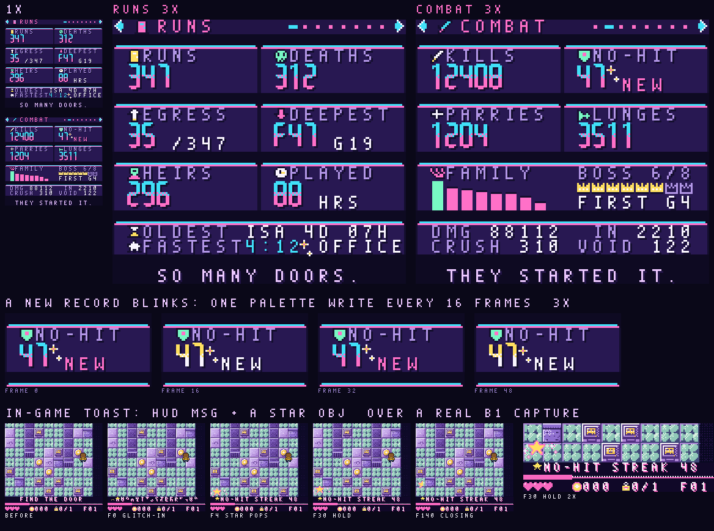

#### 9.8.1 What is tracked

Lifetime (all lines) for everything, and per line where a line can be compared with another (9.8.3).

| Page | Lifetime | Per line |
| --- | --- | --- |
| RUNS | runs, deaths, egresses (full clears), the deepest floor and its biome and generation, heirs played, lines founded, the longest-lived heir (and their name), total play time, the fastest biome clear, the fastest whole run | runs, egresses, deepest, generations, longest-lived heir |
| COMBAT | kills, kills by mob family (8), elites, each biome's boss (times beaten and the generation of the first kill), damage dealt and taken, perfect parries, dodge-cancel lunges, kills by crush, by the void and by a reaction, the longest no-hit streak | kills, bosses beaten (mask) |
| PUZZLES | rooms solved, THE ROOM FORGETS resets, glass broken, tiles collapsed, block pushes, living-obstacle rooms solved (outwitted), the fastest solve per trick type (14) | rooms solved |
| BENCH | recipes made, discovered/38, the favourite recipe, reactions by type (the 12 of 12b), the most-used element (tag) | recipes made |
| TREASURE | found / offered, hidden ones found, cursed items taken, tokens earned and spent, the best trade | treasure found, tokens earned |
| LINEAGE | the most common trait, the rarest mutation seen (and when), the most-bred dodge style, ancestors met as ghosts or bodies, the longest line; the matrix: each faction's best and worst standing, lore read, truths glimpsed (a count, never named) | founder, founded date, open/closed, ghosts met, mutations and glitch births, the line's own dominant trait and dodge |
| SKY | eclipse days played through, floors cleared under a retrograde, meteor wishes caught, birthdays celebrated, HALLEY (a first flag: you were there, and whether you kept the tail) | - |
| ODDITIES | deaths by your own CRT, deaths by your own hand, steps taken, dozes (the 30 s idle), times you let go of the floor, the most visited biome | - |

Per heir there is nothing new: the tree node already keeps kills and rooms cleared (9.6), and the epitaph its cause.

**The run is changing.** A run is now about 50 floors over 8 biomes (branch run50). The layout already allows it: the
floor is 6 bits (1..63), the biome 3, and bosses are counted per **biome slot** (8), whatever run50 settles as the
boss that closes each biome. The fastest biome clear runs from a biome's first floor entry to its last floor's exit.

#### 9.8.2 The record

**Sizes.**
- One copy: **384 bytes**, in two parts.
  - **Lifetime share: 256 bytes:** a 4-byte header, **246 bytes of lifetime fields**, a 4-byte spare and the
    2-byte CRC. The spare and the CRC sit at the end of the record, after the lineage slots.
  - **Lineage: 128 bytes:** 4 slots x **32 bytes**.
- Two copies (A/B): **768 bytes**, at `0xBC00`–`0xBEFF` (9.5).

**Encodings.**
- **Counters saturate.** They stick at their maximum and never wrap: u16 for most, u24 only for steps, times,
  lifespans, kills, damage dealt, tokens, tiles collapsed, pushes and recipes made.
- **Little-endian**, like the other records.
- **Bitfields for firsts and flags.**
- **The CRC** is CRC-16/CCITT-FALSE (the meta record's `egc_crc16`, with a 16-bit length) over bytes
  `0x000`–`0x17D`.
- **A/B.** The valid copy with the newer sequence wins (a serial compare, so 0 beats 255). A write goes to the older
  copy, with the sequence and CRC last, so a power cut mid-write keeps the other copy.

**Lifetime fields** (one copy; offsets from the record's start):

| Offset | Size | Field | Page | Meaning |
| --- | --- | --- | --- | --- |
| `0x000` | 2 | `magic` (raw x 2) | - | 'S','T' |
| `0x002` | 1 | `version` (u8) | - | 1 |
| `0x003` | 1 | `seq` (u8) | - | write sequence; the newer valid copy wins (serial compare) |
| `0x004` | 2 | `runs` (u16) | RUNS | runs started |
| `0x006` | 2 | `deaths` (u16) | RUNS | heirs lost |
| `0x008` | 2 | `egresses` (u16) | RUNS | full clears (the last floor's egress) |
| `0x00A` | 2 | `deep` (u16) | RUNS | deepest: floor bits 0-5 (1..63), biome bits 6-8, spare 9-15 |
| `0x00C` | 2 | `deep_gen` (u16) | RUNS | the generation (in its line) of that deepest run |
| `0x00E` | 2 | `heirs` (u16) | RUNS | generations played, all lines |
| `0x010` | 1 | `lines` (u8) | RUNS | lines founded |
| `0x011` | 3 | `long_life` (u24) | RUNS | longest-lived heir, minutes (birth stamp to death) |
| `0x014` | 1 | `long_name` (u8) | RUNS | that heir's name id |
| `0x015` | 2 | `long_line` (u16) | LINEAGE | most generations in one line |
| `0x017` | 3 | `play_s` (u24) | RUNS | total play time, seconds (194 days) |
| `0x01A` | 2 | `fast_biome` (u16) | RUNS | fastest biome clear, seconds (0 = none) |
| `0x01C` | 1 | `fast_biome_id` (u8) | RUNS | its biome (bits 0-2); bits 3-7 spare |
| `0x01D` | 3 | `fast_egress` (u24) | RUNS | fastest whole run to the egress, seconds (0 = none) |
| `0x020` | 3 | `kills` (u24) | COMBAT | all kills |
| `0x023` | 16 | `kills_fam` (u16 x 8) | COMBAT | kills by mob family (one per biome, 7.1) |
| `0x033` | 2 | `elites` (u16) | COMBAT | elites killed |
| `0x035` | 8 | `boss_n` (u8 x 8) | COMBAT | each biome's boss slot: times beaten |
| `0x03D` | 8 | `boss_gen` (u8 x 8) | COMBAT | generation of the first kill (0 never, 255 = 255+) |
| `0x045` | 3 | `dmg_out` (u24) | COMBAT | damage dealt |
| `0x048` | 2 | `dmg_in` (u16) | COMBAT | damage taken, half hearts |
| `0x04A` | 2 | `parries` (u16) | COMBAT | perfect parries |
| `0x04C` | 2 | `lunges` (u16) | COMBAT | dodge-cancel lunges (B then A) |
| `0x04E` | 2 | `k_crush` (u16) | COMBAT | kills by crushing |
| `0x050` | 2 | `k_void` (u16) | COMBAT | kills by the void (shoved or dropped) |
| `0x052` | 2 | `k_react` (u16) | COMBAT | kills by a reaction |
| `0x054` | 2 | `nohit` (u16) | COMBAT | longest no-hit streak, kills in a row |
| `0x056` | 2 | `solved` (u16) | PUZZLES | puzzle rooms solved |
| `0x058` | 2 | `forgets` (u16) | PUZZLES | THE ROOM FORGETS resets taken |
| `0x05A` | 2 | `glass` (u16) | PUZZLES | glass broken (floor glass and partitions) |
| `0x05C` | 3 | `collapsed` (u24) | PUZZLES | tiles collapsed under or behind you |
| `0x05F` | 3 | `pushed` (u24) | PUZZLES | block pushes |
| `0x062` | 2 | `outwit` (u16) | PUZZLES | rooms with a living obstacle solved (7.7) |
| `0x064` | 14 | `trick_best` (u8 x 14) | PUZZLES | fastest solve per trick type 1-14, seconds (0 never, 255 = 4:15+) |
| `0x072` | 3 | `mixes` (u24) | BENCH | recipes made |
| `0x075` | 5 | `known` (raw x 5) | BENCH | recipes ever discovered: 38-bit mask (bits 38-39 spare) |
| `0x07A` | 19 | `fav` (d4 x 38) | BENCH | favourite recipe: DECAY4, a nibble per recipe (halve all at 15) |
| `0x08D` | 24 | `reacts` (u16 x 12) | BENCH | reactions triggered, by the 12 cause reactions (12b) |
| `0x0A5` | 8 | `tags` (d8 x 8) | BENCH | element use by tag (HOT COLD WET SHINY ALIVE MAGIC GLITCH STONE) |
| `0x0AD` | 2 | `t_found` (u16) | TREASURE | patches found |
| `0x0AF` | 2 | `t_seen` (u16) | TREASURE | patches offered (the X of 'FOUND 2 OF X') |
| `0x0B1` | 2 | `t_hidden` (u16) | TREASURE | hidden patches found |
| `0x0B3` | 2 | `t_cursed` (u16) | TREASURE | cursed items taken |
| `0x0B5` | 3 | `tok_in` (u24) | TREASURE | tokens earned |
| `0x0B8` | 3 | `tok_out` (u24) | TREASURE | tokens spent |
| `0x0BB` | 1 | `trade_id` (u8) | TREASURE | best trade: the item id |
| `0x0BC` | 2 | `trade_gain` (u16) | TREASURE | best trade: ROM value minus the price paid, tokens |
| `0x0BE` | 10 | `traits` (d8 x 10) | LINEAGE | expressed traits of played heirs, DECAY8 (9.2 order) |
| `0x0C8` | 3 | `dodges` (d8 x 3) | LINEAGE | dodge styles of played heirs, DECAY8 (ROLL SLIDE BLINK) |
| `0x0CB` | 1 | `rare_mut` (u8) | LINEAGE | rarest mutation seen: bits 0-3 trait, 4-7 rarity rank (lower is rarer) |
| `0x0CC` | 2 | `rare_gen` (u16) | LINEAGE | the generation it appeared in |
| `0x0CE` | 2 | `ghosts` (u16) | LINEAGE | ancestors met as ghosts or bodies |
| `0x0D0` | 6 | `faction_pk` (raw x 6) | LINEAGE | per faction: high nibble best standing, low nibble worst (offset 8) |
| `0x0D6` | 2 | `lore` (u16) | LINEAGE | lore fragments read |
| `0x0D8` | 1 | `glimpses` (raw) | LINEAGE | truths glimpsed: 4 axes x 2 leanings (shown as a count, never named) |
| `0x0D9` | 1 | `eclipses` (u8) | SKY | eclipse days played through |
| `0x0DA` | 2 | `retros` (u16) | SKY | floors cleared under a retrograde |
| `0x0DC` | 2 | `wishes` (u16) | SKY | meteor wishes caught |
| `0x0DE` | 1 | `birthdays` (u8) | SKY | birthdays celebrated (solar returns played) |
| `0x0DF` | 2 | `crt_self` (u16) | ODDITIES | deaths by your own CRT |
| `0x0E1` | 2 | `self_deaths` (u16) | ODDITIES | deaths by your own hand (owner SELF) |
| `0x0E3` | 3 | `steps` (u24) | ODDITIES | steps taken (16 px cells entered) |
| `0x0E6` | 2 | `dozes` (u16) | ODDITIES | times the heir dozed off (30 s idle) |
| `0x0E8` | 2 | `falls` (u16) | ODDITIES | times you let go of the floor |
| `0x0EA` | 8 | `visits` (d8 x 8) | ODDITIES | floors entered per biome, DECAY8 |
| `0x0F2` | 4 | `firsts` (raw x 4) | - | 32 first-time flags (FIRSTS below) |
| `0x0F6` | 4 | `unseen` (raw x 4) | - | 32 NEW-record bits: set at commit, cleared when that page is viewed (they blink) |
| `0x0FA` | 128 | lineage slots 0-3 (4 x 32) | LINEAGE | below |
| `0x17A` | 4 | spare (zero) | - | |
| `0x17E` | 2 | CRC-16/CCITT-FALSE, LE | - | over bytes 0x000-0x17D |

**Firsts** (`firsts`, 32 bits, 24 used, in order): egress, elite, perfect parry, boss (any), all 8 bosses, egress
with no hits taken, 38 of 38 recipes, solar eclipse, lunar eclipse, meteor wish, birthday, HALLEY (you were there),
HALLEY'S TAIL kept, glitch birth, mutation, SKYBORN heir, a line of 10, a line of 30, every biome entered, a cursed
item, a ghost met, own CRT death, a doze, 100 floors cleared. Firsts are the cheap fun facts: they cost a bit each,
and the pages show them as lit icons.

**NEW bits** (`unseen`, 32 bits, 24 used): deepest, fastest biome, fastest egress, longest life, longest line, no-hit
streak, best trade, rarest mutation, new recipe, boss first kill, and one per trick type (14). The commit sets a bit
when it beats a record. Viewing the page that shows that record clears it. While any bit is set, the title menu's
STATS item and the pause menu's carry a small star.

**Lineage slot** (32 bytes, 4 slots after the lifetime fields):

| Offset | Size | Field | Meaning |
| --- | --- | --- | --- |
| 0 | 1 | `line_no` (u8) | line number (1, 2, 3...) |
| 1 | 1 | `founder` (u8) | founder's name id |
| 2 | 2 | `founded` (u16) | founded: days since 2000-01-01 (the kept clock) |
| 4 | 1 | `state` (u8) | bit 0 used, bit 1 closed (NO ONE CAME AFTER), bits 2-5 the line's kind |
| 5 | 2 | `gens` (u16) | generations |
| 7 | 2 | `runs` (u16) | runs |
| 9 | 1 | `egresses` (u8) | full clears |
| 10 | 2 | `deep` (u16) | deepest floor and biome (the lifetime 'deep' packing) |
| 12 | 3 | `kills` (u24) | kills |
| 15 | 1 | `bosses` (raw) | biome boss slots beaten (8-bit mask) |
| 16 | 2 | `solved` (u16) | puzzle rooms solved |
| 18 | 2 | `mixes` (u16) | recipes made |
| 20 | 2 | `t_found` (u16) | treasure found |
| 22 | 3 | `tok_in` (u24) | tokens earned |
| 25 | 3 | `long_life` (u24) | longest-lived heir, minutes |
| 28 | 1 | `long_name` (u8) | that heir's name id |
| 29 | 1 | `ghosts` (u8) | ancestors met as ghosts or bodies |
| 30 | 1 | `muts` (raw) | mutations (low nibble) and glitch births (high nibble), saturating at 15 |
| 31 | 1 | `dominant` (raw) | most common trait (bits 0-3, 0 none) and dodge style (bits 4-5); recounted from the tree ring at each pick |

**Lineage slots.**
- **Which lines are kept.** The live line always has a slot. When a line ends ("NO ONE CAME AFTER", 12b.7) its
  slot is marked closed and kept. A fifth line reuses the oldest closed slot. Its numbers stay in the lifetime
  fields, so nothing is lost from the totals, only that line's own column.
- **The dominant trait and dodge** are recounted from the tree ring (24 nodes, plus the founders' trait mask) at each
  heir pick, which is already in SRAM, and frozen when the line closes. They cost no counters.

#### 9.8.3 Favourites and "most" values

The schemes are chosen by the size of the alphabet. `stats_save.py` checks each one against exact counts on
simulated play (Zipf tastes, 30 to 30,000 events; "clear" means the top item leads the next by 10% or more):

| Value | Scheme | Bytes | Check |
| --- | --- | --- | --- |
| most-used element (8 tags), most visited biome (8), most common trait (10), most-bred dodge (3) | **DECAY8:** one u8 counter per kind. When the bumped counter would pass 255, every counter is halved first, then it is bumped. The favourite is the argmax (ties go to the lower id) | 1 per kind | 292/292 clear favourites right |
| favourite recipe (38) | **DECAY4:** the same rule with one nibble per recipe (halve all at 15) | 19 | 285/289; it follows a change of taste (400 x A, then 60 x B gives B) |
| (rejected) favourite recipe | Space-Saving top-k: (id, n) slots, a miss replaces the smallest | 12 (k=4), 18 (k=6) | 208/289 and 271/289: it loses the favourite when tastes are flat |
| deepest, fastest, longest, best trade, rarest mutation | **running best:** one value (plus its id); replaced when beaten | as listed | exact |
| reactions by type (12), kills by family (8), bosses (8) | exact saturating counters: the alphabet is small enough | 24, 16, 16 | exact |

DECAY counts lean toward recent play, which suits a favourite: the screen shows what you reach for now, not what you
did in your first ten hours. The exact totals (MIXES, the reaction counts) are kept separately, so no shown number
depends on a decayed counter.

#### 9.8.4 Counting without per-frame cost

**During a stage** every counter is a WRAM byte or word, bumped at the event that already happens: a kill, a parry
resolved, a cell entered (the fragile-tile code already sees it), a reaction resolved, a mix, a pickup, the idle
animation's doze. That is a load, an add and a store, a few M-cycles per event, and nothing runs per frame.
- **Timers** read the kept clock's VBlank count (9.7.1) at the start and at the end, so a room or stage time is one
  subtraction, never a per-frame increment.
- **Saturation.** Stage deltas are u8 where a stage can't reach 255 (kills, mixes, glass) and u16 where it can (damage,
  steps, collapsed tiles). They saturate too.
- **The mix log** holds 8 recipe ids a stage. A ninth mix still counts in MIXES; only its DECAY4 bump is skipped.

**Stage accumulator in WRAM** (resident during play):

| WRAM | Bytes | Note |
| --- | --- | --- |
| `d_kills` | 1 | kills this stage |
| `d_fam` | 8 | kills by family |
| `d_elites` | 1 |  |
| `d_boss` | 1 | biome boss slot beaten (bit 7) + id |
| `d_dmg_out` | 2 |  |
| `d_dmg_in` | 1 | half hearts |
| `d_parries` | 1 |  |
| `d_lunges` | 1 |  |
| `d_kcause` | 3 | crush, void, reaction kills |
| `nohit_cur` | 2 | the live streak (run-long; reset on a hit) |
| `d_solved` | 1 |  |
| `d_forgets` | 1 |  |
| `d_glass` | 1 |  |
| `d_collapsed` | 2 |  |
| `d_pushed` | 1 |  |
| `d_outwit` | 1 |  |
| `room_t0` | 2 | the room's entry frame stamp (from the kept clock) |
| `d_mixes` | 1 |  |
| `mix_log` | 8 | recipe ids made this stage, bumped into DECAY4 at commit (a 9th mix still counts in MIXES) |
| `d_reacts` | 12 | per reaction |
| `d_tags` | 8 | per tag |
| `d_treasure` | 4 | found, seen, hidden, cursed |
| `d_tokens` | 4 | earned u16, spent u16 |
| `d_trade` | 3 | best trade this stage |
| `d_ghosts` | 1 |  |
| `d_steps` | 2 |  |
| `d_dozes` | 1 |  |
| `d_sky` | 1 | eclipse, retrograde, wish, birthday bits this stage |
| `stage_t0` | 3 | stage entry frame stamp |
| `bests` | 25 | bests cache, loaded at run start, updated live, written back at commit: deep floor 1, no-hit 2, trick bests 14, fastest biome 2, known-recipe mask 5, toast-fired flags 1 |
| `toast` | 6 | queue of 4 record ids + timer + state |

- **Resident WRAM: 109 bytes.** That's the stage accumulator (78), the bests cache (25) and the toast queue (6).
- **The bests cache** holds the records that can fire a toast mid-stage. It is loaded from the record at run start,
  updated live, and written back by the commit. So the screen and the toasts never touch SRAM during play.

**The commit**, at stage end (behind the room's collapse into the next stage) and at death (at the start of the death
card, 12b):
1. Enable SRAM. Copy the valid copy over the older one.
2. Merge in the stage deltas, all saturating:
   - the lifetime fields and the live line's slot;
   - the DECAY bumps;
   - the bests cache's running bests;
   - the firsts and NEW bits;
   - milestones (below).
3. Write the new sequence, then the CRC. Disable SRAM.
4. Clear the deltas. The run-long no-hit streak is kept.

**Commit cost.** About 100k M-cycles, almost all of it the bitwise CRC over 382 bytes (about 240 M-cycles a byte).
That is roughly 3 frames at double speed, hidden in the transition. Boot verifies both copies, about 6 frames, under
the KEEL boot. These are estimates, not yet measured on the cartridge. A 512-byte CRC table would cut them by about 4x
if the boot ever needs the time.

**Pausing mid-stage.** STATS opened from the pause menu draws the committed record plus the live deltas, so the
numbers include the stage you are in.

#### 9.8.5 The screen

`mock_stats.png`: RUNS and COMBAT at 1x and 3x, a NEW record blinking, and the in-game toast over a real B1 capture.

**Where it opens.**
- **The title menu:** STATS sits under TREE (9.6).
- **The pause menu:** resume, book, tree, **stats**, setup, leave (12).
- B or START closes it and returns to wherever it was opened from.

**Paging.** Left/Right flips through 8 pages and wraps: RUNS, COMBAT, PUZZLES, BENCH, TREASURE, LINEAGE, SKY,
ODDITIES. A flip is a 3-frame VHS tear: SCX per line, the rewind look of the retrograde scene (19). Behind it, the
new page's map and attributes are copied from a WRAM shadow, one VBlank each.

**Layout** (20 x 18 tiles):

| Rows | Content |
| --- | --- |
| 0 | header: page icon, page name, 8 page pips (the current one a cyan dash). The ◄ ► arrows are OBJ and bob 1 px every 16 frames: they are the paging cue |
| 1, 5, 9, 13 | card rims on the void: cyan over pink, 2 px, corners cut (the EGRESS panel edge). Flat cards, no fake lighting |
| 2–4, 6–8, 10–12 | three rows of cards: two 10-tile stat cards, or one 20-tile card for bars and icon rows |
| 14–15 | the record strip: two lines of small text (`OLDEST ISA 4D 07H`, `FASTEST 4:12 OFFICE`) |
| 16 | void |
| 17 | the page's flavour line, centred, 18 glyphs at most (12) |

**Stat cards.** Each card has an 8x8 icon and a label in lilac. Under them is the **big number**, in a VCR clock face:
7-segment digits, 8x16 (two tiles each), cyan over pink with a 3-row dithered band and an ink shadow. After the
number goes a small sub-value (`/347`, `G19`, `HRS`) or the NEW tag.

**The pages:**

| Page | Cards (big numbers) | Wide card | Strip | Flavour |
| --- | --- | --- | --- | --- |
| RUNS (mocked) | RUNS, DEATHS, EGRESS /runs, DEEPEST F47 G19, HEIRS, PLAYED HRS | - | oldest heir; fastest biome | SO MANY DOORS. |
| COMBAT (mocked) | KILLS, NO-HIT, PARRIES, LUNGES | kills by family (8 bars, the top one mint); bosses (8 crowns, lit when beaten) and FIRST G4 | damage out and in; crush and void kills | THEY STARTED IT. |
| PUZZLES | SOLVED, FORGETS, GLASS, PUSHED | the 14 trick glyphs in two rows, lit once solved, NEW ones blinking | the fastest trick best; outwitted and tiles collapsed | THE ROOM REMEMBERS. |
| BENCH | MADE, FOUND 31/38 | the 12 reactions as bars; the favourite recipe's icon and name; the element as a tag chip | the top reaction and its count | STEAM, AGAIN? |
| TREASURE | FOUND /offered, HIDDEN, TOKENS IN, OUT | cursed taken; the best trade (icon and gain) | find rate; hidden share | FINDERS, KEEPERS. |
| LINEAGE | LINES, LONGEST LINE, GHOSTS | the common trait and dodge as chips; 6 faction pips (best and worst ticks); TRUTHS 3 GLIMPSED | the rarest mutation and its generation | SAME HANDS? |
| SKY | ECLIPSES, RETROGRADES, WISHES, BIRTHDAYS | HALLEY: a lit comet if you were there, otherwise a dim 2061 | sky firsts as icons | THE SKY WATCHED. |
| ODDITIES | STEPS (7 digits fit), DOZES, OWN CRT, LET GO | the most visited biome; own-hand deaths | the remaining firsts as icons | YOU WERE HERE. |

- **LINEAGE's line slots.** On the LINEAGE page, Up/Down steps through ALL LINES (the lifetime numbers), THIS LINE
  and the kept closed lines. Only the card values change.
- **A NEW record blinks.** Its digits, its NEW tag and any small NEW value use BG palette 6. Palette 6 toggles every
  16 frames between the digit colours and yellow/white: one 8-byte palette write blinks every NEW thing on the page
  at once. One sparkle OBJ sits on each NEW number. Viewing a page clears its NEW bits; the screen writes them back
  on close with the commit path (one A/B write).

#### 9.8.6 The in-game toast

The record toast is the HUD's own toast (`hud_msg` in `src/hud.c`): the window rises 8 px for one text row, for
about 150 frames.
- **The text** is 18 glyphs at most: `NO-HIT STREAK 48`, `DEEPEST EVER F48`, `KETTLE BEST 0:09`. It is led by a star
  glyph, one extra HUD tile in the accent colour.
- **The row glitches in:** 2 frames of per-line SCX tear.
- **A 16x16 star** (2 x 8x16 OBJ in the particle palette, 5.5) pops above the row with 2 sparkles from the particle
  pool. It settles, then blinks out a half at a time.
- **The sound** is a two-note chime in the music's key (14).

**What fires one:**
- **Live records,** compared at the event against the bests cache:
  - deeper than ever (on floor entry);
  - the no-hit streak passing its best (once a run);
  - a trick best (on solve);
  - the fastest biome (on clear);
  - a boss slot's first kill;
  - a recipe never made before.
- **Milestones,** found at the commit: a counter crossing 100, 1,000, 10,000 and so on (runs, kills, steps, recipes
  made, rooms solved). These wait for the next safe moment.

**Rules.**
- A record toast never pre-empts a gameplay message; it waits while one shows.
- None plays during a boss's phase change or the death sequence.
- The queue holds 4. When it overflows, the oldest is dropped, and the page still blinks the record.

#### 9.8.7 GBC budget (checked by `stats_mock.py`)

| Item | Budget | Measured in the mock |
| --- | --- | --- |
| BG palettes | 8: VOID, FRAME, LABEL, DIGIT, ICON-A, ICON-B, NEW (blinks), HEAD | 0 tile violations on all 4 frames (both pages, both blink states) |
| OBJ palettes | 2: arrows (white, cyan, pink) and sparkles (white, yellow, pink); the toast uses the play's particle palette | 0 violations; at most 2 sprites a line (3 on screen, at most 6 with 4 NEW records) |
| BG tiles | **224 reserved** (3,584 B), loaded once by HDMA behind the opening fade: the small font in two inks (≤ 96), the big font (23), icons (≤ 64: 8 page icons plus about 7 a page), rims, pips, bars and crowns (≤ 32) | RUNS 83, COMBAT 90, both pages together 117 unique tiles |
| Big-number font | 13 glyphs (0–9, F, :, .), 2 tiles each = 23 unique tiles, 368 B of ROM | 23 |
| VRAM per page flip | map + attributes for 18 rows: 2 x 576 B by GDMA, one VBlank each | - |
| WRAM, screen only | a 720 B shadow map and attributes plus a 384 B record copy = **1,104 B**, from the screen scratch the tree screen also uses (not resident in play) | - |
| WRAM, in play | **109 B** (9.8.4) | - |
| The toast | 1 extra HUD tile (the star glyph), 4 OBJ tiles (the 16x16 star), the particle palette, no new BG palette | the toast row fits the HUD palette |

#### 9.8.8 Settled (owner, 2026-10-15: the recommended defaults)

1. **Fastest biome clear: one record**, not eight. The lifetime share keeps its 4 spare bytes.
2. **Favourites show the name only.** DECAY values aren't counts, so no number is shown.
3. **Four line slots**, each a full 32-byte summary. When a fifth line starts, it reuses the oldest closed line's slot.
4. **Play time counts unpaused play only.** Menus and pause don't count.

---

## 10. Story: a small calamity

Something happened in the building. The floors come apart and reassemble wrong. You don't know what you did. The tone
is backrooms meets dreamscape: fluorescent hum, pastel sky, office carpet in the void.

**The truth matrix** (the CHAT matrix) has four signed axes. Each is a byte that leans, never a fixed fact:

| Axis | Negative end | Positive end |
| --- | --- | --- |
| CAUSE | it was the building (structural, natural) | it was made (someone combined something) |
| CULPRIT | a faction | you |
| REVERSIBLE | it can be undone | it can't, only survived |
| SELF | heirs are different people | it's the same person every time |

**What moves it:**
- **what you make:** recipes made push CAUSE toward "made", for example;
- **what you say:** talk choices push CULPRIT;
- **what you do:** collapsing things on purpose, saving the escorted talker, stealing;
- **how you die:** lineage deaths feed SELF.

The seed sets the starting lean, so every run differs from the first line, and play moves it from there.

**Delivery:**
- Short fragments only, never exposition:
  - whispers drifting in the void;
  - two- or three-line talks;
  - the book's margins;
  - boss lines.
- Each **faction** (COMPILE, CHARGE, SKY, WATCH, ROOT, LOCK; faces from the shared generator's PROGRAM, DAEMON, GHOST, AI,
  OPERATOR and RELIC styles) has its own partial, unreliable version, slanted by its standing with you.
- **Endings are questions.** The final room reads the four axes and asks one: "WAS IT ALWAYS THIS SHAPE", "WHO
  OPENED IT FIRST", "DO YOU REMEMBER THE STAIRS". Never cheesy, never a reveal.

**Three linked matrices:**
- **CHAT** (truth axes and faction standing):
  - standing shifts the **WORLD** deck (a friendly WATCH means fewer turrets and more dark rooms with lanterns;
    an angry ROOT means more ALIVE mobs);
  - the CAUSE lean tilts biome mood (palette warmth, music mood weights).
- **FUNCTION** (pieces and reactions):
  - the recipes you make feed CHAT;
  - the elements common in a biome come from **WORLD**.
- **WORLD** (biome x stage type x modifiers):
  - the stages you clear or flee feed CHAT (fleeing collapses leans toward REVERSIBLE = no);
  - mods found are seeded by **FUNCTION** rarity.

---

## 11. Characters and animation

- **Talk portraits:** the shared procedural face generator (CRUCIBLE's code, ported, not redrawn; `src/avatar/`,
  done and verified to produce the same faces). It covers blinking, the mouth moving while text types (`avatar_say`,
  `avatar_tick`), and glitch.
- **The player** is built from the same genome:
  - the skin and ink colours and the hair style (bald, short, long, bun, spikes) of the heir's face drive a 16x18
    chibi sprite;
  - the DREAM/BOY/GIRL look picks the silhouette;
  - clothes take the faction colour.
- **Mobs and bosses** use the avatar styles (robot, AI eye, sheet ghost, flame, cloud, pixel invader...) on bodies
  from the mob axes; mobs get their own generator (section 7.6).

**Animation is data:** `state → {frames[], ticks[], loop, events}`, with the events firing triggers (the hit frame,
the i-frame window, the footstep SFX). States:

| Owner | States |
| --- | --- |
| Player | idle (breathe, blink), walk x8 directions, push, dig, combo hits 1–3, charge glow (3 levels), charged release, spin, dodge (roll / blink / slide per heir), sprint-slide, dash-cancel strike, parry, perfect parry, hurt, death, pickup, door exit, fall into void |
| Mobs | idle, move, tell, attack, recover, hurt flash, death; boss: per phase, plus a phase transition |
| Items | tokens spin and glint; keycards bob; CRTs flicker → wobble → shatter; foam crumbles; drywall cracks → breaks; doors locked → hum → open; the shop idles; talker faces blink and mouths move while text types |
| Tiles | palette-animated ambient: water, LEDs, neon, fluorescent buzz, void twinkle |

`anim.png` shows the player plan: 5 drawn directions plus 3 mirrored, walk, idle, combo, charge glow levels, roll,
blink, hurt and death. The final frames are drawn per state and baked by the art tool.

**Heir sprite style, round D (open; no style picked yet):** A, B, C and AB were rejected. A (16x20) was closest, so
D1, D2 and D3 are refinements of A: same size and read in the room, plus hard cel bands lit from the top left, more
ordered dither and C's outfit detail. D1 has the hardest bands, D2 the most dither and D3 is two rows taller (16x22).
All stay at 4 sprites, 4 per line, in 2 palettes of 3 colours. In D the BODY palette is hair/ink, skin and a
hue-shifted skin *shadow* (`skin_shadow` in `tools/mock/sprite_styles.py`), replacing the portrait's skin light, so
deep-skin shadows are warm red-brown rather than ink dithered into the face. Shots: `docs/shots/sprite_styles_D.png`,
`sprite_styles_D_room.png` and `sprite_styles_D_anim.gif`.

---

## 12. Text and screens (folded in from the M2 notes)

**Text** uses EGRESS's own font (M2's, with its drop shadow) and 20-column rules:
- names ≤ 9 characters;
- HUD messages ≤ 18;
- talk lines ≤ 18 with a 1-row margin;
- descriptions never on the same row as names (the M2 trade overlap);
- one blank row between a portrait and its text (the M2 landing squeeze).

Every text screen gets a layout test in the harness, which renders every string in its box and fails on overflow.

**Screens:**
- title (section 15);
- heir pick;
- tree (the lineage);
- bench;
- book (the recipes you know, with margins for fragments);
- stats (9.8): eight pages of lifetime and per-line records, from the title menu and the pause menu;
- landing (talker plus trader);
- pause (resume, book, tree, stats, setup, leave);
- setup (4/8-way, music and SFX volume, palette assist);
- ending (the question).

**Mid-run continue:** the run is saved at every floor start and every landing (the continue record, 3.6.10), and
continuing resumes at that floor's assembly or that landing. With a ~3-hour full run, this is what makes a run
playable in sittings. Pulling the power never heals: HP is rewritten on every hit.

---

## 12b. Death sequence

The M2 death screen was plain text on black (`docs/shots/12_death.png`). The redesign makes death a short sequence
that ties into the collapsing world and the lineage: the room lets go of the heir, a memorial badge says who they
were and how it happened, a panel shows what the line keeps, and the tree takes the new ancestor.

**Mocks** (1x and 4x side by side; `tools/mock/death_mock.py`, which legalises every frame, see "GBC budget"):

| File | Shows |
| --- | --- |
| `docs/shots/death_sequence.gif` | the full sequence, 9.4 s, with the beat name and time beside the 1x frame |
| `docs/shots/death_collapse.png` | LET GO: the drained room coming apart outside-in into the pastel void |
| `docs/shots/death_card.png` | the epitaph card (memorial / office ID badge) |
| `docs/shots/death_variants.png` | the fall by dodge style, first death, no heirs left, a boss kill, a faction note, the ghost later |

### 12b.1 Beats

Unskipped it runs **9.4 s** (566 ticks at 60 Hz). The table is printed from the mock's timeline.

| Time | Ticks | Beat | What happens |
| --- | --- | --- | --- |
| 0.00–0.17 s | 0–10 | HITSTOP | The killing hit freezes. White flash on the heir, 2 px shake (SCX/SCY). |
| 0.17–0.83 s | 10–50 | FALL | The death animation by dodge style. The palette drains to cool greys in 4 steps, 8 ticks apart. The heir drains only halfway: it is the last thing with colour. Music cuts on the next beat into a low drone. |
| 0.83–1.00 s | 50–60 | STILL | Nothing moves. The drone settles. |
| 1.00–2.02 s | 60–121 | LET GO | The room collapses outside-in, ordered by distance from the body. Each cell cracks (3 ticks), then splits into two 8x16 halves that fall and dissolve into the void (8 ticks). The void's palette steps from drained indigo to pastel. The HUD lets go at 1.67 s. Glitch tears. |
| 2.02–2.67 s | 121–160 | LIGHT | Dithered light falls from the top onto the last tile. The heir brightens 2 palette steps, and motes drift down. |
| 2.67–2.87 s | 160–172 | CARD IN | The memorial badge slides up (window layer). |
| 2.87–5.50 s | 172–330 | CARD | Name, kit and floor appear, then the IN/OUT clock. The cause types at 1 character per tick, the epitaph fades in over 2 palette steps, and the stats count up. |
| 5.50–5.70 s | 330–342 | SWAP | The card slides out left as the carry panel comes in from the right. |
| 5.70–7.70 s | 342–462 | CARRIES | Kept and lost rows land 18 ticks apart, then the trait teaser. |
| 7.70–7.90 s | 462–474 | OUT | The panel drops away. Back to the lit tile. |
| 7.90–8.40 s | 474–504 | DROP | The body tile cracks and drops into the void with the heir. |
| 8.40–9.43 s | 504–566 | THE LINE | The tree slides in from the right. The new ancestor drops into the row, faded, eyes shut, with a glitch. The 3 kids slide up. The heir pick takes over. |

**Skipping:**
- The first death ever plays in full.
- After that, **hold B** for 30 ticks to skip. A ring fills around a small B in the corner, and the sequence jumps
  to THE LINE (kept, 1 s, so the new ancestor is always seen added).
- **A** advances the card and carry beats early.
- Skipping writes the same records: the ring node, the epitaph id, the matrix nudge.

### 12b.2 The fall: by dodge style, accented by traits

The heir's death animation is chosen by its dodge gene. `DEATH_ANIM` in the mock lists the frames. They are poses
of the heir rig (`proto/anim/heirs.py`), so every generated heir gets all three.

| Dodge | Fall |
| --- | --- |
| ROLL | white flash, a stagger, a two-frame tumble (the roll ball), then flat on the back |
| SLIDE | flash, a skid with dust (6 px), then slumps sitting, head down, eyes shut |
| BLINK | flash, flickers out in two glitch frames, re-forms 2 px off and kneels, with a 1-px glitch |

**Trait accents** (one extra event, no new frames):
- HEAVY: a 2 px thud shake and a dust ring.
- SMALL: a 3 px bounce.
- DAMP: a puddle cell under the body.
- GLITCHED: one torn frame.
- ECHO: a faint afterimage stands for 20 ticks and rises.
- LOUD: the drone starts a beat early.

### 12b.3 The world lets go

The order is designed. Cells are sorted by distance from the body, with seeded jitter, so the room comes apart from
the edges inward. The wall row and the door go early, and the 8 neighbours go last. That leaves the heir on **one
floating tile** in the pastel void.

The void becomes pastel by palette writes alone (BG palette 2, 4 steps). It is the same void tiles as during play,
so the place you die in is the place you always walked over, just lit differently.

The light is a column of dithered BG tiles in its own palette over the void. It reaches the tile in 18 ticks. Light
only comes from something in the world (section 1): the gap above the last tile.

### 12b.4 The epitaph card

The card is a memorial and an office ID badge at once: a lanyard slot, a header band, a photo, a barcode and a
time-clock stamp. The look is synthwave: a cyan rim and pink and cyan type on indigo.

| Part | Content | Source |
| --- | --- | --- |
| Header | MEMORIAL, GEN nn | lineage header |
| Photo | the face generator's own face with the **eyes shut** (its blink frame), wearing the heir's accessory as the tree bust does (CORA's beanie), printed in 3 memorial tones; a glitch row tears through it every few ticks | genome; `avatar_dump genome HEX talk` now prints the blink frame too |
| Name | ≤ 9 characters, pink | name id |
| Kit | dodge + first expressed trait (SLIDE HEAVY) | genome |
| Place | F3 OFFICE | death floor + biome |
| Barcode | the face genome as bars (decor, but true) | genome |
| IN | birth date and time = the real moment the parent died | the birth stamp (birth-data design) |
| OUT | now (= the next heirs' IN) | the clock |
| Cause | 2 lines, ≤ 18 each, generated (below) from the event: the killer, the reaction, a twist | the node's 3 cause bytes (offsets 17–19) |
| Epitaph | 1 line, ≤ 18, in quotes, lilac: the meaning from the truth matrix, the flavour from traits and best feat (below) | the node's epitaph id (offset 20), chosen from the lean at death (27–28), the expressed traits and the best feat (47) |
| Stats | tokens, treasure X/5, kills, recipes made (count up, icons are sprites) | run stats |

**Cause-of-death grammar.** It is filled at the killing blow from what actually happened:
- `how`: the damage or reaction that landed;
- `killer`: the mob's generated name, the object, the boss, the hazard or the reaction;
- `owner`: who set the killer in motion (SELF, MOB, BOSS or ROOM), plus *how* (pushed, made, poured, planted,
  reflected, threw, dug, lit);
- context flags: mid-dodge, carrying, last heart, one hit short, seconds on the floor, boss phase.

```
CAUSE  := VERB "BY" KILLER [TWIST]          broken onto 2 lines of <= 18 at the most balanced word boundary
VERB   := the reaction's participle         CRUSHED COOKED STEAMED FROZEN SHORTED OUT OVERGROWN UNRENDERED
                                            SHATTERED DROWNED STUCK ERASED MELTED
        | the biome's verb for a plain hit  FILED AWAY (office) VENTED DUNKED DEFRAGGED RUNG UP COMPOSTED
                                            BLOWN OFF DELETED (glitch core)
KILLER := POSS "OWN" NOUN                   when the owner is SELF and the killer is a reaction or projectile
        | "A"/"AN" NOUN | BOSS NAME
TWIST  := PRON OWN_VERB REFLEX | PRON OWN_VERB      when the owner is SELF ("A CRT SHE PUSHED HERSELF")
        | ", " CONTEXT                              MID-ROLL, MUG IN HAND, LAST HEART, PHASE 3, 4S IN, ONE HIT SHORT
special: falling into the void = "LET GO OF / THE FLOOR ON Fn"
```

Candidates are tried from most to least specific, and the first that fits on 2 lines wins. If nothing fits, the twist
is dropped. Pronouns follow the look gene: SHE/HER/HERSELF, HE/HIS/HIMSELF, or THEY/THEIR/THEMSELF.

**The record: 3 bytes** at the killing blow, stored in the tree node at offsets 17–19 (9.6). The card, the tree's
node detail, a ghost's tag and a talker all rebuild the lines from these bytes plus what the node already holds (the
look gene for pronouns, the biome for a plain hit's verb, the floor for the void, the dodge for MID-dodge). Nothing is
stored as text, so they always agree.

| Byte | Bits | Field |
| --- | --- | --- |
| VERB (17) | 0–3 | how: the plain hit (takes the biome's verb), the 12 reactions (CRUSH ... LAVA), the void; 2 spare |
| | 4–5 | owner: SELF, MOB, BOSS, ROOM |
| | 6–7 | killer class: mob, object, reaction/projectile, boss |
| KILLER (18) | 0–7 | a mob's generated name (bits 0–3 its noun, bits 4–7 its adjective, 0 = none), else the object, reaction or boss id |
| TWIST (19) | 0–2 | the context clause: none, ONE HIT SHORT, MID-dodge, item IN HAND, Ns IN, PHASE n, LAST HEART; 1 spare |
| | 3–7 | its value: the item id, the seconds, the boss phase |

A SELF death's relative clause ("A CRT SHE PUSHED HERSELF") costs no bits: owner SELF plus an object implies it, and
the verb is that object's own in the ROM table (a CRT is PUSHED, a puddle POURED, a sprout PLANTED). Every record
round-trips through `pack_cause`/`unpack_cause` (`tools/mock/death_text.py`, checked over 65,536 records).

Generated by the mock (`death_mock.py --grammar`):

| Death record | Bytes | Card |
| --- | --- | --- |
| CRT, pushed by self | `41 00 00` | CRUSHED BY A CRT / SHE PUSHED HERSELF |
| her steam, frozen | `84 00 00` | FROZEN BY / HER OWN STEAM |
| puddle he poured, shocked | `45 01 00` | SHORTED OUT BY A / PUDDLE HE POURED |
| a mob, mid-roll, vents | `10 10 02` | VENTED BY A DAMP / INTERN, MID-ROLL |
| his own fire orb, reflected back | `82 01 00` | COOKED BY / HIS OWN ORB |
| a sprout she planted | `46 02 00` | OVERGROWN BY A / SPROUT SHE PLANTED |
| boss beam, phase 3 | `eb 00 1d` | ERASED BY OLD / MONITOR, PHASE 3 |
| a leak, carrying | `79 03 03` | DROWNED BY A / LEAK, MUG IN HAND |
| a mob 4 s into the floor, mall | `10 21 24` | RUNG UP BY A RIME / TOASTER, 4S IN |
| fell into the void | `7d 00 00` | LET GO OF / THE FLOOR ON F2 |

**Epitaph: both sources.** The cause line says what happened (the event data, above). The quoted epitaph says what it
meant, and it never repeats the cause:
- **Meaning, from the truth matrix.** The axis that leans hardest at death, and its sign, pick a pool of 3–4 lines.
  The seed picks the line. The lines are short and odd, never a reveal or a pun.
- **Flavour, from traits and best feat.** Some lines have a keepsake slot ({K}, with its own default noun). The heir's
  best feat fills it if they had one (first boss CROWN, elite MEDAL, rarest recipe FLASK, treasure KEY, escort GLOVE),
  else an expressed trait does (HEAVY BOOT, SMALL VENT, ECHO HALL, GLITCHED PIXEL, INSOMNIAC LAMP, REMEMBERS NOTE,
  DAMP COAT, LOUD BELL, COLOURBLIND SIGN, ALLERGIC MASK). When there is a keepsake, slotted lines count twice in the
  draw. Averaged over the 8 pools, a heir with a keepsake gets a flavoured line about a third of the time: 6 in 7 on a
  SELF + lean, 1 in 2 on pools with one slotted line, never on the three pools without one.

| Lean | Lines ({K} = keepsake slot, default noun shown) |
| --- | --- |
| SELF + (the same person) | THE {CHAIR} WAS WARM · SAME {DESK}, AGAIN · THE {BADGE} FIT · SHE KNEW THE WAY |
| SELF − | A STRANGER'S {SHOES} · NOBODY KNEW HER · THE NAME WAS NEW |
| CAUSE + (made) | SOMEONE MIXED THIS · IT WAS PUT HERE · THE {BENCH} WAS WARM |
| CAUSE − (the building) | THE FLOOR GAVE UP · ALWAYS LOOSE · THE BUILDING SAGS |
| CULPRIT + (you) | SHE HAD THE {KEY} · HER HANDS, AGAIN · SHE OPENED IT |
| CULPRIT − (a faction) | THEY WROTE IT DOWN · SOMEONE WATCHED · THE DOOR WAS DRAWN |
| REVERSIBLE + | NOT YET. NOT HERE · IT CAN BE PUT BACK · THE STAIRS WAIT |
| REVERSIBLE − | SOME DOORS STAY · THE {STAIRS} WENT · NOTHING CAME BACK |

Examples with the same seed and a SELF + lean: CORA (HEAVY and SMALL, no feat) gets "THE BOOT WAS WARM", which is on
`death_card.png`; a boss-killer gets "THE CROWN WAS WARM"; with no feat and no traits it stays "THE CHAIR WAS WARM". The pronouns in a line are
rewritten for the heir (THEY KNEW HER NAME became THEY WROTE IT DOWN, because "THEY KNEW THEIR NAME" runs to 20
characters and reads as the faction's own name). Every filled line, for every pronoun and keepsake, is checked
to fit 18.

The choice is stored as the node's **epitaph id** (offset 20: pool, line, keepsake source), so the tree, a ghost and a
talker quote the same line later; the keepsake noun is re-read from the node's own feat and genome.

### 12b.5 What carries on

One row lands every 18 ticks. Each row has an icon, a label and a verdict chip (KEEP in cyan, LOST in pink), and its
own small animation. The rules are section 9.5's:

| Row | Animation | Verdict |
| --- | --- | --- |
| weapon mods unlocked (EMBER MOD) | icon settles | KEEP |
| recipes known (4 icons) | the forgotten one (1 in 4, seeded; REMEMBERS protects one) Bayer-dissolves | 3/4 |
| faction trace (WATCH, 6 pips) | the pips halve, 6 → 3 | HALF |
| tokens | count down 23 → 00 | LOST |
| pocket and weapon pieces | icon greys | LOST |

The truth lean is never shown as a number. The world just keeps leaning.

**Trait teaser.** Then one line about the coming kids, built from the three siblings already rolled at death, such
as SMALL RUNS IN IT. Their silhouettes stand unlit, and the ones carrying that trait get a yellow rim. A mutated
child adds SOMETHING NEW, without naming it. The full reveal is the heir pick.

### 12b.6 Into the heir pick

The body tile cracks and drops with the heir (both halves dissolve into the pastel). THE LINE slides in from the
right over the void, showing the elders, the grandparent and the new ancestor. The new ancestor drops into the row as
sprites with a tear, faded and eyes shut, then commits to the BG. The three kids' cards slide up into the heir pick
layout (`mock_heir.png`). The full tree screen is designed separately; this is only its entrance.

### 12b.7 Variations (`death_variants.png`)

**First death:**
- A FIRST OF THE LINE TO STOP stamp lands on the card.
- The carry panel holds each row a beat longer and names the rule once (e.g. "1 IN 4 RECIPES FORGET").
- It can't be skipped.

**No heirs left** (the line ends):
- The tile does not drop. The light column narrows to the heir and goes out, column by column.
- The card says NO ONE CAME AFTER, and there is no carry panel.
- A:BEGIN AGAIN starts a new founder. The old line is kept in the tree as a closed branch.

**Boss kill:**
- Before the cause types, the boss speaks one line in a talk box: its face, its name, and a line from its matrix
  slant ("OLD MONITOR: YOU LEFT IT ON. SO DID SHE.").
- The line is stored by id, so the boss can bring it up again on a rematch.

**Faction note:**
- About 1 death in 6, and only when a faction's standing with the line is strong. That talker adds a line after the
  card, slanted by standing ("WATCH: WE SAW HER PUSH IT. WE WROTE IT.").
- It nudges CULPRIT.

**The ghost later:**
- On the floor where an ancestor died, their ghost (ECHO) or their body (a relic) stands where they stopped.
- Its line is built from the stored cause and epitaph ("SHE STOPPED HERE. MIND THE SCREEN. -CORA, GEN 06").
- The killer noun becomes the warning: a CRT death warns about screens, and a steam death says "IT GETS COLD
  AFTER".

### 12b.8 GBC budget (checked per frame by the mock)

The mock composes each frame the way the cartridge would. It maps the BG/window layer to 8x8 tiles against the
phase's palette set, so no tile has more than 4 colours, and it counts sprites per line, 8x16 mode.

| Phase | BG palettes | Unique BG tiles (with flips) | Sprites / line (max 10) | Notes |
| --- | --- | --- | --- | --- |
| FALL, LET GO | 8: floor, wall, void, underside, HUD, hearts, light, objects | ≤ 134 | ≤ 10 | the drain is 4 palette writes (64 B each); the CRT at rest is BG in the object palette |
| LIGHT → DROP (scene) | 3: void, light, last tile | ≤ 134 | ≤ 10 | the void and light colours follow the drain and pastel steps |
| CARD / CARRIES (window) | 5: header, body text, name/kit, labels and stats, photo | 200 / 111 | 4 (stat icons) / 6 (carry icons) | 3 + 5 = 8 while the card slides over the scene. The heir's OAM is hidden while the window covers it |
| THE LINE | 8: pastel void, 2 text, 5 faces | ≤ 261 | 2 (the dropping face) | the scene is gone, so all 8 are free |

- **Collapse throughput:** a small scheduler (`schedule()` in the mock) launches the next cell only while ≤ 8 cells
  are in flight (16 OAM) and no line passes 10 sprites, counting the heir's two layers. The 39 cells of an 8x5 room
  clear in 61 ticks. A bigger room just takes longer, and the wave keeps its order.
- **VRAM:**
  - collapse commits are map writes, 4 map + 4 attribute bytes per cell, ≤ 6 per VBlank (section 2);
  - the crack tile and the light dither are 6 tiles, preloaded with the biome;
  - the card is 200 unique tiles (font about 50, the photo 36, the rest panel and barcode), uploaded by HDMA
    during STILL and LET GO (≈ 3.2 KB, about 14 tiles per VBlank, finished well before CARD IN);
  - the carry panel reuses the font and adds about 12 icon tiles;
  - THE LINE uploads its faces as the TREE screen does.
- **OAM during the card:** the heir is hidden, and the stat icons and carry icons use 4–8 sprites in OBJ palettes
  4–7.
- **Sound:** the drone is the collapse mood's pad, alone (the music system's DROP transition). The card's typing tick
  borrows pulse 1 in the key, and each KEEP/LOST chip is a pickup arpeggio up or down.
- **Data:** the grammar, the noun tables and the epitaph strings are about 1.2 KB in ROM (`tools/mock/death_text.py`
  holds them, shared by the card and tree mocks).
- **Save:** 4 bytes of the tree node: the cause's VERB, KILLER and TWIST (offsets 17–19, 12b.4) and the epitaph id
  (offset 20). The 24-heir ring and the SRAM map are in 9.5 and 9.6.

**Open questions for the owner:**
1. **The clock.** The card's IN/OUT wants a real-time clock, and MBC5 has none. Without one, use play-time stamps,
   or move to MBC3+RTC. This is shared with the birth-data design.
2. *(Decided: both sources. The cause line comes from the event, the epitaph's meaning from the truth matrix and its
   keepsake from traits and best feat; 12b.4.)*
3. *(Decided: 3 cause bytes; 12b.4 and 9.6.)*
4. **Length.** 9.4 s unskipped. The card holds about 2.6 s. Is that long enough to read two lines plus an epitaph,
   or should A be required to leave the card on the first few deaths?
5. **Tone of the biome verbs** (FILED AWAY, RUNG UP, DEFRAGGED). These are the funniest lines on the card. Keep
   them, or keep the card fully deadpan and put the jokes only in the cause nouns?

---

## 13. Balance targets (folded in)

The run is ~52 floors (3.6). The targets are for a skilled player and are checked by the survival model
(`egplan survive`, 3.6.7), then by the harness bot once the biomes exist.
- **HARD, in absolute terms:**
  - a first heir dies in biome 1 about half the time, reaches biome 3 about 1 run in 6 and biome 4 about 1 in 20
    (model: 49.2% / 18.9% / 5.3%);
  - the egress (a full clear, from any door) per run: under 0.5% before generation 10, about 1–2% at 20, about
    5–9% at 30 (model: 0.07%, 2.1%, 8.1%); the first egress comes around generation 25–40 (quartiles 26 / 32 / 38);
  - a full clear needs the shortcut doors: by generation 20 most heirs start at door 6, and from about generation 23 a
    line that takes the doors clears more often than one that doesn't (16.2% against 7.5% a run at 40);
  - the front-door clear (no shortcuts) is reported on its own (model: 0.1%, 2.3%, 5.2% and 7.5% a run at
    generations 10, 20, 30 and 40). It is a 3-hour run, the feat the STATS page counts.
- **Fair:** every boss attack has a 24-frame tell and the no-hit bot clears every template untouched; every puzzle is
  solver-verified; an unseen mechanic only ever arrives alone.
- **The nudge never makes it easy:** at most one level softer, only after two failures running, never under the
  curriculum floor (3.6.8).
- **Boss:** 20–25 good hits over 3 phases; mid-boss: 10–12. A biome boss is the run's wall: about 0.3 ability per
  earlier attempt is what the line learns of it.
- **Hearts** start at 4; the SMALL trait costs 1; a heart shard drops from each mid-boss and boss (4 make a heart). No
  healing between floors; a landing restores 2.
- **Prices:** tune so that a run that reaches the egress from a door can buy 2 of 3 shop items; a door toll costs a
  generous heir's whole purse (40 x (k − 1) tokens) and buys a stake of about 20 floors of finds (3.6.4).
- **Pacing:** a stage 2–4 minutes; a front-door full run about 3 h 10 min; a run from door 7 about 45 minutes.
- **Bot runs without invincibility.** A harness bot plays generated runs and reports the floor reached, the deaths
  by cause, and the tokens over time; prices, hearts and the model's knobs are tuned from it.
- **Build spread:** no archetype above ≈ 60% clear rate per stage in the sim (the same bar CRUCIBLE used), none
  useless. **And over the whole run:** a bred strategy stays within +3 points of random picks on the egress rate at
  every generation from 10 to 40 (model: at most +2.0). A constant edge compounds (+3.7 a stage gives +9 by
  generation 37), so the bred edge falls with the line's strength: 9.4's shared ceiling (3.6.7).

---

## 14. Music and SFX: one semi-generative system

**PROOF.** `proto/music/egm.c` is a real cartridge driver and `compose.py` writes its data. A test ROM plays them
on an emulated CGB, and the previews in `docs/audio/` (16 MP3s) are recordings of that ROM.
- **Moods:** 9 (calm landing, uneasy explore, tension, combat, boss, collapse/chase, dream, glitch rift, ending),
  each with its BPM, mode and layers per intensity 0–3.
- **Biomes:** 8, each with its own key, wave/bass timbre, lead, 4-sound kit, echo and a four-note motif. The motif
  answers phrases in any mood, so a floor is recognisable.
- **Semi-generative scheme:**
  - authored chord progressions, phrase forms and grooves per mood;
  - notes are chord-relative, so harmony is data;
  - the seed picks the progression, the grooves and a lead transform per phrase, from a music-only RNG stream so
    gameplay stays deterministic;
  - `egm_intensity()` adds and removes layers by game state (more kit in combat, the pad in calm, no bass in
    collapse).
- **Transitions are on the bar:**
  - XFADE: the old song's tails fade while the new song takes its channels;
  - DROP: the combat→collapse bass dropout;
  - BEAT: for stingers.
- **SFX in the music's key:** tonal effects resolve against the current key and chord (pickups arpeggiate the bar's
  chord). Effects borrow pulse 1 (tonal) or noise (impacts) by priority (step < pickup < key/hit/door < hurt). The
  rest of the music ducks by about 2.5 dB and recovers. MUSIC and SFX volumes run 0–8 with fades.
- **Budgets:**
  - data 3.8 KB, code about 10 KB, WRAM 368 B;
  - CPU (measured): mean 5.3–7.5% of a double-speed frame, worst 21–31% on song-change frames;
  - the target is ≤3% mean with no dropped frames: move state to globals, write the hot paths in assembly, and
    spread song changes over two frames.
- **Levels:** no clipping; peaks −6.8 to −12.3 dBFS. The spectral centroid is 358–877 Hz with 1–2.6% of the energy
  above 5 kHz, which is warmer than or equal to CRUCIBLE's current recordings.

**Owner decisions (2026-10-14), recorded, not yet applied** (the previews predate them, and the owner is
listening):
- combat and boss lean toward CRUCIBLE's trailer groove (kicks on pulse 1, harmony thins in fights);
- the key is per biome;
- in calm rooms, SFX may borrow the lead so the pad never breaks;
- the driver runs in the main loop with frame catch-up, and VBlank stays free;
- hot paths in assembly to reach ≤3%;
- the hardware click/thump check comes later.

**Previews:**
- one per mood: `mood-*.mp3`, plus two seeds of explore/vents;
- transitions: explore→combat, combat→collapse (bass dropout), calm→tension (layers);
- `sfx-over-music_explore_office.mp3` (in-key effects with ducking);
- `volume-fades_explore_office.mp3`.

Full design: `proto/music/DESIGN.md`.

---

## 15. PRESS START title and rare first-person stages

**Title.**
- A slow, seeded backrooms walk, rendered by the same first-person renderer as the rare FPS stages:
  - pastel walls with posters and nostalgic objects (EGRESS's objects as wall decals);
  - fluorescent lights that blink and buzz (palette flicker plus the buzz SFX);
  - corners turned and random doors found.
- It's different every boot.
- The EGRESS.EXE logo and PRESS START sit above and below the viewport (a glitch-in neon logo,
  blinking prompt).
- See `mock_title.png`.

**Rare FPS stages.**
- A Wolfenstein-style raycaster on the CGB, as a rare stage type in the deck: exploration or escape, light combat,
  find the egress.
- The maze is generated by the same world generator.
- The same pieces and reactions, the same weapon and the same chat matrix apply.
- **Feasibility is measured first** (prototype in `proto/raycast/`). The results:

**Method.** The prototype is in `proto/raycast/`. It was measured in PyBoy over about 760 frames of the same
scripted walk per configuration, with frame timing counted in scanlines (154 per frame).
- CGB double speed; one ray per wide column, fixed-point DDA, 1024-angle tables, 67.5° field of view.
- Textured 8x16 walls, doors, distance dither, one billboard figure.
- A per-tile-row BG palette gradient for the ceiling and floor.
- The hot loops are hand-written assembly.
- Double buffering: a GDMA copy to the hidden VRAM bank, then one LCDC bit flips between two BG maps.
- A host build of the same C matched all 40 framebuffer snapshots byte for byte (an SDCC miscompile check).

| View | Column | fps min / avg | Cast + fill + sprite (scanlines) |
| --- | --- | --- | --- |
| **96x64** | 4 px | **29.9 / 32.8** | 115 + 126 + 22 |
| 112x72 | 4 px | 19.9 / 27.4 | 132 + 160 + 25 |
| 128x80 | 4 px | 19.9 / 23.6 | 152 + 193 + 26 |
| 96x64 | 2 px | 14.9 / 17.3 | 225 + 254 + 32 |
| 128x80 | 2 px | 9.9 / 12.3 | 303 + 386 + 38 |

**Verdict: viable at 96x64 with 4 px columns, at a steady 30 fps** (locked to every second frame). The edges are
chunky but the full 1 px vertical resolution keeps it readable.
- **FPS stages:** use 96x64 at 30 fps, with the HUD around it. (v1, untextured floors; see 15.1 for the
  textured v2 numbers that replace this.)
- **Title:** v1 could run 128x80 at about 24 fps. The v2 renderer is laid out for 96x64 only (its 128-byte strips
  and page-aligned buffers don't fit 128x80), so the title uses 96x64 too, at the same 24.8 fps as a stage.
- **Cost:** 2 px columns cost twice as much and are not viable.
- **Caveats:**
  - only tested in PyBoy; it needs a hardware check;
  - PyBoy treats DMA as free, so the ROM pads the equivalent time;
  - the two framebuffers need 3–5 KB of banked WRAM;
  - some tables need a planned ROM spot.

Shots: `proto/raycast/shots/ray_*.png` and `ray_walk.gif` (4.4 s walk). The title mock frames a real 128x80
render.

**FPS stage design (rare deck entry).**
- **The maze:** generated by the world generator (31x31 cells, loops, doors at dead ends).
- **Goal:** find the egress, under a light threat (one or two billboard mobs, which react through the same tags).
- **Bench:** the same pocket and bench (the overlay pauses the view).
- **Lights:** some lights are off (a GLOWS item lights a cone).
- **Collapse:** the corridor collapsing behind you is shown as walls closing (map cells flipping to solid).
- **Frequency:** at most one per run, never on floor 1.

### 15.1 v2 renderer: dithered fog, textured walls, floors and ceilings

Prototype in `proto/raycast/v2` (build: `build2.sh 96 64 SCENE`; measure: `measure2.py`). It replaces v1's flat
floor gradient and plain walls.
- **Ordered-dither fog.** There are 17 fog levels from 3 cells (clear) to 10 cells (full haze), drawn as 4x4 Bayer
  patterns. Walls take the level per column. Floors and ceilings take it per row. Rows that are fully fogged are
  skipped.
- **Wall textures.** 16x16 textures are stored as colour runs per texel column:
  - office: 3 bases plus outlet, poster, vent, exit sign, CRT, stain, water, tear, clock, two doors, and the 4 burn
    frames of the puzzle wall;
  - vents: 3 bases plus grate, fan, pipes, hazard, sign, steam, ladder, hatch;
  - 3 office→vents blend tiles.
  Walls shorter than 32 px use an 8-row mip, so far walls don't shimmer. The y-faces darken the mid colour with a 25%
  dither (level 4); the 50% checker read as noise in review.
- **Floor and ceiling textures.** There are 8 floor/ceiling sets: office and vents, each lit and dark, plus 3 blend
  steps. One sample covers 4 px across. Groups of 4 rows share a sample, and gameplay stages use 8-row groups below
  mid-depth (see 15.2).
- **Per biome and seeded.** `dress()` turns the generator's raw cells (wall, open, door) into texture ids:
  - a hash of the cell picks the decor and the base;
  - 8x8-cell zones keep bases coherent;
  - 4x4-cell patches pick the dark sets (the lights are out there);
  - biome thresholds pick the blend steps.
  The same seed gives the same room.
- **Same-view comparison:** `docs/shots/raycast_v1_v2_stills.png` and `raycast_v1_v2_walk.gif`. The camera poses
  are recorded from v1 and replayed in v2.

**Measured at 96x64, 960 frames per scene in PyBoy.** Phases are in scanlines (154 per frame). Every scene's
framebuffer matched the host build of the same C byte for byte at 4 checkpoints.

| Scene | fps avg | Frames per view (count) | upd | ray | walls | floors | sprites |
| --- | --- | --- | --- | --- | --- | --- | --- |
| Stage walk (scene 0) / title (scene 4) | **24.8** | 2: 189, 3: 134 | 6 | 102 | 167 | 82 | 0 |
| Combat: 2 mobs + elite, weapon (scene 1) | **21.3** | 2: 56, 3: 226 | 7 | 126 | 120 | 124 | 42 |
| Puzzle: poster wall burns open (scene 2) | **23.9** | 2: 147, 3: 145 | 2 | 105 | 176 | 81 | 8 |
| Biome blend, office→vents (scene 3) | **22.2** | 2: 99, 3: 157, 4: 16 | 17 | 105 | 184 | 88 | 8 |

**What the texture and dither pass costs.**
- v1 ran the same walk at 32.8 fps; v2 runs it at 24.8 fps. That is about 8 fps (~25%) for textured, fogged walls
  plus textured floors and ceilings.
- The stage target (≥24 fps) holds, but only just. The title is a slow walk, and it reads as smooth at 24.8.
- Where the time goes:
  - walls cost 167 lines, against v1's 126 for plain fills;
  - floors and ceilings cost 82, against 0 in v1 (a palette gradient).
- The speed-ups that got v2 from 18.1 to 24.8 fps:
  - the walls and floors loops in assembly, with per-slot colour caches;
  - the 8-row wall mip, so short walls read fewer runs;
  - 4-row floor groups with a lookup-table fast path;
  - the DDA cast in assembly.
- **ROM:** 38 KB of tables across banks 2–4 (walls 14.8 KB, floors 12.3 KB, walls mip 11.4 KB). The ROM is
  128 KB in total, so it is well inside the 1.9 MB budget.

### 15.2 3D stages as full gameplay

The FPS stage stops being "walk to the exit". It uses the same pieces, reactions, moveset and solver as the 2D
floors. The feasibility checks came first, and each is in a GIF:
- **≥3 billboards with distance scaling and z-occlusion, one an elite.** Passed. See `raycast_v2_combat.gif` and
  `_sheet.png`:
  - mobgen mobs are pre-scaled to 6 sizes (12–48 px) and cropped to 8x16 OBJ columns;
  - they are hidden per 4 px column against the wall depths;
  - the elite has its crown and two orbiting sparks.
- **A puzzle wall tile changes after a reaction.** Passed. See `raycast_v2_puzzle.gif`: a HOT recipe on a poster
  wall burns it through 3 frames to char, and the cell opens.
- **A biome blend.** Passed. See `raycast_v2_blend.gif`: wall tiles dither across a 3-cell threshold while the BG
  palettes crossfade with the camera.
- **fps with textures plus sprites at 96x64.** **21.3 avg in combat, never below 20.** Every view takes 2 or 3
  frames. An earlier cut of the scene had all three mobs close at once and dipped to 15 fps; staggering the spawns
  (below) removed the dips.

**How sprites work on the CGB.**
- Each mob variant bakes 7 frames into its own ROM bank (~9–10.5 KB per variant): walk ×2, tell, attack, hurt,
  die ×2.
- Each view copies the visible 8x16 columns into a WRAM staging area (24 sprites max, 768 B). The copy masks each
  column against the wall depths, in 4 px steps.
- The second VBlank of the flip GDMAs the staging area into the hidden VRAM bank.
- OAM and the OBJ palettes are double-buffered and swapped with the BG flip, so sprites never tear against the
  walls.
- Palettes:
  - distance haze takes 4 steps per mob and is cached;
  - death fades into the haze;
  - tells (yellow) and hits (white) are fixed flash colours, never hazed, so a wind-up reads at any distance.
- The first-person weapon takes 4 sprites and its own palette, with an idle frame and a strike frame.

**What had to give to reach 20 fps in combat.**
- Start: 17.4 fps.
- **Sprite build: 97 → 67 lines** (42 with the staggered spawns). The billboard column copy and the visibility fill went into assembly. Palettes are
  cached per haze step. Only the OAM entries used last time are cleared.
- **Gameplay stages sample the near floor once per 8 rows** instead of 4 (below mid-depth): **−32 lines.** Near
  texels are magnified anyway. The cost is blockier floor bands at your feet. Walk-only stages and the title keep
  4-row groups.
- **Scene and AI update: 16 → 9 lines.** Divisions came out of the frame loop.
- Not given up: the texture detail, the fog dither, the view size, and 3 mobs. 96x56 was tried and only gained
  about 1 fps, because the walls stay just as tall.
- **Room depth is not the knob.** Rooms 9 or 11 cells deep measured slower than 14: mobs come closer, so they are
  bigger, and there is more near floor.
- **The rule for stage design (accepted):** at most 3 mobs in view, at most one at the largest size, and the boss
  alone with its adds kept off-screen. If we need more, the honest next cut is mob frames on twos (a 30 fps HUD over
  a 10 fps mob animation), not the world.
- **The 10-sprites-per-line limit sets the spawn spacing.** Every billboard stands on the floor, so they all share
  the rows around the horizon. In practice the limit is a column budget: the columns of every mob in view, plus the
  weapon's 2, must stay at or under 10. A 48 px mob is about 6 columns, 32 px is 4, 16 px is 2.
  - The first cut of the scene broke it on 114 of 960 frames, peaking at 12 on a line. The hardware drops the
    farthest mob's columns on those lines.
  - The encounter director therefore staggers spawns. The next mob waits deep in the room (small) or behind a door
    until the near one is down, and a wave never brings in more than the column budget.
  - With that, the scene peaks at 8 per line, with 0 frames over (measure2.py now counts this from live OAM).
  - Because the hardware already drops the farthest mob first (OAM is ordered nearest first), a slip shows as a
    flickering far mob, never a broken near one.
- **Unverified:** real hardware. PyBoy only.

**Puzzles (all in map cells, so the solver sees them exactly as in 2D).**
- *Switches and doors:* a wall switch texture (on/off frames) flips a door cell elsewhere. The door slides as 4 wall
  frames over 8 views.
- *Blocks:* a pushable crate is a half-height billboard that snaps cell to cell. Pressure plates are floor-set
  cells.
- *Bench recipes on walls:* the reaction hits the facing wall cell. Burn opens posters, WET shorts a panel, GLOWS
  lights a dark set. Each is a texture swap, as in the puzzle GIF.
- *Light and dark:* the dark floor and ceiling sets plus a darker palette row. A GLOWS item lifts the fog level
  around you, which is cheap (a different fog table page).
- *Keys and egress:* a key is a billboard pickup. The egress door uses the exit texture.
- *Collapse:* cells behind you flip to solid wall over a few views, with a dust burst.
- *Living obstacles (7.7):* the sentry in a corridor moves only on views where none of its columns drew. Patrollers
  cross junctions.
- *Landmarks:* unique decor (clock, CRT, fan) is placed once per zone, so a player can navigate without a map.
- The 2D solver checks the cell graph unchanged. 3D only adds line of sight, and the generator keeps every switch
  visible from its door's approach.

**Combat moveset in first person.** The same two buttons as section 6:

| Input | Move | 3D read |
| --- | --- | --- |
| A | strike | weapon swing frame, hit flash white |
| B | sidestep (with a direction) / backstep | 0.4-cell camera slide |
| B then A | lunge | a forward slide plus a strike |
| A then B | parry | a strike frame on the tell beat; the enemy flashes and staggers |
| hold A | charge | alternating strike and recoil frames, multi-hit |

- **Tells:** a yellow and white blink plus the TELL frame. They last about 0.67 s (normal) or 0.7 s (elite): 13–14
  views at 20 fps, which is plenty to read.
- **Bosses use the room.** A boss pulls a collapse ring around the arena. It burns posters so fire spreads along
  walls (a texture reaction you must avoid). It kills the lights (dark sets) and only shows by its tell glow. Bosses
  get a whole bank of frames and are the only large billboard on screen.

**Biome blends.** A stage can cross a biome border:
- 3 blend wall tiles and 3 floor/ceiling blend sets per biome pair (about 2 KB of ROM per pair);
- a 16-step palette crossfade driven by the camera position.
The crossfade costs 17 lines in the update while it runs, which caused the 4-frame dips in the blend GIF. Spread it
over 4 views on the cartridge.

---

## 16. Boot

EGRESS uses the **same KEEL startup as CRUCIBLE**, ported exactly (art, palette, animation, timing, sound, power
light). Proof: `docs/shots/boot_compare.png`, a frame-by-frame PyBoy comparison.

**PROOF, done.** CRUCIBLE's cartridge has no start-up of its own. Its KEEL start-up is the handheld's, on the
crucible.onkeel.io site (`boot.ts`, the chime in `sound.ts`, the mark `keel-mark.png`). That is what was ported,
into `src/boot/keel_boot.c` (tables generated by `proto/boot/keel_boot_ref.py`). The sequence:
1. A light screen. The KEEL glyph over "KEEL" scrolls down to the centre in whole-pixel steps (1.5 s).
2. It lands with the two-note chime (C6 for 5 frames, then B6 for 44; pulse 1, 50% duty).
3. It holds for 0.7 s.
4. It dithers away into the title in 16 ordered steps (0.3 s).

**Comparison** (`proto/boot/compare.txt`, `docs/shots/boot_compare.png`):
- **Frames:** 150 of 150 frames are pixel-identical to the site's boot at Game Boy frame times.
- **Chime:** both chime notes are within 0.3% of the site's pitch, at the same frame (90). The loudness-envelope
  correlation is 0.945.
- **Difference:** the APU's volume steps make the second note fall silent after 550 ms instead of the site's
  808 ms. The site ramps it linearly.
- **Power light:** it lives in the site's handheld shell (`package-scene.ts`: on at power-on, flickers 1,0,1,1,0,1
  in 25 ms steps, steady after 150 ms). A GBC cartridge has no LED it can drive. The flicker timing is recorded in
  the port's reference so a shell or website can reproduce it.
- **Build:** the boot is wired into `src/main.c`/`screens.c`; ROM 81,920 bytes after the gate.

---

## 16b. Clocks and the RTC build

The owner chose both clock options: a set-once clock on every cart, and a second ROM for a board with a real clock
chip. Both come from the same source; the clock rules themselves are 9.7.1's.

### 16b.1 Two ROMs

| Output | Mapper (0x147) | Clock | Build |
| --- | --- | --- | --- |
| `build/egress.gbc` | MBC5 + RAM + battery (`0x1B`) | set-once, counted with VBlanks | `make` (`MAPPER=mbc5`, the default) |
| `build/egress-rtc.gbc` | MBC3 + timer + RAM + battery (`0x10`) | the MBC3 RTC, falling back to set-once | `make rtc` (`MAPPER=mbc3`) |

- `make all` builds both. `make test` builds both and runs `make test-rtc`.
- Both declare 2 MiB of ROM (`0x148 = 0x06`) and 8 KiB of SRAM (`0x149 = 0x02`), and both are trimmed and gated by
  `tools/finish_rom.py` (`--mapper mbc5|mbc3`). MBC3 addresses 128 banks of 16 KiB, so the 1,900,000-byte gate and
  the autobank stop at bank 114 hold unchanged.
- Only `src/run.c` and `src/clock.c` include `src/mapper.h`, so only those two are compiled per mapper
  (`build/obj-mbc5/`, `build/obj-mbc3/`, with `-DEG_MBC3`). Everything else is compiled once (`build/obj/`).

### 16b.2 The set-once clock (both ROMs)

This is 9.7.1, as built in `src/clock.c`. The rules live in `src/core/eg_clock.c`, which has no hardware access and
is tested on the host.
- **Asked once.** A new save asks **WHAT IS TODAY?** after PRESS START: the date, the time and the zone (UTC−12:00 to
  UTC+14:00, in 15-minute steps). LEFT/RIGHT picks a field, UP/DOWN changes it (it repeats when held), A or START
  keeps it, and B skips. Either way, the save is never asked again by itself.
- **SETUP.** SELECT on the title opens SETUP (CLOCK, BACK). CLOCK opens the same screen as **SET THE CLOCK**.
- **Title row.** The title shows the local date and time on row 16, or `SELECT: SET CLOCK` while it is unset.
- **Counting.** The clock counts VBlanks (`sys_time`) with an 18-bit remainder, so it is exact against the crystal.
  `frame_wait` polls it every 64 frames.
- **Kept clock.** The clock is written to SRAM at every set, every power-on, every meta save, and every 5 minutes of
  play. It is two alternating 16-byte records:
  - 0–1: `CK`;
  - 2: version 1;
  - 3: flags (known, asked, host) and, in the high nibble, the number of power-ons since the last set;
  - 4: sequence;
  - 5: UTC offset in quarter hours;
  - 6–7: UTC days since 2000;
  - 8–9: UTC minute of the day;
  - 10: seconds;
  - 11–13: the 18-bit fraction;
  - 14–15: CRC-16/CCITT.
- **HOST CLOCK** (9.7.1's version-2 block) is read at power-on. If it is valid, it sets the clock silently with
  quality HOST, and the magic is zeroed.
- **Stale, and the drift prompt (owner's rule).** A clock resumed from SRAM after a power-off is quality STALE (0).
  - On the set-once build, the prompt shows once per power-on, from the **2nd power-on since the last set** (the
    saved power-on count `boots` >= 2). The 1st power-on after a set is usually the same day, so it stays quiet.
  - While it shows, the title row cycles every ~2 s between the date, `MAY HAVE DRIFTED` and `SELECT TO SET IT`. It
    never blocks play.
  - On the RTC build, it never shows while the chip is healthy. If the chip fails the probe, the fallback follows the
    set-once rule.
  - Setting the clock, a host block, or a working RTC clears it.
  - A cart without a clock cannot measure how long it was off, so the power-on count stands in for a "long gap".
- **Range.** Years 2000–2135: the RTC base is a u32 of seconds since 2000.

### 16b.3 The RTC build

- **Anchor.** Whenever the clock is set (player or host), the cart latches the chip and stores
  `base = now (UTC s since 2000) − counter (s)` in the RTC block. A halted chip, or one with a stale carry, is
  started and cleared first (one write to DH, only if its registers read valid).
- **Every boot.** The cart reads the chip twice: once before the KEEL boot and once after it, about 2.5 s later. It
  uses `now = base + counter` when all of these hold:
  - both reads are in range (seconds and minutes < 60, hours < 24);
  - the halt bit is clear;
  - the counter moved by at least 1 s, and by no more than 4× the VBlank estimate + 4 s;
  - the result is no earlier than the kept clock minus 2 minutes (a chip that lost power and restarted at 0 fails
    this).

  The stamp quality is then PLAYER, or HOST if a host block set the anchor. There is no drift prompt.
- **Fallback.** If any of those fail, the boot is `RTC_DEAD`, silently. The set-once clock carries on from the kept
  record (stale, with the prompt). Examples are a flash cart without a clock, open bus, a stopped chip, or a reset
  chip.
- **Day-counter carry.** After 511 days the 9-bit day counter wraps, and the chip sets its sticky carry. The boot
  folds it in three steps:
  1. write the block with `base + 512 days` and FOLDING set;
  2. clear the chip's carry (write DH);
  3. write the block with FOLDING clear.

  A power cut after step 1 or 2 is finished by the next boot, without adding the 512 days twice
  (`egc_rtc_fold_plan`, tested with a cut after every step). Two wraps while the cart is off (more than 1,023 days)
  lose 512 days, because the chip itself cannot tell.
- **Register access.** The latch is `0x6000` ← 0 then 1. The register select is `0x4000` ← `0x08`..`0x0C`, and the
  registers are read and written through `0xBFFF`. On a flash cart that maps the RTC selects onto SRAM instead, a
  stray access lands in that last byte, never in a save record.

### 16b.4 Mapper abstraction and the audit

`src/mapper.h` is the only macro set:
- `EG_SRAM_ON/OFF/BANK/OPEN/CLOSE`;
- `EG_ROM_BANK` (`SWITCH_ROM`, `0x2000` only);
- `EG_RTC_LATCH/SELECT/PORT` (MBC3 only).

`run.c`, `clock.c` and the avatar's SRAM scratch (`crucible_avatar_int.h`) use it. On the MBC3 build it redefines
`SWITCH_ROM_MBC5` and `SWITCH_ROM_MBC5_8M` to an undefined symbol, so any use fails to link. `tools/mapper_audit.py`
lists every store to `0x0000`–`0x7FFF` in each link and fails on two cases:
- any store to `0x3000`–`0x3FFF`;
- a latch write outside the MBC3 build's `clock.c`.

It reads the game's SDCC assembly with per-block register tracking, and decodes the linked GBDK modules from their
relocatable objects. `--self-test` plants writes to prove the scanners see them.

| What | Writes | Note |
| --- | --- | --- |
| GBDK `SWITCH_ROM(b)` | `rROMB0` (`0x2000`) | the same on every `-yt` type; `-yt` only sets header byte 0x147 (makebin), no code differs |
| GBDK `SWITCH_ROM_MBC5(b)` | `rROMB1` (`0x3000`) ← 0, then `0x2000` | not used; poisoned on MBC3 (there, `0x3000` is the ROM bank register: it would select bank 1) |
| GBDK `SWITCH_ROM_MBC5_8M(b)` | `0x3000`, `0x2000` | not used; poisoned on MBC3 |
| GBDK `SWITCH_RAM` / `ENABLE_RAM` / `DISABLE_RAM` | `0x4000` / `0x0000` | used only through `mapper.h` |
| `___sdcc_bcall_ehl` (the banked-call trampoline, linked) | `ld (0x2000),a` twice (enter, return) | 7-bit safe: the game's banks are 1..114 |
| `___sdcc_bcall`, `far_ptr` (`__call__banked`) | `0x2000` only | not linked |
| `crt0.o` | none | the current bank lives in HRAM (`__current_bank`) |
| `src/run.c` (meta save) | `0x0000`, `0x4000` (bank 0) | both builds |
| `src/clock.c` | `0x0000`, `0x4000` (bank 0; RTC `0x08`..`0x0C` on MBC3), `0x6000` latch (MBC3 only) | |
| everything else in `src/` | none | |

**Result:** MBC5 has 14 mapper writes and MBC3 has 24, with 0 forbidden. No store to `0x3000` exists in either
link.

### 16b.5 SRAM differences and moving saves

Both builds use one layout, 9.5's map in SRAM bank 0. The only difference is the RTC block.

| Address | Size | Content | MBC5 build | MBC3 build |
| --- | --- | --- | --- | --- |
| `0xB4C0`–`0xB4DF` | 32 | kept clock A/B (9.7.1, layout in 16b.2) | read/written | read/written |
| `0xB4E0`–`0xB4EF` | 16 | HOST CLOCK block | consumed | consumed |
| `0xB4F0`–`0xB4FF` | 16 | **RTC block**: `RT`, version 1, flags (valid, folding, host), base u32 LE, folds, offset, CRC-16 | never touched | read/written |
| `0xBFFF` | 1 | RTC access byte (the RTC port address; stray accesses land here on a flash cart without a clock) | never touched | reserved |

The STATS record (`0xBC00`–`0xBEFF`, 9.8) is the same in both builds. It sits below the `0xBFFF` access byte, with
255 free bytes between them.

- **Board RAM.** An MBC3 board can carry 32 KiB of RAM (4 banks), but the header declares 8 KiB and the game uses
  bank 0 only. The RTC registers are mapped in through the same `0x4000` register (`0x08`–`0x0C`), not stored in
  RAM.
- **The battery file.** It is 8,192 bytes for both ROMs. An emulator keeps the MBC3 clock beside it: PyBoy uses a
  `.rtc` file, and VBA-style and mGBA-style emulators append a 48-byte footer.
- **MBC5 → RTC: works.** The meta save, the kept clock and everything else load. The RTC block is absent
  (`RTC_UNANCHORED`), so the clock runs stale with the prompt until it is set (SETUP or a host block). From the next
  boot the chip is used.
- **RTC → MBC5: works.** The kept clock resumes, stale. The RTC block is ignored and left byte-for-byte intact, so
  moving back still finds it.
- **SETUP help.** The SETUP screen says `MOVED THE SAVE? SET THE CLOCK ONCE.` Moving saves between the two builds is
  supported in both directions (16b.5).
- **Caveat.** The RTC block belongs to one chip. If a save moves to a different MBC3 cart or emulator without its
  clock state, two things can happen:
  - The new counter reads earlier than the kept clock: it is rejected (the fallback).
  - It reads later: it would be believed. After such a move, set the clock once in SETUP.

### 16b.6 Tests

- **`build/host/test_clock`** (50 checks, 0 failures):
  - the calendar round-trips every day 2000–2135, with 2100 not a leap year;
  - N VBlanks add exactly N × 4389/262144 s in any chunking;
  - local ↔ UTC across day and year edges;
  - the record round-trips, a flip of any byte is refused, and the newest sequence wins across the wrap;
  - HOST CLOCK v2 parsing;
  - the RTC counter, the tick probe, and the carry fold over 600 and 1,100 days with a power cut after each step.
- **`tools/mapper_audit.py`:** the self-test and both links pass (16b.4).
- **`test/rtc_test.py`** (31 checks, 0 failures) runs both ROMs in PyBoy. PyBoy's MBC3 RTC runs on the host's wall
  clock (`time.time() − timezero`), latches on `0x6000` 0→1, and is saved beside the RAM as an `.rtc` blob (a
  double `timezero`, then halt and carry). Moving `timezero` back between a stop and the next boot is a real
  power-off of that length. The checks:
  - **power-off** (RTC): a host block anchors 2026-10-15 12:00 UTC−5. After 3 days 2 hours off, the next boot reads
    2026-10-18 14:00, `RTC_OK`, with no prompt.
  - **carry** (RTC): after 520 more days off, the boot reads 2028-03-21. The RTC block shows `folds = 1` with
    FOLDING clear, and the chip's carry is 0.
  - **dead chip** (RTC): three cases all fall back silently to the kept clock (stale, with the prompt), with no
    write to the missing chip:
    - the header patched to `0x13` (MBC3 without a timer: the selects read SRAM and never tick);
    - every read forced to `0xFF` (the `dbg_rtc` hook, poked during the KEEL boot);
    - a fresh chip whose counter reads earlier than the kept clock.
  - **set-once** (MBC5): after a power-off the clock resumes where it stopped (stale, with the prompt). SELECT →
    SETUP → CLOCK → hour +1 → A sets it (PLAYER, no prompt).
  - **first ask** (MBC5): a blank save asks WHAT IS TODAY? after START, and A starts the run.
  - **moving saves:** both directions, as in 16b.5.
- **Title screenshots:** `docs/shots/clock_titles.png` shows both titles, the drift prompt cycle, the first ask and
  the set screen.
- **`tools/test_finish_rom.py`** runs on both ROMs. It checks the trim, the gate, the cartridge type, the size codes
  and both checksums, and that each ROM boots to the title. It also checks that an MBC5 link finished as MBC3 fails.
- **`test/harness/play.py`:** all 8 flows pass on both ROMs (boot, solve, combat, death, save, landing, boss,
  save_win). The first-boot ask accepts START, so the harness needs no change.

| ROM | Bytes | 0x147 | Header checksum | Global checksum |
| --- | --- | --- | --- | --- |
| `build/egress.gbc` | 81,920 (5 banks; headroom 1,818,080) | `0x1B` | `0x97` | `0x4A9F` |
| `build/egress-rtc.gbc` | 81,920 (5 banks; headroom 1,818,080) | `0x10` | `0xA2` | `0xB5DB` |

**PyBoy quirk:** its RTC register writes move `timezero` by the wrong amount. A DH write shifts time by a few
seconds. The cart only ever writes DH (to start a halted chip or clear carry), so the tests allow for it.

### 16b.7 For the owner

1. **"Long gap" on the set-once clock.** Without a clock, the cart cannot know how long it was off. So the gentle
   prompt shows after every power-off since the last set (title row only, never blocking). An option is to show it
   only from the second stale power-on, using the boots counter that is already kept.
2. **9.5's map** should mark `0xB4F0`–`0xB4FF` (RTC block) and `0xBFFF` (RTC access byte) as used. 16b leaves 9.5
   to its owner.
3. **Moving an RTC save to another MBC3 chip** can carry a wrong base when the new counter reads later (16b.5).
   Re-asking whenever the RTC block's chip looks foreign would need a chip signature that MBC3 does not have.

## 16c. Target hardware and LCD tricks

**Priority (owner, 2026-10-15)**
1. **The ModRetro Chromatic.** It is the primary hardware: most players will use it.
2. **SameBoy-accurate emulators.** SameBoy models the real-hardware quirks from test ROMs.
3. **Original GBCs, other flash carts and looser emulators.** Best effort.

**One ROM, no runtime mode.** There is no FAST/SAFE switch and no boot self-test (owner, 2026-10-15). Tricks are
built, then tested headless in SameBoy as they go. A trick stays when it works in SameBoy and on the owner's
Chromatic; one that fails either is replaced with an approach that works. Documented CGB features are preferred:
- double speed;
- HDMA/GDMA in mode 0/1;
- LY/SCY row doubling;
- palette writes inside their safe windows (Pan Docs).

Undocumented or tight-timing tricks are allowed only when they buy real fps and pass both checks. Caveat: the
Chromatic is an FPGA, so a trick verified on it is not guaranteed on an original GBC on undocumented edges.

**SameBoy runs.** The tester is `sameboy_tester` v1.0.4 (built from source; `--cgb --length N [--sav]`, last frame
to `.bmp`). The fullscreen 3D and the title are checked in it, and their frames are compared with PyBoy's. PyBoy is
not the judge of timing: it isn't cycle-accurate for HDMA, mid-scanline writes or STAT/LY interrupt latency.

**Trick test ROM.** Each trick runs on its own with a pass/fail pattern on screen. It runs headless in SameBoy with a
screenshot compare against reference PNGs. A person can also read it by eye on the Chromatic in under a minute.

**The trick ledger.** The renderer reports name each trick, the hardware feature it relies on and the timing margin
left in cycles. The ledger is folded in here when the fullscreen work lands (15.1/15.2).
- **The title (B1):** documented features only: double speed, GDMA of pre-baked records from ROM in VBlank, palettes in
  VBlank, and an HBlank STAT wait before each logo-glitch SCX write.

---

## 17. Verification plan (what proves each part)

| Part | Proof |
| --- | --- |
| Rooms | the solver verifies every baked room: steps, branching, uniqueness, herring safety, trick necessity; `make test` re-solves all baked rooms |
| Stages | the headless stage sim at scale: every stage completable (its means present), difficulty monotonic-ish by depth, the type distribution per run, zero back-to-back repeats |
| Builds | the headless build sim (host build of the same C): clear-rate spread ≤ 60% per archetype, degenerate combos flagged |
| Mobs | the composer counts valid builds; the sim verifies every mob is killable with the means present and every attack has a tell |
| Input / movement | `host/test_input.c` and `host/test_move.c` with exact frame timings (**PROOF**, done) |
| Rendering | PyBoy harness: VRAM writes per VBlank logged, OAM per line counted, frame-time counters (no dropped frames in the worst-case scripted fight) |
| Audio | captured from the cartridge in PyBoy, mood and transition renders listened to |
| Save | SRAM layout round-trip tests, CRC corruption tests, lineage ring wrap |
| Boot | frame-exact comparison with CRUCIBLE |

## 18. Build order (after approval)

1. **Core:** input + movement (from the proofs), the room renderer with cards over the void, assembly/collapse, the
   VRAM budget.
2. **Puzzles:** pocket, bench, recipe subset, trait verbs, the backwards generator + solver, the bake.
3. **The matrix:** pieces, the reaction table, weapons/mods, particles/FX/SFX.
4. **Mobs, elites, conditions, stage types, biomes**; the stage sim. With the biomes comes the **full ~52-floor run**
   (3.6): `EG_FULL_RUN` on the cart, the B4 seed bank (keyed by lead mechanic and tier, 3.6.9), the landings and the
   final stretch. Until then the cart plays the B1 slice.
5. **Heirs, lineage, save, tree screen**; story fragments and the truth matrix.
   - **B3 (run50's half)** includes the mid-run continue record and the line progress record (3.6.10), the shortcut
     doors, their toll and the stake it buys (3.6.4), and 9.4's shared ceiling (the bred bonus clamped to the ceiling
     less the line's strength), checked against the survival model's fairness line (3.6.7).
   - **B3 (saves)** includes the STATS record at `0xBC00`–`0xBEFF`, the stage accumulator and its commit at stage end
     and death, the STATS screen (title and pause menus) and the record toasts (9.8). The checks:
     `stats_save.py` (layout, CRC, A/B, saturation, favourites, SRAM map) and `stats_mock.py` (CGB limits).
6. **Bosses** (with the no-hit bot, 3.6.6).
7. **Music system.**
8. **Title + FPS stages** (if the raycaster numbers hold up).
9. **Balance passes** with the bot, against the survival targets (13, 3.6.7).
10. **After the egress:** descent, new cycles, the deep truths (3.6.5).

Each milestone ships with its harness checks and screenshots.

The uncommitted M2 puzzle-feature edits (crumble, plates, gates, pits in `eg_room`) are kept as the physical layer.
They'll be committed with a rebake when step 2 starts.

---

## 19. Sky event scenes

**MOCK.** `tools/mock/skyscene_mock.py` writes `docs/shots/skyscene_eclipse.gif`, `skyscene_retrograde.gif`,
`skyscene_meteors.gif` (each frame: 1x and 3x side by side, with the beat and what the hardware is doing),
`skyscene_eclipse_variants.png` (total, annular, partial at their peak) and `skyscene_report.json` (the costs below).
`proto/skyscenes/meteors.py` bakes the meteor-shower table. Event times come from the sky engine's baked events
(`proto/sky/out/events.json`, minutes since 2026-01-01 00:00 UTC, the same base as its event streams). The captions
show a sample local offset of UTC-5; the cartridge uses the player's RTC offset.

During a notable sky event, the game plays a short animated scene. The heir looks out of the building's big
three-pane window, or a skylight, at the shared world's sky.
- **Length:** 4–8 s. B skips.
- **Captions:** a small caption gives the real event name and local time (`MERCURY STATIONS / RETROGRADE 02:15`).
  The scene closes on the **SKY TODAY** line that the event adds to the chart screen's panel.
- **Sting:** each event has a two-bar sting in the current music key and chord (section 14's in-key SFX path). It
  is 20–30 bytes of chord-relative notes per sting.
- **Shown once:** each scene plays once per event per save. The **SKY** gallery in the chart screen replays every
  scene the save has seen, using the real event it first saw.

### 19.1 Triggers

| Trigger | When it plays |
| --- | --- |
| First boot of the day | an event is active today (within its window, below) |
| Character creation or picking an heir | an event is active at that minute: the heir's birth moment gets its scene, and the heir is event-born (19.4) |
| An heir's first play on an event day | once per heir per event, on the landing |
| An event begins mid-session | as an interstitial at the next safe point (room change, landing, death card done). Never mid-combat, mid-boss or mid-puzzle-collapse; if the run ends first, it plays at the next landing |

Event windows: an eclipse, station, ingress, lunation, solstice or equinox is active from its minute to 24 h after
it (the scene's caption still gives the exact minute). A meteor shower is active from 24 h before its peak to 12 h
after. The heir's birthday is the whole local day of their solar return. Two events on the same boot play the
rarer one (the order below, top first), and the other waits for the next safe point.

**Save:** 1 byte per scene kind (17 kinds) holds "seen this instance" against the instance's minute hash, and a
4-byte gallery bitmask marks which kinds and variants the save has seen. For replay, the first-seen event minute
of each variant is kept (u32 x 24 variants = 96 B SRAM). The Halley record (original or copy, 19.4) adds 4 B. The
total is about 124 B of the save.

### 19.2 The scenes (by rarity)

| Scene | Variants | What happens | Built from |
| --- | --- | --- | --- |
| Halley's Comet (easter egg) | 1 | Perihelion ~2061-07-28; the window runs ±30 days. The tail is plotted across all three panes, the room glows teal, and an old ghost in the tree remembers 1986 (if the line is that deep). Unique drop: **HALLEY'S TAIL** (once per save, ever; tradeable over the link cable as a copy, 19.4) | night kit + plotted tail tiles + 2 sprites |
| Solar eclipse | total, annular, partial | The moon slides over the sun. The room, the sky and the music drop to a hush. In a total eclipse: diamond ring, then a dithered corona, stars, street lights and a 360° sunset on the horizon. In an annular one, a ring of fire. In a partial one, a bite and a dimming | day kit + corona block (palette-revealed) + 6-sprite moon |
| Lunar eclipse | total, partial, penumbral | Blood-moon tint over the building (a palette walk to rust and rose). The ancestors' ghosts (the last 3 dead heirs, dithered) stand at the sill and look up | night kit + moon sprite + 3 ghost sprites |
| Planet ingress (Jupiter, Saturn; others skip) | 2 planets x 12 signs | The sign glyph assembles from scattered stars, the way the room cards fall in | night kit + the chart screen's sign glyphs |
| Retrograde station | 8 planets x R/D | The planet's glyph moves, slows, halts and judders, then loops backwards across the window. VHS rewind: a noise band, line tears, REW on screen, a chroma wobble. A direct station plays the rewind as fast-forward (FF) | night kit + 2-sprite glyph + plotted trail |
| Supermoon / full / new | super full, full, new | Full: the moon rises over the corridor's end (the raycaster's sky strip in first-person stages, or the window). Supermoon: bigger, with a halo. New: the stars brighten | night kit + moon sprite |
| Meteor shower | 11 showers | Streaks fly from the shower's radiant across the panes. Each bright one carries a wish, written as matrix talk; a fireball drops a wish star to the sill | night kit + plotted streaks + baked table (19.3) |
| Solstice / equinox | 4 | A palette sweep runs through the building, wall by wall, in the season's colours. Solstice nights hold the longest-night or longest-day light | any kit, palettes only |
| Heir's birthday (solar return) | 1 | Party glitch: the cake is made on the bench (FIRE + SEED + a candle piece, by the bench's own animation), confetti is palette-cycled sparkle sprites, and the room tiles glitch with joy | the bench's sprites + 4 confetti sprites |

The three mocked scenes (frames checked):

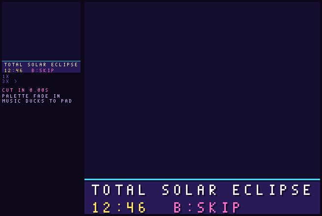 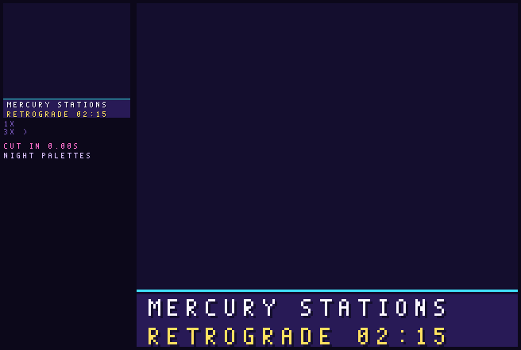
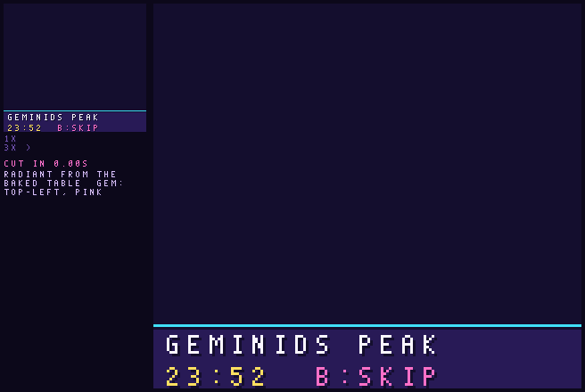

- **Eclipse (total, 2026-08-12, 12:46 at UTC-5).** Every corona pixel is in the BG from the first frame. BG
  palette 1 holds the sky colour in two slots until totality, then the corona's lilac and white, shimmering between
  two palette states. The sky darkens with coverage^3.5. The room darkens with it, and the shared world's windows
  light up (palette 2, slot 3). The moon is a 24x24 sprite (6 OBJ). The diamond ring is one sparkle sprite at second
  and third contact.
- **Retrograde (Mercury, 2026-10-24, 02:15).** The glyph is a 16x16 sprite (2 OBJ) in the planet's colour. The trail
  is plotted into the sky tiles in the same colour (SKY palette slot 2, so changing planets is one palette write).
  The VHS band is one row of 20 map writes to two stored noise tiles. The tears are per-line SCX (BG only). REW is
  3 OSD sprites.
- **Meteors (Geminids, 2026-12-14, 23:52).** The radiant octant and streak colour come from the table.
  - **Streaks:** each one is a head and a fading tail, plotted into sky tiles (worst 11 tiles a frame).
  - **Wishes:** each wish is a talk line composed from the family's matrix tags, e.g. *PIM: A GREEN KEY THAT
    REMEMBERS* (SEED -> GREEN). It is two caption lines; a long name drops the clause.
  - **Fireball:** a sparkle-sprite head. The room flashes in the shower's colour (palette).

**Per-planet colour and tune (retrogrades):**

| Planet | Colour |
| --- | --- |
| Mercury | cyan |
| Venus | pink |
| Mars | coral |
| Jupiter | apricot |
| Saturn | sand |
| Uranus | mint |
| Neptune | blue |
| Pluto | violet |

Each planet's sting is the biome motif's four notes reversed (rewind), in a planet-specific mode: Mercury
mixolydian, Venus lydian, Mars phrygian, Jupiter major, Saturn dorian, Uranus whole-tone, Neptune lydian flat-7,
Pluto locrian. That is 4 bytes per planet.

### 19.3 Meteor-shower table (2026–2126)

`proto/skyscenes/meteors.py` (Astronomy Engine 2.1.19, already in `.venv`) finds each year's peak. The peak is the
minute the Sun's J2000 ecliptic longitude reaches the shower's IMO peak solar longitude, bisected to the minute.
The script writes `proto/skyscenes/out/meteors.json` (every peak, with UTC strings) and `meteor_tab.c`/`.h` (the
cartridge table plus a 4-line decoder, `meteor_peak(s, year-2026)`). The decoder was checked against the JSON on
the host.

**Size: 1,225 bytes** (a 4-byte header, then 11 showers x 111 bytes).
- **Per-shower header (10 bytes):** id, ZHR, radiant octant + colour, residual unit, the u32 2026 peak, and a u16
  mean step per year.
- **Residuals:** 101 int8, one per year.
- **Accuracy:** every residual fits in ±127 min at a 1-minute unit, so the max decode error is 0 min. The table is
  exact to the bake.

| Shower | λ☉ (J2000) | ZHR | 2026 peak (UTC) | 2126 peak (UTC) |
| --- | --- | --- | --- | --- |
| Quadrantids | 283.15 | 80 | 01-03 12:47 | 01-03 19:14 |
| Lyrids | 32.32 | 18 | 04-22 10:41 | 04-22 15:22 |
| Eta Aquariids | 45.5 | 50 | 05-06 00:12 | 05-06 04:30 |
| Southern Delta Aquariids | 127.0 | 25 | 07-30 03:06 | 07-30 06:53 |
| Perseids | 140.0 | 100 | 08-12 16:48 | 08-12 20:50 |
| Draconids | 195.4 | 10 | 10-08 16:12 | 10-08 21:32 |
| Orionids | 208.0 | 20 | 10-21 09:22 | 10-21 14:59 |
| Northern Taurids | 230.0 | 5 | 11-12 09:17 | 11-12 15:24 |
| Leonids | 235.27 | 15 | 11-17 14:51 | 11-17 21:04 |
| Geminids | 262.2 | 150 | 12-14 04:52 | 12-14 11:27 |
| Ursids | 270.7 | 10 | 12-22 13:19 | 12-22 19:54 |

Real peaks scatter by an hour or more around the solar-longitude moment, and the Draconids and Leonids vary by
year. The scene uses a day-wide window, so this doesn't matter.

A cheaper option: the cartridge already computes the Sun's longitude live (`sky_positions`), so it could solve
for the peaks at run time from 11 x 2-byte longitudes (22 B plus ~150 B of code). The baked table is kept because
it is exact and needs no solver on the boot path.

### 19.4 Gameplay ties

- **Sky event stages (3.6.1):** on an event day the run planner deals one sky stage into a combine slot (biome 2 on).
  The room is built on the event (the eclipse's dark room, the meteor shower's falling wish stars), and its SKY TODAY
  effects hold for that stage. Sky stages are generated on the cart, with no seed bank.
- **SKY TODAY:** each scene closes on the caption pages of its SKY TODAY row. The effects and values are 9.7.7's,
  the same numbers the balance sim runs. Each page is two 19-glyph lines: white is the row; yellow | pink is the
  effect | its value. The font has no `%`, so foe and pickup numbers are the chart screen's points (+2 = +2%), and
  dark-room odds are fractions (+1/4 = ×20/16). One page holds 1 s; B skips. The table is `CAPTIONS` in
  `skyscene_mock.py` (checked for length and glyphs, 65 pages, written to `skyscene_report.json`):

  | Scene | Caption pages (line 1 / line 2) | 9.7.7 |
  | --- | --- | --- |
  | Solar eclipse (all 3 kinds) **(mocked)** | SOLAR ECLIPSE / DARK ROOMS +1/4 · BOSS VARIANT / FOES +2 · ECLIPSE-ONLY DROPS / LIGHT PUZZLES | dark ×20/16, foes +2%, boss variant, light puzzles, eclipse-only drops |
  | Mercury retrograde station **(mocked)** | MERCURY BACKWARD / MIX ROOMS +1 STEP · TALKERS MISREMEMBER / GHOSTS COME BACK | mix rooms +1 step, talk, ghosts; never the controls |
  | Meteor shower **(mocked, Geminids)** | GEMINIDS / WISHES: PICKUPS +1 (the shower's name, up to S. DELTA AQUARIIDS) | offering +1 |
  | Halley's Comet | HALLEY'S COMET / DROP HALLEY'S TAIL | the drop (below) |
  | Lunar eclipse | LUNAR ECLIPSE / MORE GHOSTS FOES +2 · ECLIPSE-ONLY DROPS | foes +2%, eclipse-only drops |
  | Ingress (Jupiter, Saturn) | JUPITER INTO PISCES / A TALKER NOTICES (short sign names past 19 glyphs: SATURN INTO CAP) | a guided talk |
  | Other stations | VENUS BACKWARD / PRICES +-1 A VISIT · FACTION WARMTH / SWINGS +-1 A VISIT; MARS BACKWARD / FIRE HITS 3/4 · PARRIES HOLD / LONGER +1 BEAT; JUPITER (SATURN) STATIONS / PICKUPS +3 (ELITES +4) · FOR THE RUN / 2 DAYS EITHER SIDE; direct stations: MERCURY FORWARD / RECIPES HOLD AGAIN, VENUS FORWARD / PRICES SETTLE, MARS FORWARD / FIRE HITS FULL; Uranus..Pluto: URANUS BACKWARD / THE SKY TURNS | as 9.7.7 |
  | Moons | FULL MOON / FOES +3 PICKUPS +2; SUPER FULL MOON / FOES +5 PICKUPS +3; NEW MOON / DARK ROOMS +1/8 · STARS BRIGHTEN / PICKUPS +1; SUPER NEW MOON / DARK ROOMS +3/16 · STARS BRIGHTEN / PICKUPS +1 | foes, offering, dark ×18/16 and ×19/16 |
  | Solstice / equinox | WINTER SOLSTICE (SPRING EQUINOX, ...) / NEW COLOURS, TUNE | no numbers |
  | Heir's birthday | SOLAR RETURN / HP THIS RUN +6 | +6 HP for the run |

  The scene shows only its own event's row. Other states that day (an eclipse is always a new or full moon) appear
  on the SKY TODAY panel, not in the caption.
- **Event-born heirs (decided, 9.7.11):** an heir born while an event is active is sky-born: *eclipse-born*,
  *meteor-born*, *retro-born* and so on. **It always applies; it is never a choice or a prompt.** The mark is 9.2's
  spare flag bit, SKYBORN. The kind is recomputed from the birth minute (`astro_born_kind`), and the rarest overlapping
  event wins.
  - The trait is a small third trait. It never counts toward the 2 expressed traits. It is never inherited (each
    child's bit is set at its own birth), so it cannot stack.
  - Traits: Halley-born and meteor-born, 1 elite in 20 drops a wish star; eclipse-born, one more hidden SHINY cell in
    dark rooms; retro-born, the last room's recipe hint once per floor; moon-born, +1 status; season-born, +1 guard;
    ingress-born, one more guided talk a run.
  - **Balance (`astro_sim`):** each kind forced on every heir moves the clear rate by **0.0 to +0.9 points, within the
    ±3 bound**. This covers a player who times every birth. Natural births: 17.7% of heirs are sky-born, their own
    rate moves +0.3, and the whole line moves 0.0 (58.8%).
- **HALLEY'S TAIL over the link cable (decided):** it can be traded, as a **copy**. The original stays with the giver.
  - **The mark:** HALLEY'S TAIL is unique, so the save keeps one 4-byte Halley record rather than a bit in the piece:
    state (0 none, 1 original, 2 copy), the giver's 16-bit save hash and a spare byte. A copy shows as *HALLEY'S TAIL
    (COPY)*, with the tail glyph outlined rather than filled, and one line on its card: "SEEN FROM ANOTHER WINDOW."
  - **Same piece:** a copy has the same stats as the original. It is a sidegrade anyway (found-only rule), so a copy
    gives nothing over not having one that the original doesn't.
  - **No endless copying:** a copy can't be copied. The trade menu greys it out ("A COPY CAN'T BE COPIED"), and it
    can't be moved to another save either. A save holds at most one HALLEY'S TAIL, original or copy, so a second
    offer is refused ("YOU ALREADY CARRY ONE"). The original can give a copy to any number of other saves, but only
    by a direct link. So the tail spreads one hop from someone who was playing in 2061, never further.
  - A copy doesn't unlock the Halley scene in the SKY gallery; only seeing the event does.

### 19.5 Costs (from `skyscene_report.json`)

GBC limits hold in every frame of all three scenes:
- **BG palettes:** at most 7 of 8.
- **OBJ:** at most 13 of 40, with at most 9 sprites on any line.
- **OBJ palettes:** at most 3 of 8.
- **Caption:** legalised against its two window palettes with zero error.
- **Tiles on screen:** at most 184 at once (one VRAM bank's 256-tile BG range is enough).
- **Length:** the eclipse runs 7.6 s and the retrograde 6.7 s, because their SKY TODAY rows take 3 and 2 caption
  pages. The meteors run 6.5 s. All fit the 4–8 s range.
- **Caption text:** all 65 pages of 9.7.7's rows are at most 2,075 B as plain text. That is less in practice, since
  the ingress and season lines are composed from names the chart screen already holds. It goes in the scene
  player's bank with the stings.

| Scene | ROM tiles (own) | Tile bytes | Map + attrs | Palette keys | Script | **ROM bytes** | Plotted tiles / frame (worst) | Map writes / frame |
| --- | --- | --- | --- | --- | --- | --- | --- | --- |
| Shared window kit (wall, mullions, sill, carpet, skyline) | 59 | 944 | – | – | – | **944** | – | – |
| Solar eclipse (day sky, corona block) | 72 | 1,152 | 600 | 256 | 48 | **2,056** | 0 | 0 |
| Retrograde (night sky + 2 noise tiles) | 58 | 928 | 600 | 192 | 64 | **1,784** | 17 | 41 |
| Meteor shower (night sky) | 56 | 896 | 600 | 192 | 96 | **1,784** + table 1,225 | 11 | 13 |

The retrograde and meteor scenes share the same night-sky tiles, so they are stored once, and the meteors add only
their map, palette keys and script (888 B). The real total for the three scenes is about **5.7 KB** (5.1 KB if the
night scenes share one map), plus the meteor table.

**Estimates for the scenes not mocked** (they reuse the kits):
- lunar eclipse: ~0.6 KB (moon and ghost sprites, palette keys);
- moons: ~0.4 KB;
- solstice/equinox: ~0.3 KB (palettes only);
- ingress: ~0.3 KB (it reuses the chart screen's sign glyphs);
- birthday: ~0.7 KB;
- Halley: ~0.9 KB.

Per-planet glyphs add 8 x 64 B. Stings take ~0.4 KB and the scene player code ~3 KB.

**Everything fits in one 16 KB bank (~14 KB, tight).** The worst-case VBlank load is 17 plotted tiles (272 B) plus 41
map bytes, within a CGB VBlank with HDMA.

**Raycaster:** the "corridor opening onto the sky" variant (full moon, solstice) would use the first-person
stage's sky strip, a palette and a sprite over the raycaster's ceiling band (`proto/raycast/v2`). It is not mocked
here; the window kit covers every scene.

**Open questions for the owner:**
1. ~~Placeholder effects~~ Decided: the captions carry 9.7.7's effects (19.4), and the event-born traits are
   simulated (9.7.11).
2. ~~Choice or always on~~ Decided: always on, never a prompt (SKYBORN, 9.7.11).
3. ~~Halley in link play~~ Decided: tradeable as a copy that can't be re-copied (19.4).
4. Still open: should the eclipse's 3 caption pages be cut to 2 (dropping LIGHT PUZZLES to the panel) to keep the
   scene under 7 s?
